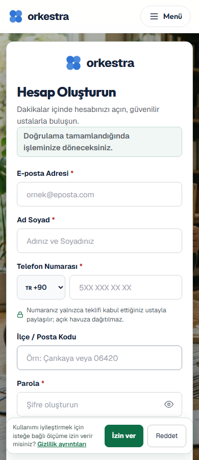
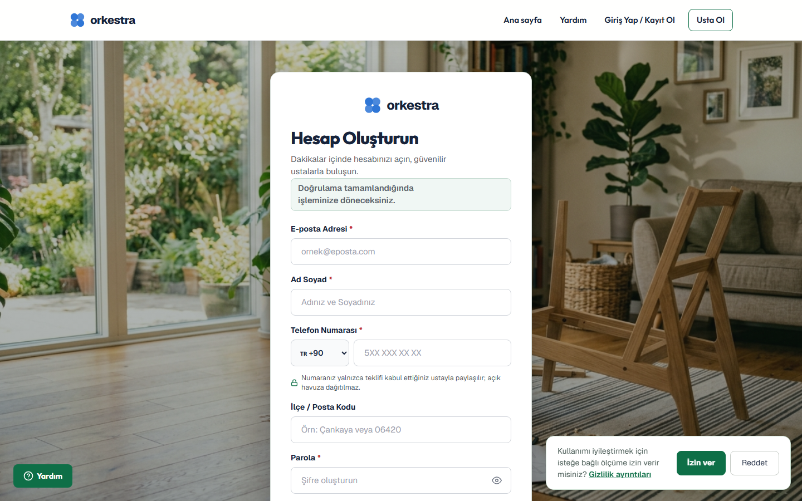

# Auth Control Refinement — nötr-yeşil geçiş yüzeyi

Bu dilim, wizard içindeki “Giriş yap / kayıt ol ve devam et” aksiyonundan gerçek `/giris` ve `/kayit` sayfalarına geçişi aynı kontrol diliyle hizalar. Amaç auth akışını yeniden tasarlamak değil; mevcut bilgi mimarisini koruyarak kontrol şekillerini, odak davranışını ve dönüş bağlamını Orkestra’nın nötr-yeşil sistemiyle tutarlı hale getirmektir.

## Tasarım kararı

- Form alanları ve ikincil aksiyonlar: opak beyaz yüzey, 8 px radius, nötr çerçeve.
- Birincil gönderim: forest green (`#0e6f47`), 8 px radius, gölgesiz ve yükselmesiz hover.
- Dönüş bağlamı: yeşil bilgi yüzeyi içinde kısa ve görünür mesaj.
- Odak: 3 px yeşil dış çerçeve; klavye odağı input border’ından ayrıştırılır.
- Mobil auth kartı: mevcut 14 px köşe yarıçapı korunur; 44 px kapatma hedefi ve 48 px form kontrolleri korunur.

## Kanıt / gözlem / Orkestra kararı

| Tür | Bulgı | Karar |
| --- | --- | --- |
| Kanıt | Wizard auth linki forest-green birincil aksiyonla hizalıydı; gerçek auth formunda pill kontroller ve daha ağır gölgeler devam ediyordu. | Auth formunda kontrol geometrisi wizard ile eşitlendi. |
| Gözlem | 390 px ve 1440 px ekranlarda form okunabilir; global consent banner kayıt formunun alt alanlarını geçici olarak kapatabiliyor. | Consent banner ayrı bir bounded dilim olarak izlenecek; bu dilimde davranışı değiştirilmedi. |
| Orkestra kararı | Auth yüzeyi güven verici, nötr ve görev odaklı kalmalı; dekoratif yükselme ve yoğun gölge kullanılmamalı. | 8 px kontrollü köşeler, düz yüzeyler, forest-green primary ve açık odak halkası uygulandı. |

## Değişen yüzeyler

- `app/components/authForm.module.css`
  - Form input/select/button pill geometrisi 8 px kontrollü geometriye çekildi.
  - Submit ve yardım aksiyonlarında hover yükselmesi/gölgesi kaldırıldı.
  - Container çerçevesi nötrleştirildi.
  - Klavye odak halkaları tüm auth kontrol ailesine eklendi.
  - Kapatma hedefi 44 px’e çıkarıldı.
- Consent banner mobilde kompakt iki kolonlu düzene alındı; auth formunun parola ve alt aksiyonlarını kapatmayacak şekilde yüksekliği düşürüldü. Masaüstünde auth yüzeyine özel sağ-alt konumlandırma ile form kartından ayrıştırıldı.
- `tests/e2e/auth-surface.spec.ts`
  - `/giris?next=/taleplerim` için 390 ve 1440 px kontrol sözleşmesi.
  - `/kayit?next=/taleplerim` dönüş mesajı ve primary action sözleşmesi.

## Görsel QA

## Doğrulama

- `npm run build` başarılı.
- `npm run type-check` başarılı.
- Auth route E2E: 3/3 başarılı.
- Consent banner reddetme akışı: banner kapanması ve route yüzeyinin kullanılabilir kalması doğrulandı.
- Önceki wizard E2E matrisi: 24/24 başarılı.
- Gerçek Supabase giriş/kayıt yapılmadı; bu dilim yalnızca route yüzeyi, dönüş bağlamı, kontrol geometrisi ve erişilebilirlik odaklarını doğrular.

## Hata / başarı / recovery durumu

- E-posta boş bırakıldığında alan `aria-invalid="true"`, `aria-describedby="auth-email-error"` ve `role="alert"` ile doğrudan ilişkilendiriliyor; odak tekrar e-posta alanına dönüyor.
- Giriş/kayıt hatası kırmızı, doğrulama ve mevcut hesap recovery mesajları yeşil semantik yüzeyde kalıyor.
- Mevcut hesap recovery seçenekleri yeşil yumuşak yüzey içinde gruplanıyor; “Mevcut hesabımla giriş yap” ve “Parolamı yenile” kontrolleri 44 px hedefi koruyor.
- AuthForm component testi: **11/11** başarılı.

## Sınır

Bu dilimde auth mantığı, yönlendirme güvenliği ve Supabase yapılandırması değiştirilmedi. Consent banner’ın kalıcı tercih davranışı korunurken yalnızca sunum geometrisi ve mobil çakışma davranışı düzeltildi. Commit veya push yapılmadı.
