# Arşivdeki 15 platform görüntüsü

Bunlar kullanıcının Brain arşivindeki tarihsel yakalamalardır. Güncel sitelerin tamamının canlı denetimi değildir. B14 geçersiz, B15 kısmi: 13 kullanılabilir karşılaştırma, iki kanıt kısıtı.

## B01 · linear_desktop_1792155782650.png

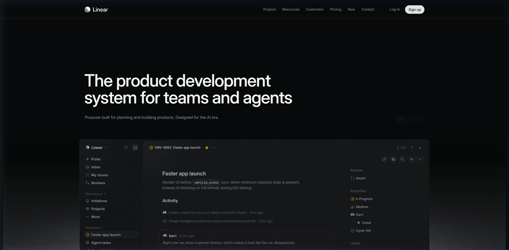

**Gözlem:** Koyu zeminde sakin başlık ve ürün ekranı.

**Çıkarım ve sınır:** Renk sayısını azaltmak; karanlık temayı kopyalamamak.

## B02 · stripe_desktop_1792155791642.png

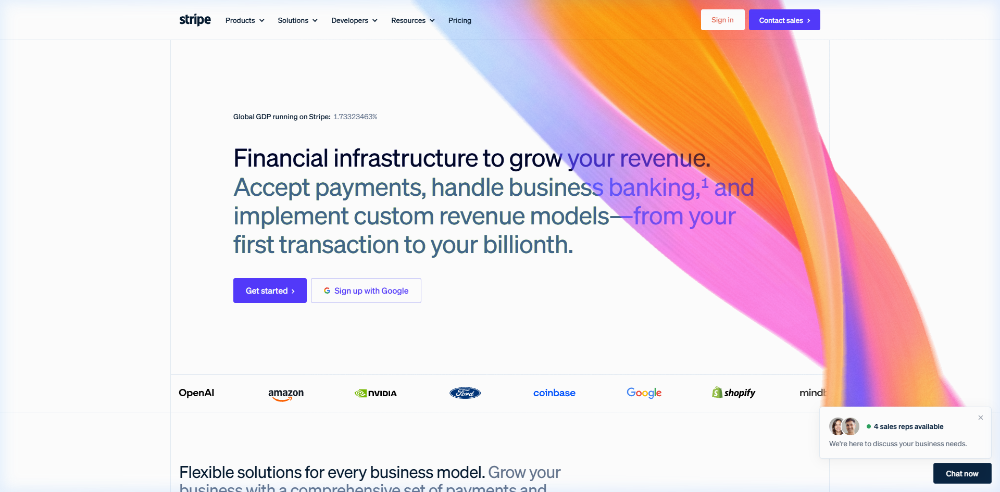

**Gözlem:** İnce ızgara çizgileri, açık zemin ve renkli kompozisyon.

**Çıkarım ve sınır:** Çizgiler premium görünümle çelişmiyor; moru taşımamak.

## B03 · apple_desktop_1792155811620.png

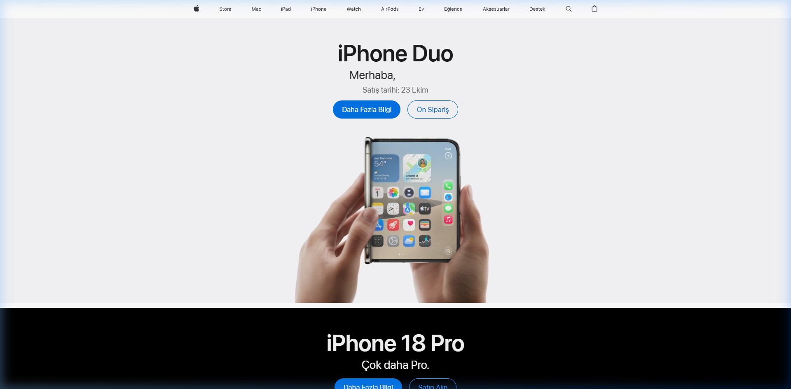

**Gözlem:** Ortalanmış ürün ve geniş tek ton alan, aşağıda zemin değişimi.

**Çıkarım ve sınır:** Özne ile boşluk oranı; bütün sayfa kenarlıksız değil.

## B04 · vercel_desktop_1792155801552.png

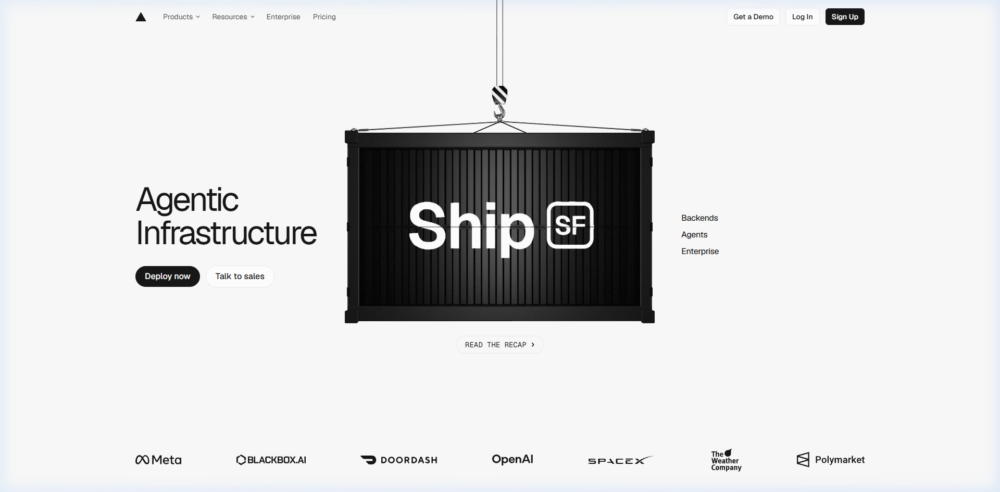

**Gözlem:** Geniş nesne fotoğrafı ve az sayıda eylem.

**Çıkarım ve sınır:** Tek görsel odak; konteyner metaforunu almamak.

## B05 · airbnb_desktop_1792155821050.png

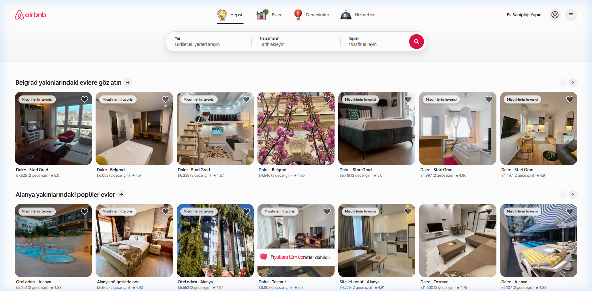

**Gözlem:** Dış kart kutusu olmadan fotoğraf ve yakın metadata.

**Çıkarım ve sınır:** İçeriğin çerçevesiz de gruplanabilmesi.

## B06 · zara_desktop_1792155860576.png

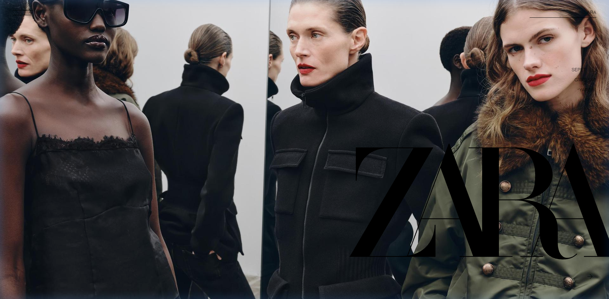

**Gözlem:** Geniş moda fotoğrafı ve üst üste logo/yazı.

**Çıkarım ve sınır:** Fotoğraf sanat yönetimi; düşük okunurluğu kopyalamamak.

## B07 · massimodutti_desktop_1792155874509.png

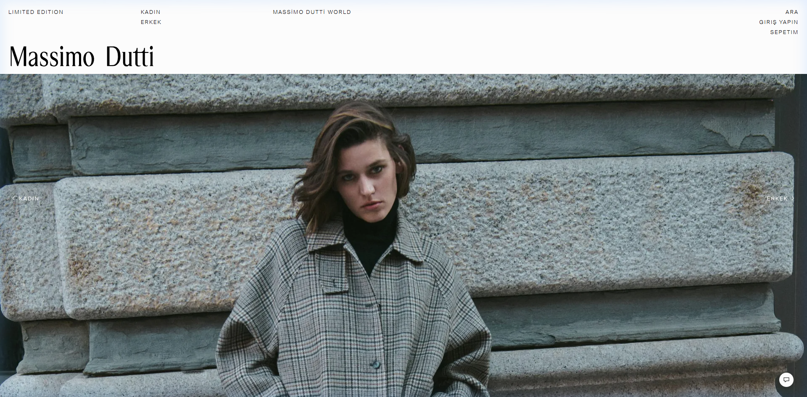

**Gözlem:** Beyaz başlık alanı ve taş duvar önünde büyük insan fotoğrafı.

**Çıkarım ve sınır:** Malzeme/ışık birlikteliği; bej palet sonucu çıkarılamaz.

## B08 · cos_desktop_1792155920520.png

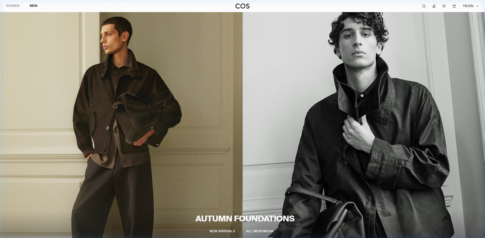

**Gözlem:** Yan yana iki portre, küçük navigasyon, az yazı.

**Çıkarım ve sınır:** Fotoğraf dizisinde ölçü ve renk ilişkisi.

## B09 · mango_desktop_1792155896539.png

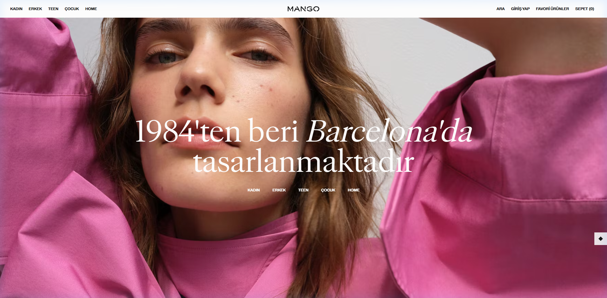

**Gözlem:** Pembe ağırlıklı geniş fotoğraf ve beyaz başlık.

**Çıkarım ve sınır:** Premium her zaman nötr değildir; bizim marka rengimiz ayrı.

## B10 · beymen_desktop_1792155953077.png

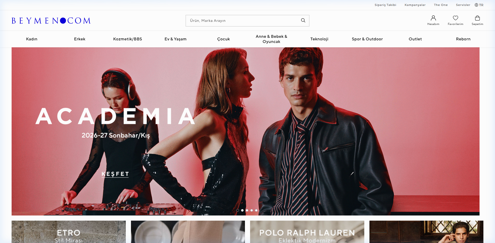

**Gözlem:** Yoğun başlık/navigasyon ve kırmızı kampanya alanı.

**Çıkarım ve sınır:** Kategoriye bağlı yoğunluk; minimalizmin evrensel olmadığını gösterir.

## B11 · taskrabbit_home.png

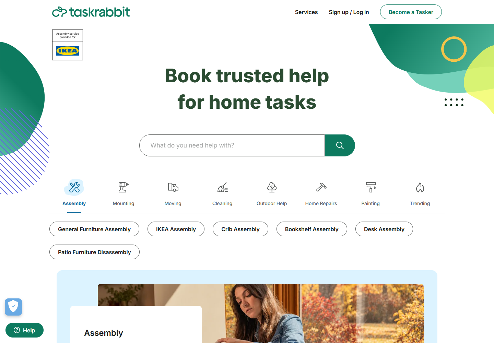

**Gözlem:** Yeşil arama, kategori ikonları ve yardımcı şekiller.

**Çıkarım ve sınır:** Ana eylemin marka rengi; süsleri almamak.

## B12 · armut_home.png

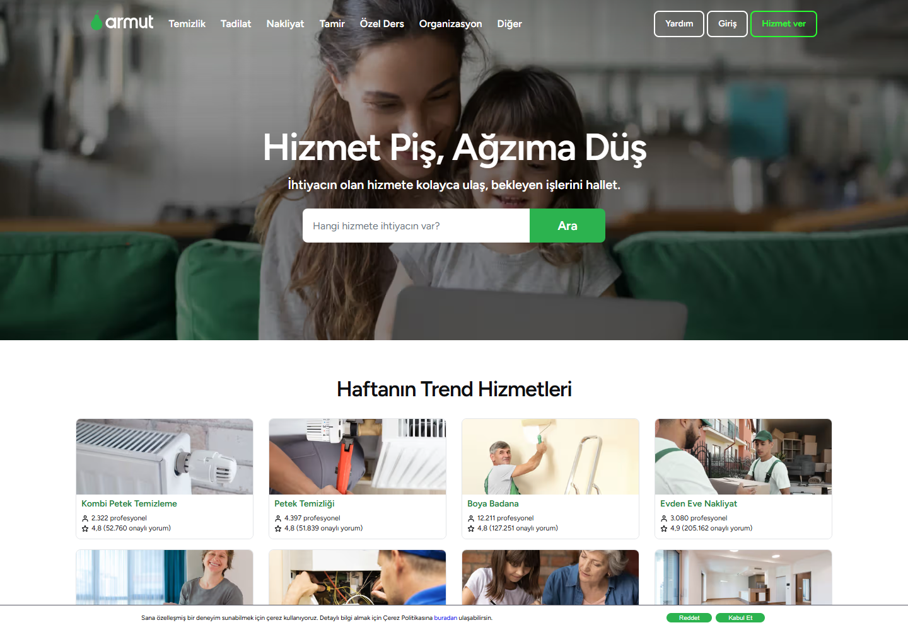

**Gözlem:** Koyu fotoğraf üstünde arama, yeşil eylem.

**Çıkarım ve sınır:** Arama ve zemin ayrımı; yeni güven vaatleri eklememek.

## B13 · thumbtack_home.png

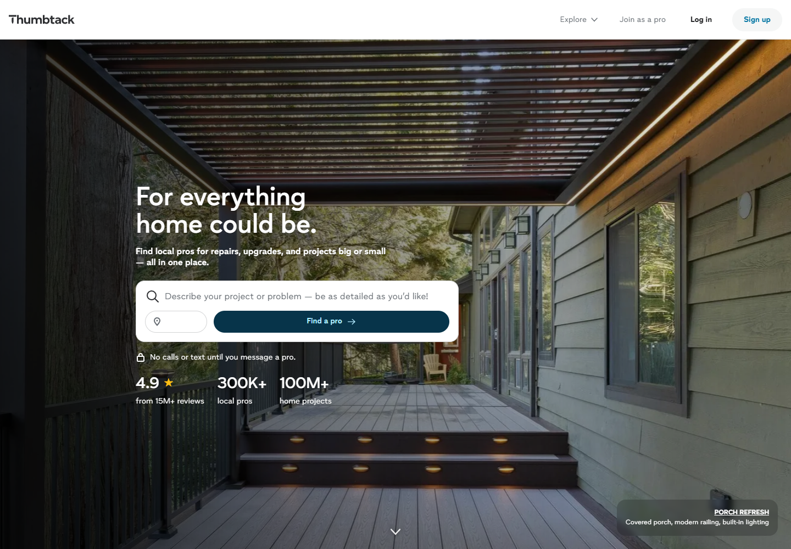

**Gözlem:** Koyu veranda fotoğrafı, beyaz arama yüzeyi.

**Çıkarım ve sınır:** Kontrastı kompozisyonla kurmak; rakamları kopyalamamak.

## B14 · mybuilder_home.png

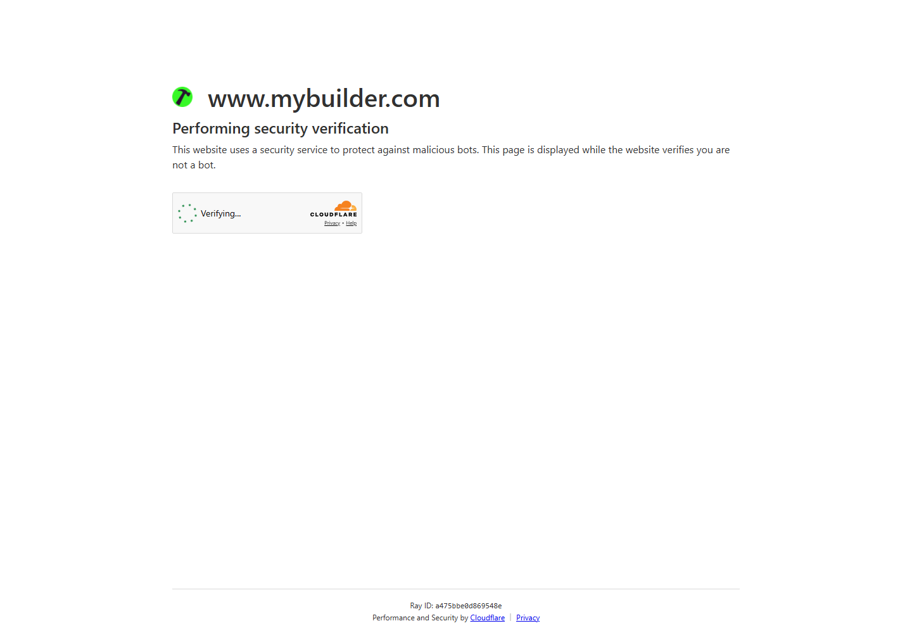

**Gözlem:** Cloudflare doğrulama ekranı.

**Çıkarım ve sınır:** Landing page kanıtı DEĞİL; değerlendirmeden çıkarıldı.

## B15 · airtasker_home.png

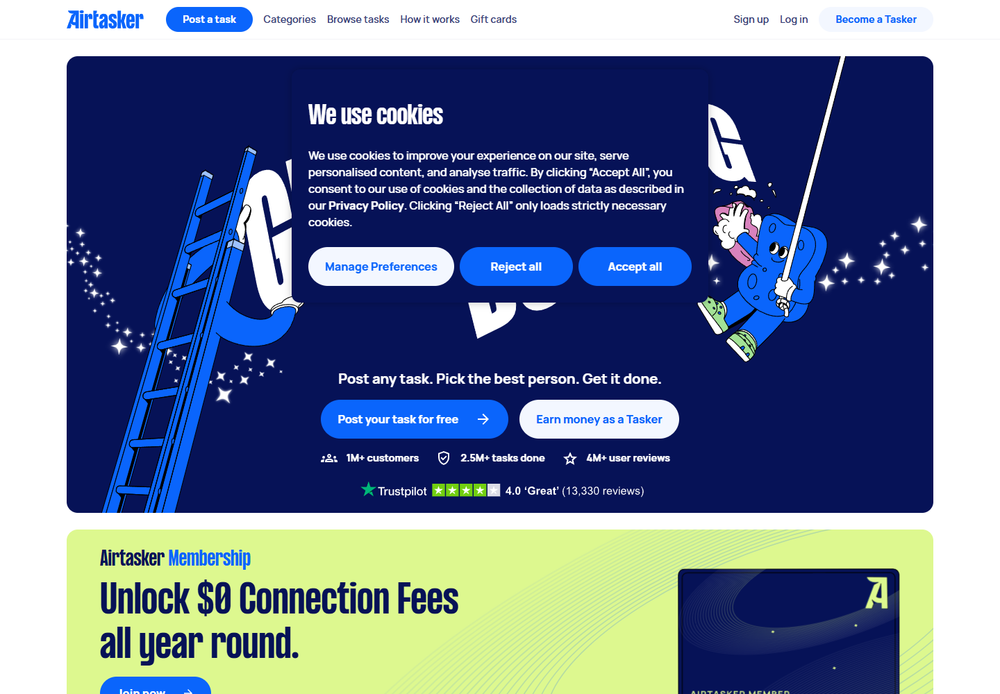

**Gözlem:** Çerez katmanı hero alanını örtüyor.

**Çıkarım ve sınır:** Kısmi kanıt; tam yerleşim değerlendirmesine alınmadı.
