# Hallmark: 48 örneğin görsel atlası

Kaynak: [Nutlope/Hallmark](https://github.com/nutlope/hallmark). Bunlar yerel Hallmark paketindeki örnek sayfa JPG’lerinin değişmeden alınmış kopyalarıdır; 48 çalışan siteye bugün girilip alınmış yeni ekran görüntüleri değildir. Tema metinleri envanterde saklanır. Sekiz temas sayfasında tüm örnekler incelendi; seçili güçlü adaylar ayrıca tam boy açıldı. Statik görüntüden hover, dönüşüm veya performans sonucu çıkarılmaz.

## H01 · almanac

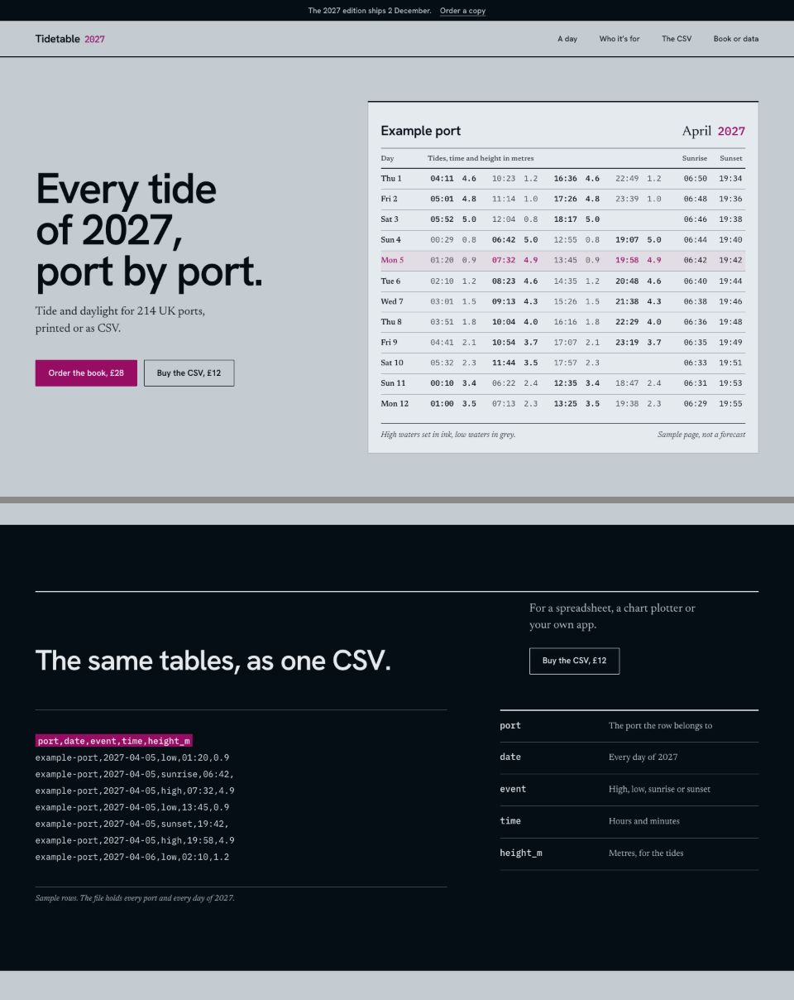

**Gözlem:** Soğuk zemin, hizalı veri satırları, küçük vurgu.

**Orkestra’ya alınabilir:** Bölge dizininde satır hizası.

**Alınmamalı:** Veri tablosunu hero yapmak.

**Fikir bağı:** I07, I18

## H02 · arcade

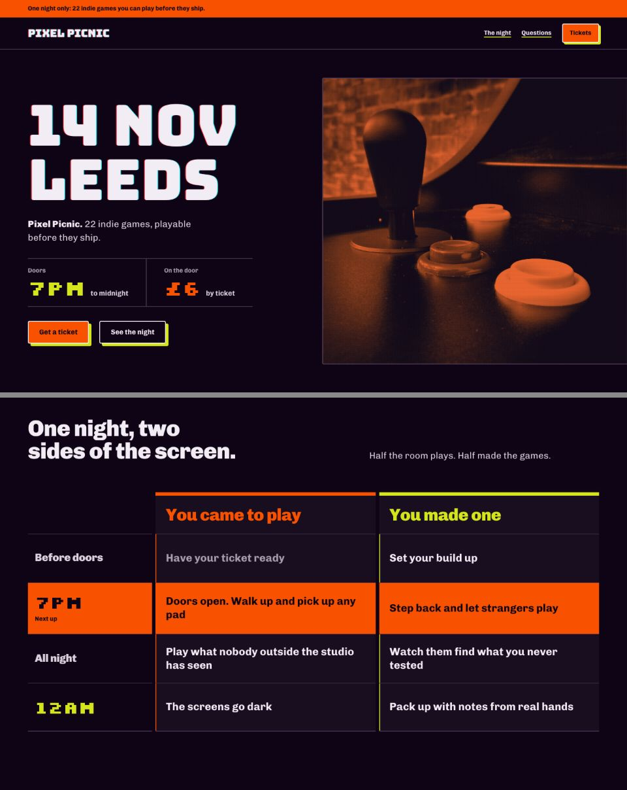

**Gözlem:** Piksel tipografi ve koyu konser programı.

**Orkestra’ya alınabilir:** Tek baskın eylem.

**Alınmamalı:** Oyun salonu kimliği.

**Fikir bağı:** Ana yön için seçilmedi; dar bir biçim ilkesi dışında sektör uyumu zayıf.

## H03 · atelier

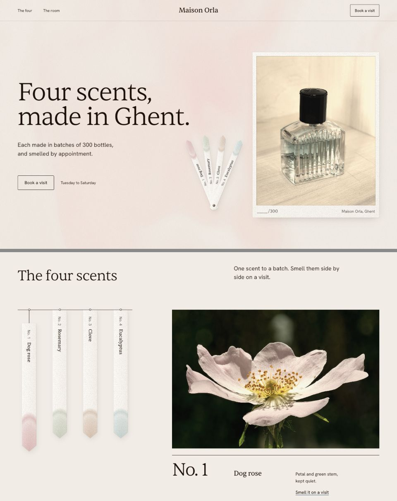

**Gözlem:** Parfüm nesnesi, sıcak zemin, serif ve paspartu.

**Orkestra’ya alınabilir:** Nesne çevresinde bilinçli boşluk.

**Alınmamalı:** Bej ve serifin otomatik lüks reçetesi olması.

**Fikir bağı:** I12, I25

## H04 · bloom

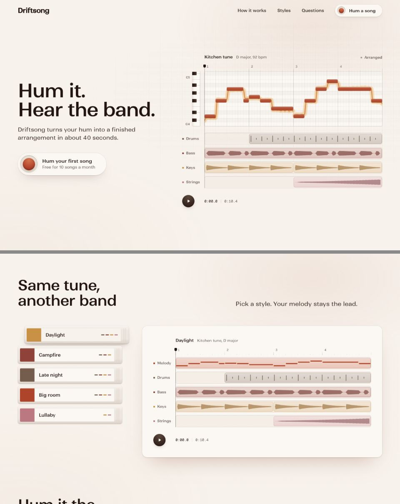

**Gözlem:** Sıcak ses arayüzü ve dokunsal kontrol yüzeyi.

**Orkestra’ya alınabilir:** Tutarlı ışık yönü.

**Alınmamalı:** Hizmet aramada cihaz simülasyonu.

**Fikir bağı:** I27

## H05 · blueprint

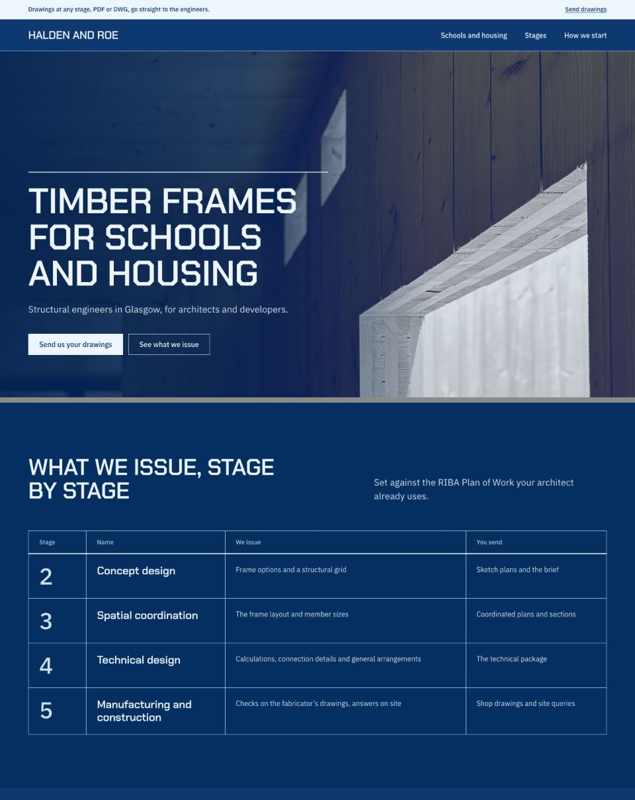

**Gözlem:** Mimari fotoğraf üzerinde teknik çizgiler.

**Orkestra’ya alınabilir:** Tek eksende hizalama.

**Alınmamalı:** Her yere proje çizimi ve ölçü etiketi.

**Fikir bağı:** Ana yön için seçilmedi; dar bir biçim ilkesi dışında sektör uyumu zayıf.

## H06 · broadside

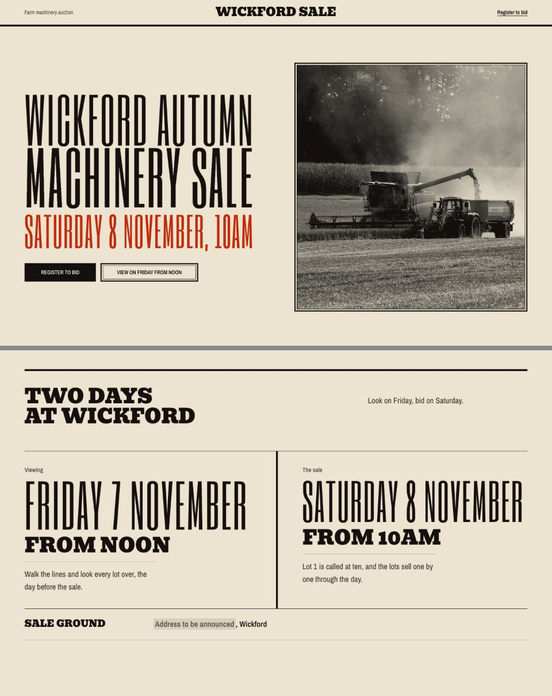

**Gözlem:** Sıkıştırılmış başlık ve güçlü yatay kurallar.

**Orkestra’ya alınabilir:** Fotoğraf ile başlık arasındaki kontrast.

**Alınmamalı:** Afiş gibi bağıran büyük harfler.

**Fikir bağı:** Ana yön için seçilmedi; dar bir biçim ilkesi dışında sektör uyumu zayıf.

## H07 · brutal

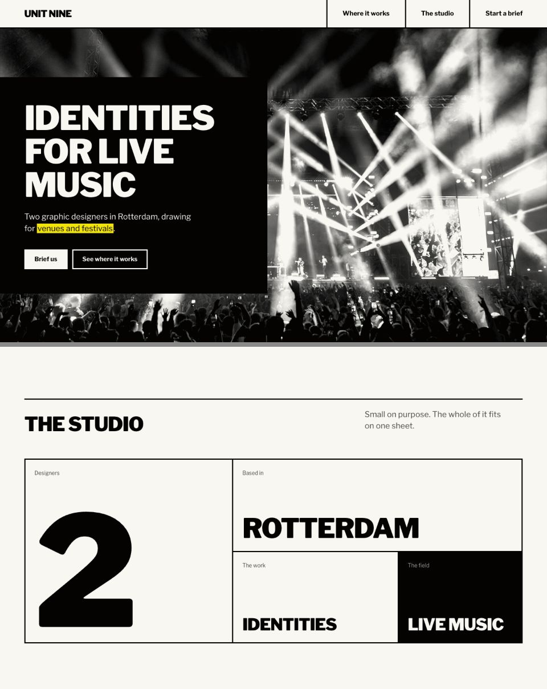

**Gözlem:** Siyah beyaz konser görseli ve sert çerçeveler.

**Orkestra’ya alınabilir:** Sınırların bilinçli ritmi.

**Alınmamalı:** Agresif köşeli görünümü aynen aktarmak.

**Fikir bağı:** Ana yön için seçilmedi; dar bir biçim ilkesi dışında sektör uyumu zayıf.

## H08 · carnival

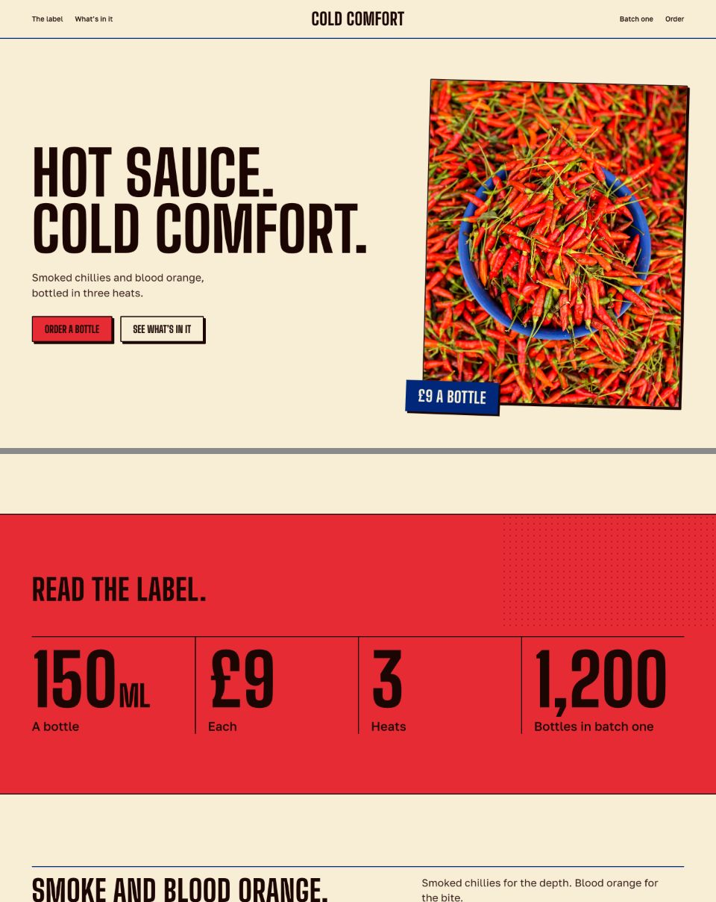

**Gözlem:** Kırmızı-sarı ürün kompozisyonu.

**Orkestra’ya alınabilir:** Tek fotoğraf konusuna bağlı renk.

**Alınmamalı:** Yüksek doygunluk ve etiket kalabalığı.

**Fikir bağı:** Ana yön için seçilmedi; dar bir biçim ilkesi dışında sektör uyumu zayıf.

## H09 · cobalt

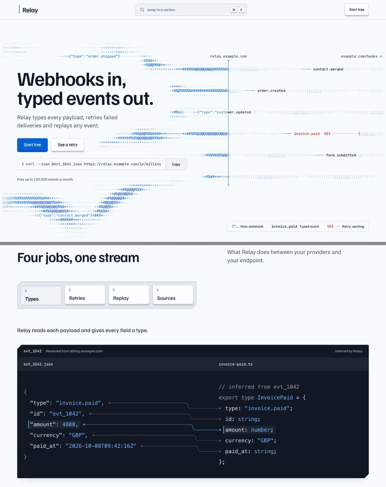

**Gözlem:** Açık zeminde mavi ağ diyagramı.

**Orkestra’ya alınabilir:** Sakin ikincil kontroller.

**Alınmamalı:** Teknik şemayı dekor olarak eklemek.

**Fikir bağı:** Ana yön için seçilmedi; dar bir biçim ilkesi dışında sektör uyumu zayıf.

## H10 · console

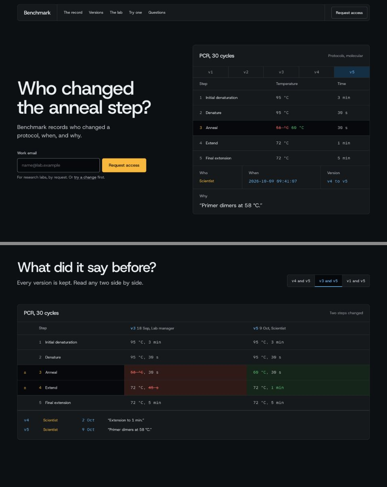

**Gözlem:** Koyu laboratuvar/veri ekranı.

**Orkestra’ya alınabilir:** Karşılaştırılabilir satırların düzeni.

**Alınmamalı:** Terminal yoğunluğunu tüketiciye taşımak.

**Fikir bağı:** Ana yön için seçilmedi; dar bir biçim ilkesi dışında sektör uyumu zayıf.

## H11 · coral

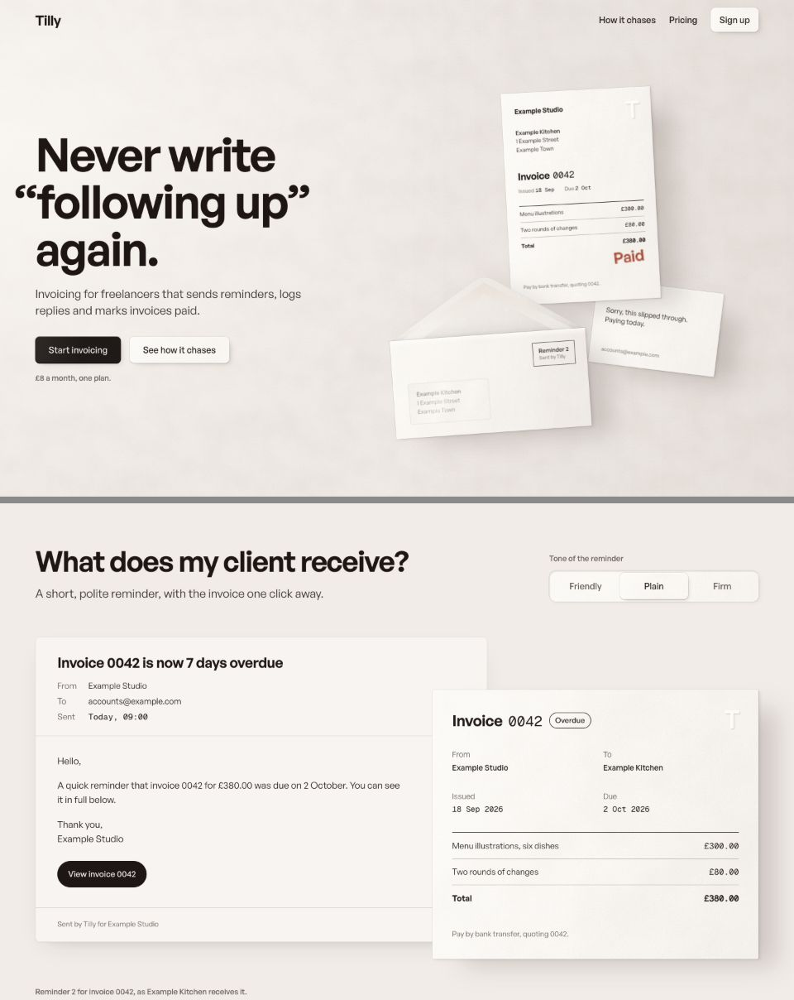

**Gözlem:** Krem zeminde fatura nesneleri.

**Orkestra’ya alınabilir:** Birbiriyle tutarlı yumuşak gölgeler.

**Alınmamalı:** Yeni fiş metaforu ve iç içe kartlar.

**Fikir bağı:** Ana yön için seçilmedi; dar bir biçim ilkesi dışında sektör uyumu zayıf.

## H12 · darkroom

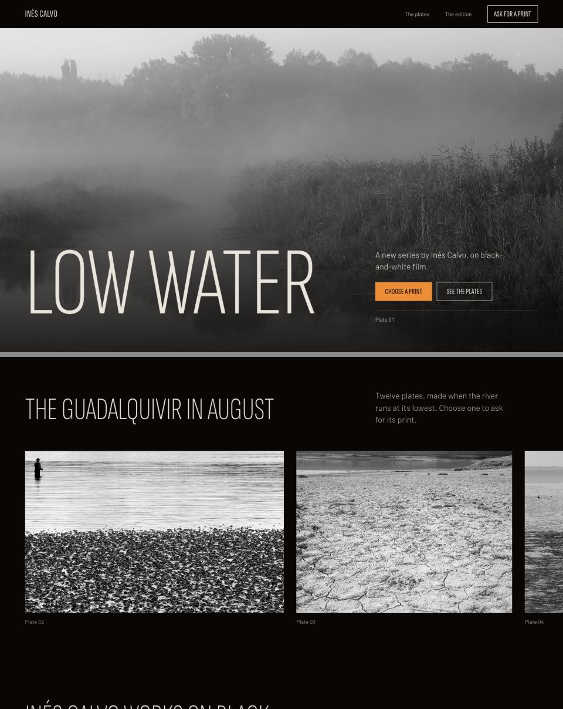

**Gözlem:** Geniş siyah beyaz fotoğraf, karanlık alt alan.

**Orkestra’ya alınabilir:** Fotoğrafın odak noktası ve boşluğu.

**Alınmamalı:** Tüm uygulamayı karartmak.

**Fikir bağı:** I24

## H13 · dose

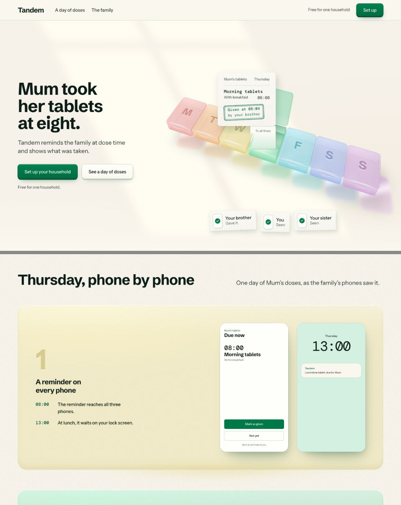

**Gözlem:** Pastel üç boyutlu ilaç kutuları.

**Orkestra’ya alınabilir:** Konusu belli ürün fotoğrafı.

**Alınmamalı:** Oyuncak hissi veren 3D nesneler.

**Fikir bağı:** I27

## H14 · dusk

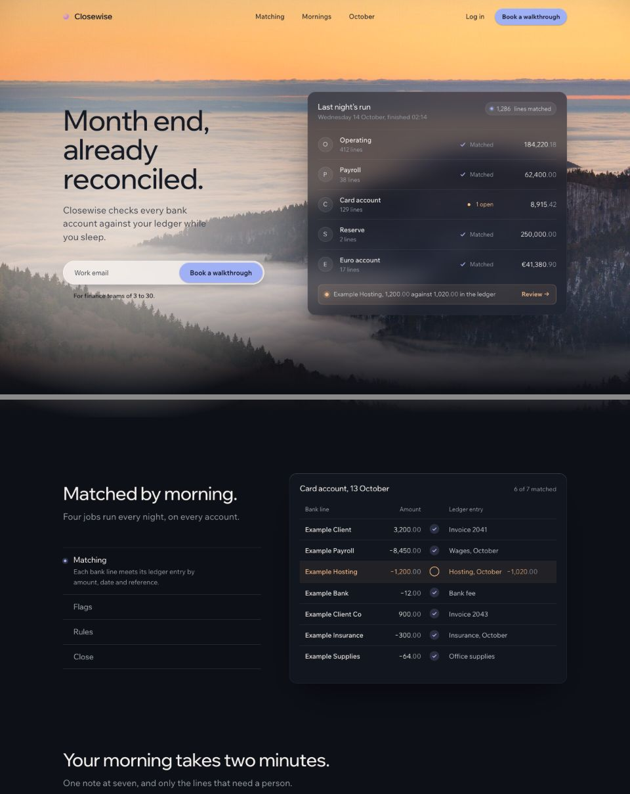

**Gözlem:** Ufuk fotoğrafından koyu zemine geçiş.

**Orkestra’ya alınabilir:** Birleşen ışık ve ton alanı.

**Alınmamalı:** Arama üzerine tekrar cam panel yığmak.

**Fikir bağı:** I28

## H15 · editorial

**Gözlem:** Repair başlığı, tamir fotoğrafı, çizgili editoryal liste.

**Orkestra’ya alınabilir:** İşin yapılışını gösteren fotoğraf ve kutusuz satırlar.

**Alınmamalı:** Dar afiş fontunu bütün başlıklara taşımak.

**Fikir bağı:** I05, I06, I09, I13, I14, I16, I19

## H16 · formwork

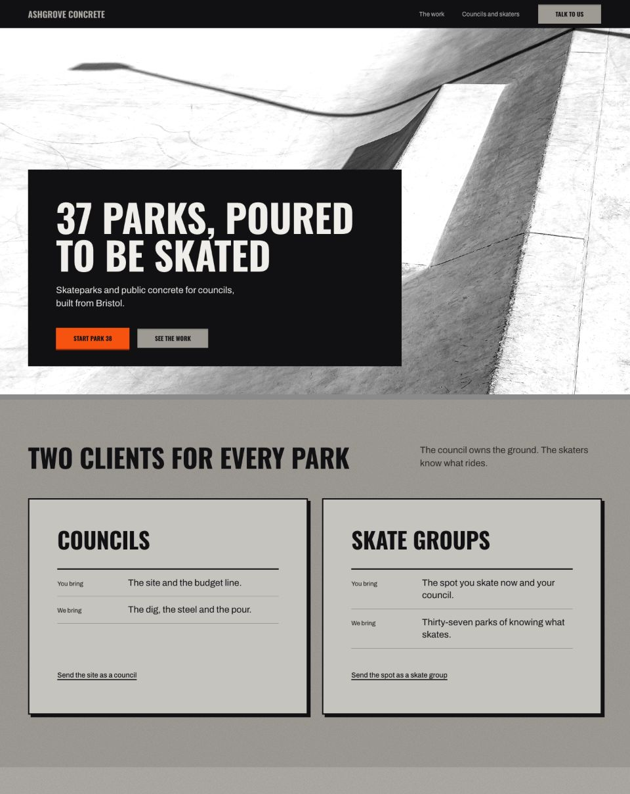

**Gözlem:** Beton fotoğrafı, koyu blok ve turuncu vurgu.

**Orkestra’ya alınabilir:** Malzemenin net kadrajı.

**Alınmamalı:** Endüstriyel sertliği ev hizmetine dayatmak.

**Fikir bağı:** Ana yön için seçilmedi; dar bir biçim ilkesi dışında sektör uyumu zayıf.

## H17 · furrow

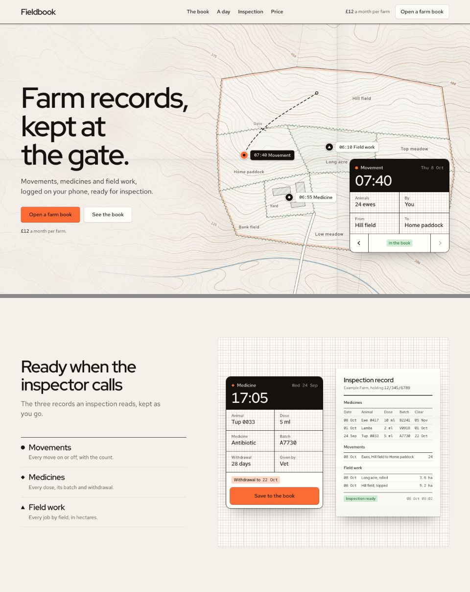

**Gözlem:** Arazi çizgileri ve kayıt düzeni.

**Orkestra’ya alınabilir:** İçeriğe özgü görsel motif.

**Alınmamalı:** Harita çizgilerini her yüzeye basmak.

**Fikir bağı:** Ana yön için seçilmedi; dar bir biçim ilkesi dışında sektör uyumu zayıf.

## H18 · garden

**Gözlem:** Yeşil, meyve fotoğrafı, açık zemin ve listeler.

**Orkestra’ya alınabilir:** Yeşilin sınırlı kullanımı.

**Alınmamalı:** Gıda kimliği ve kanıtsız büyük rakamlar.

**Fikir bağı:** I02

## H19 · grid

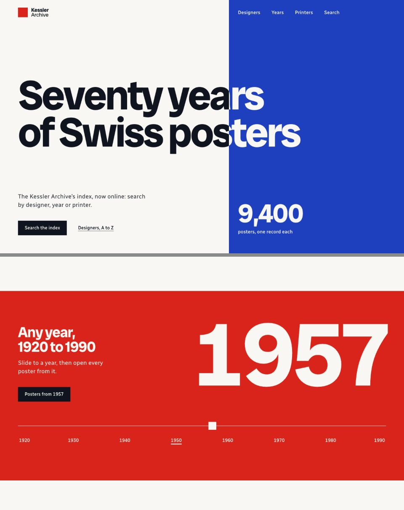

**Gözlem:** İsviçre arşivini çağrıştıran büyük yazı ve renk düzlemleri.

**Orkestra’ya alınabilir:** Ortak hizalama ekseni.

**Alınmamalı:** Kırmızı-mavi bloklarla sayfayı parçalamak.

**Fikir bağı:** I20

## H20 · halftone

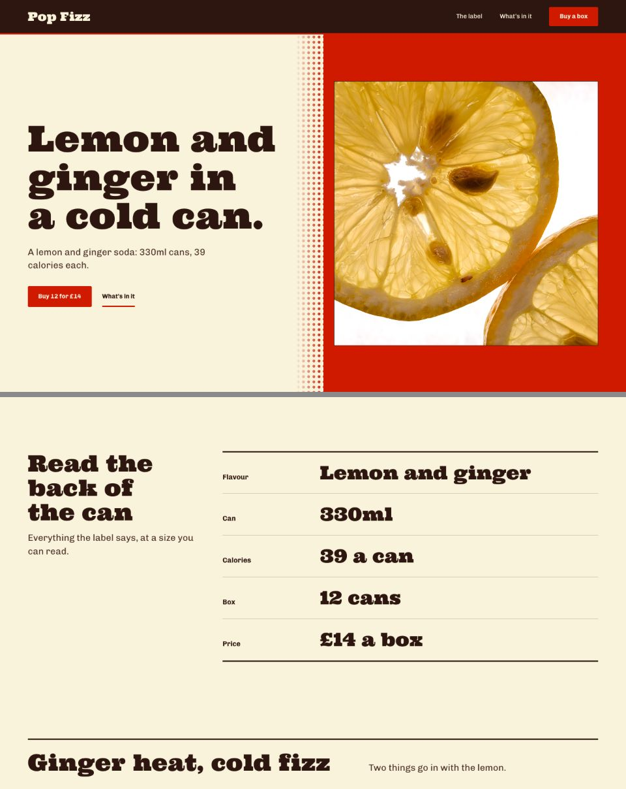

**Gözlem:** Limon makrosu, kırmızı vurgu, baskı hissi.

**Orkestra’ya alınabilir:** Malzeme yakın planı.

**Alınmamalı:** Tüm arayüze noktalı baskı filtresi.

**Fikir bağı:** Ana yön için seçilmedi; dar bir biçim ilkesi dışında sektör uyumu zayıf.

## H21 · hedgerow

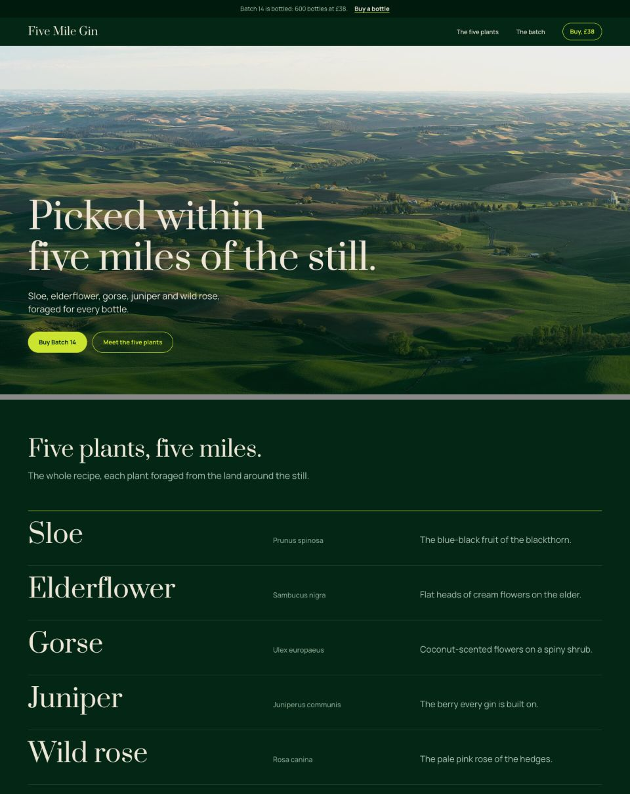

**Gözlem:** Yeşil manzara ve koyu yeşil devam alanı.

**Orkestra’ya alınabilir:** Fotoğraf ile palet ilişkisi.

**Alınmamalı:** Yeşil üstüne okunması zor yeşil yazı.

**Fikir bağı:** Ana yön için seçilmedi; dar bir biçim ilkesi dışında sektör uyumu zayıf.

## H22 · hum

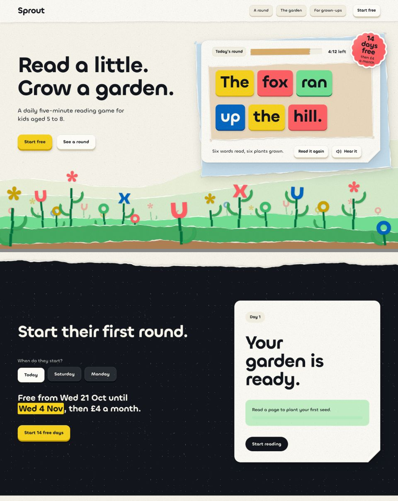

**Gözlem:** Çocuk kitabı, bahçe ve renkli kartlar.

**Orkestra’ya alınabilir:** Kendine özgü konu bütünlüğü.

**Alınmamalı:** Çocuksu çizim ve etiketler.

**Fikir bağı:** Ana yön için seçilmedi; dar bir biçim ilkesi dışında sektör uyumu zayıf.

## H23 · ink

**Gözlem:** Sade araç kütüphanesi, arama ve ince çizgili liste.

**Orkestra’ya alınabilir:** Az yüzeyle belirgin kontrol hiyerarşisi.

**Alınmamalı:** Üyelik kartını hizmet kartına çevirmek.

**Fikir bağı:** I01, I03, I07, I08, I10, I11, I13, I18, I21, I29

## H24 · kiln

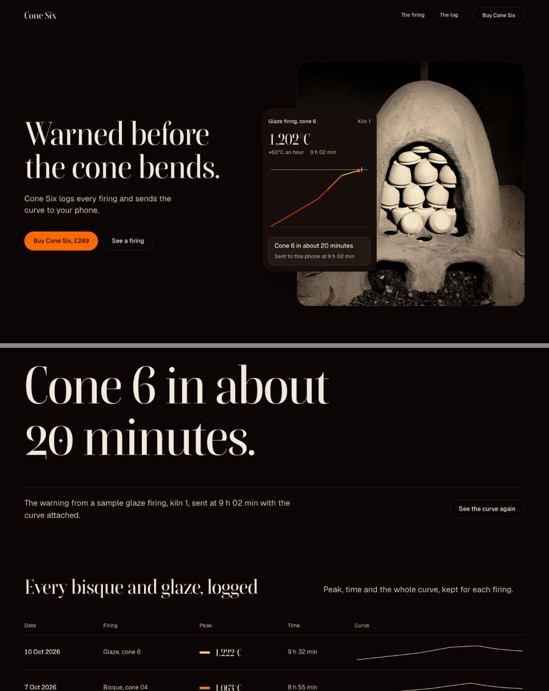

**Gözlem:** Fırın/atölye fotoğrafı, koyu sıcak ton.

**Orkestra’ya alınabilir:** Malzeme ve üretim anı.

**Alınmamalı:** Her yeri ağır ve karanlık yapmak.

**Fikir bağı:** I17, I24

## H25 · loom

**Gözlem:** Dokuma fotoğrafı ve süreç görüntüleri.

**Orkestra’ya alınabilir:** Dokuyu fotoğrafın içinde bırakmak.

**Alınmamalı:** Sayfa geneline yapay kumaş/gren katmanı.

**Fikir bağı:** I04, I05, I16

## H26 · lumen

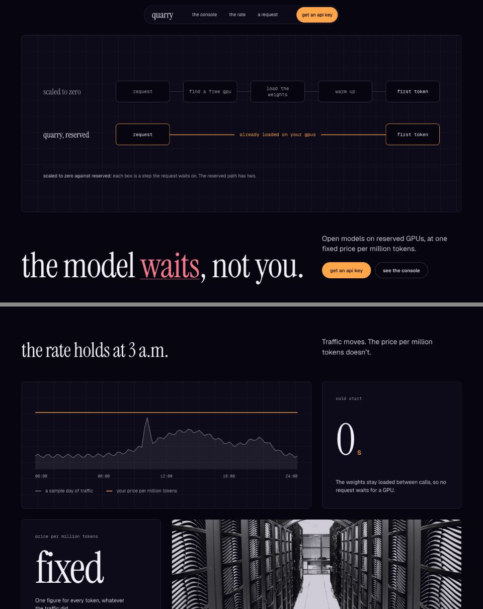

**Gözlem:** Koyu altyapı diyagramı ve pembe vurgu.

**Orkestra’ya alınabilir:** Tekrar eden elemanlarda ölçü tutarlılığı.

**Alınmamalı:** SaaS altyapı estetiği.

**Fikir bağı:** Ana yön için seçilmedi; dar bir biçim ilkesi dışında sektör uyumu zayıf.

## H27 · manifesto

**Gözlem:** Büyük siyah-krem-kırmızı manifesto.

**Orkestra’ya alınabilir:** Az unsurla güçlü odak.

**Alınmamalı:** Hizmet sitesini politik afiş gibi yapmak.

**Fikir bağı:** Ana yön için seçilmedi; dar bir biçim ilkesi dışında sektör uyumu zayıf.

## H28 · midnight

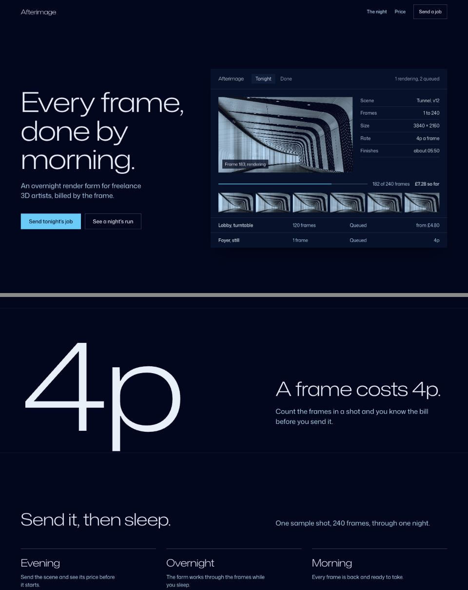

**Gözlem:** Lacivert ürün ekranı ve ince geometrik başlık.

**Orkestra’ya alınabilir:** Tonlar arasında disiplin.

**Alınmamalı:** İnce yazılı teknik ürün kimliği.

**Fikir bağı:** Ana yön için seçilmedi; dar bir biçim ilkesi dışında sektör uyumu zayıf.

## H29 · newsprint

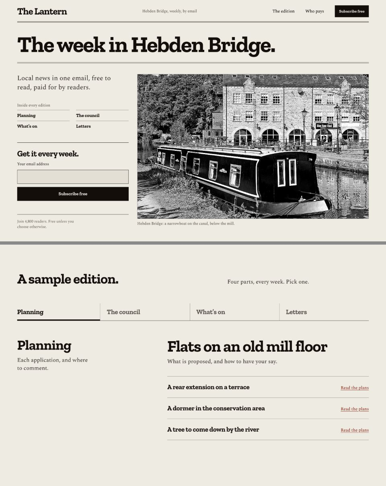

**Gözlem:** Gazete sütunları, kent fotoğrafı, serif.

**Orkestra’ya alınabilir:** Bölümleri kutu yerine tipografiyle ayırmak.

**Alınmamalı:** Resmî sicil/gazete kimliğine dönüşmek.

**Fikir bağı:** I26

## H30 · overprint

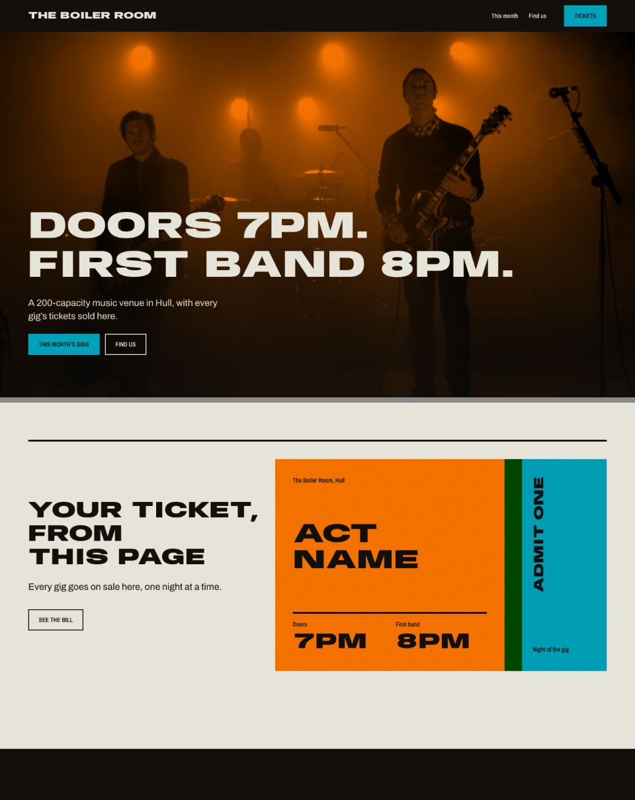

**Gözlem:** Bant fotoğrafı, büyük yazı ve renkli bilet.

**Orkestra’ya alınabilir:** Tek baskın fotoğraf.

**Alınmamalı:** Bilet ve festival görsel dili.

**Fikir bağı:** Ana yön için seçilmedi; dar bir biçim ilkesi dışında sektör uyumu zayıf.

## H31 · pasteup

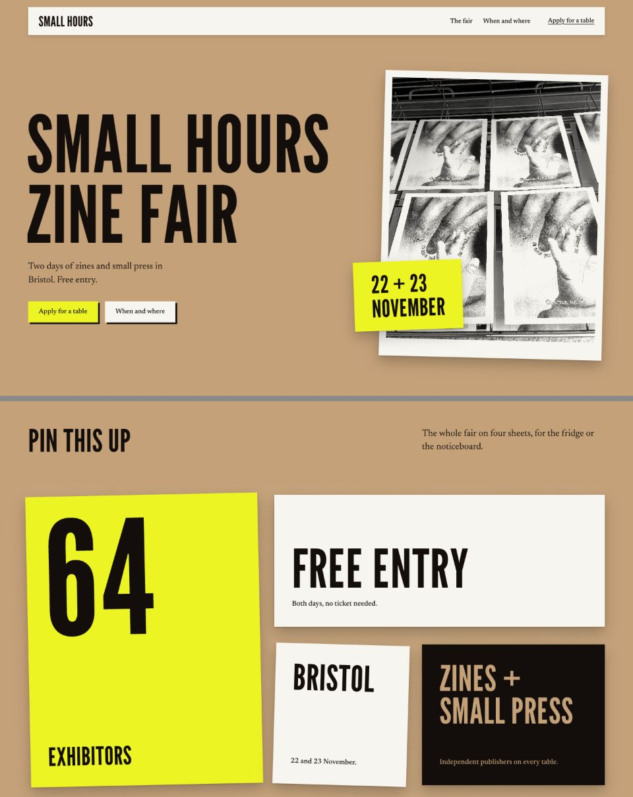

**Gözlem:** Eğik yayın fotoğrafı ve sarı etiket.

**Orkestra’ya alınabilir:** Malzemeye bağlı renk seçimi.

**Alınmamalı:** Rastgele dönük kartlar.

**Fikir bağı:** Ana yön için seçilmedi; dar bir biçim ilkesi dışında sektör uyumu zayıf.

## H32 · piste

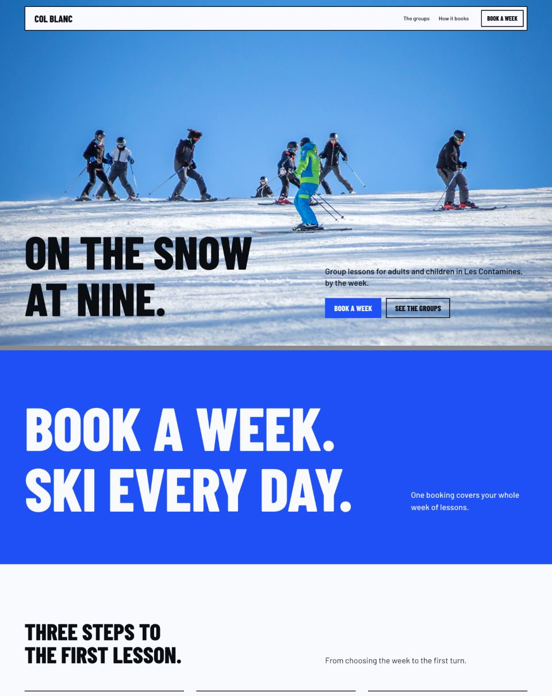

**Gözlem:** Kayak fotoğrafı, mavi-beyaz ve güçlü başlık.

**Orkestra’ya alınabilir:** Fotoğraflarda benzer ışık.

**Alınmamalı:** Spor afişi tonu.

**Fikir bağı:** Ana yön için seçilmedi; dar bir biçim ilkesi dışında sektör uyumu zayıf.

## H33 · ribbon

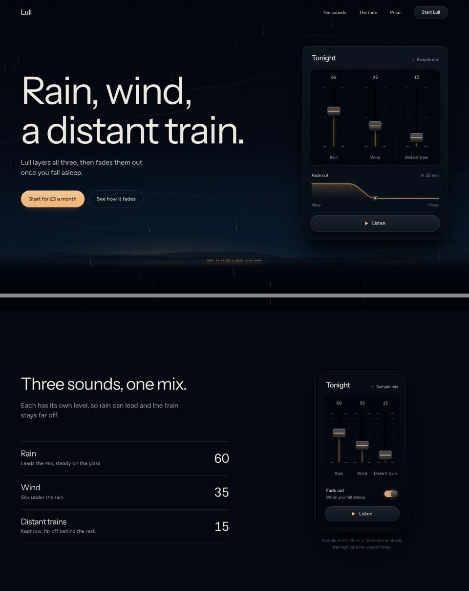

**Gözlem:** Koyu mavi manzara ve ses kontrolleri.

**Orkestra’ya alınabilir:** Az ve sakin vurgu.

**Alınmamalı:** Uyku uygulaması görünümü.

**Fikir bağı:** I28

## H34 · rim

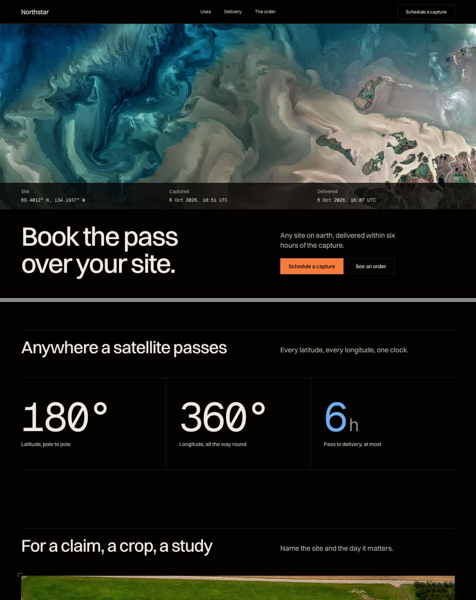

**Gözlem:** Uydu makrosu, siyah alan ve turuncu detay.

**Orkestra’ya alınabilir:** Nesne için kesintisiz geniş alan.

**Alınmamalı:** Teknik istatistik bölümleri eklemek.

**Fikir bağı:** Ana yön için seçilmedi; dar bir biçim ilkesi dışında sektör uyumu zayıf.

## H35 · riso

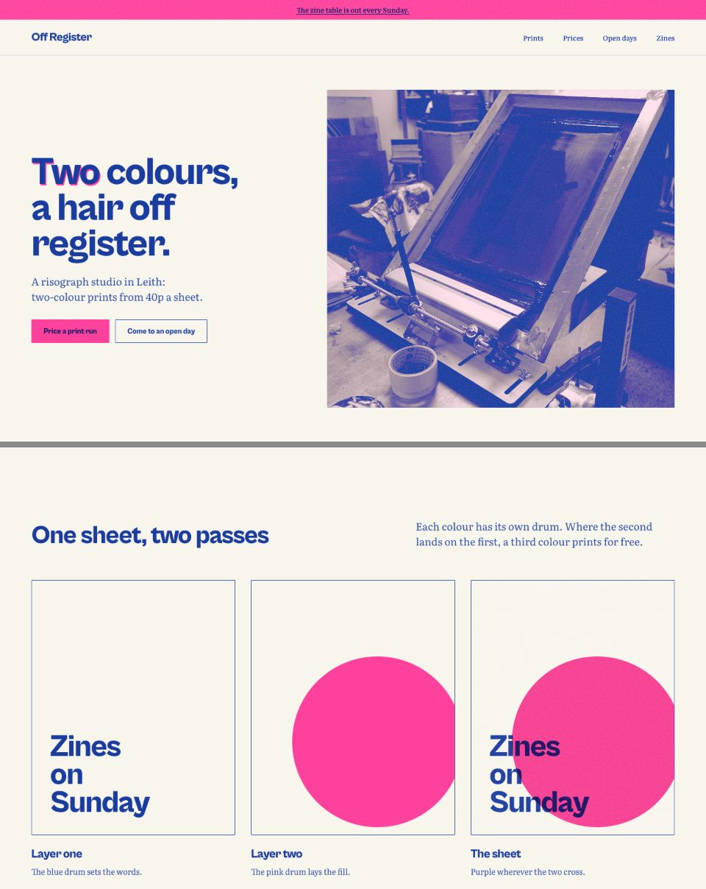

**Gözlem:** Pembe-mavi baskı ve doku.

**Orkestra’ya alınabilir:** Tek bir görsel üretim tekniği.

**Alınmamalı:** Duotone ve grenle premium taklidi.

**Fikir bağı:** Ana yön için seçilmedi; dar bir biçim ilkesi dışında sektör uyumu zayıf.

## H36 · solstice

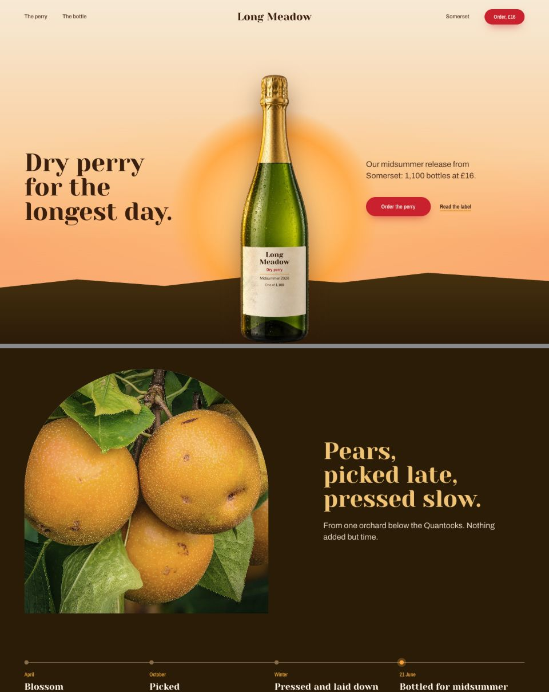

**Gözlem:** Şişe/armut fotoğrafı ve sıcak ışık geçişi.

**Orkestra’ya alınabilir:** Konunun çevresinde ışıkla boşluk oluşturmak.

**Alınmamalı:** Altın parlama efektleri.

**Fikir bağı:** I25

## H37 · specimen

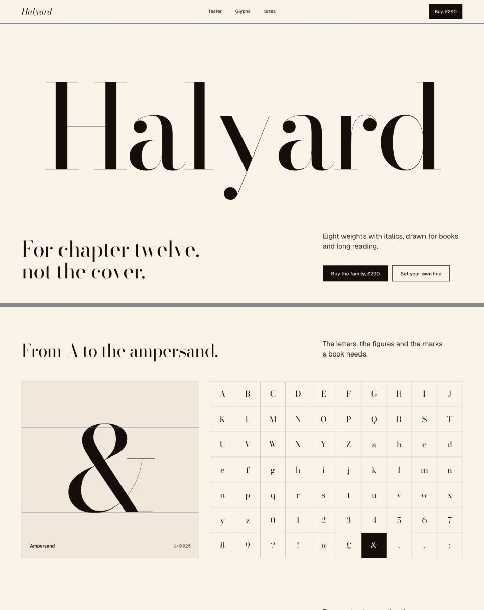

**Gözlem:** Yazı karakteri örnekleri ve büyük serif.

**Orkestra’ya alınabilir:** Harf/satır oranlarının bilinçli seçimi.

**Alınmamalı:** Serif eşittir premium varsayımı.

**Fikir bağı:** I03, I21, I26

## H38 · spore

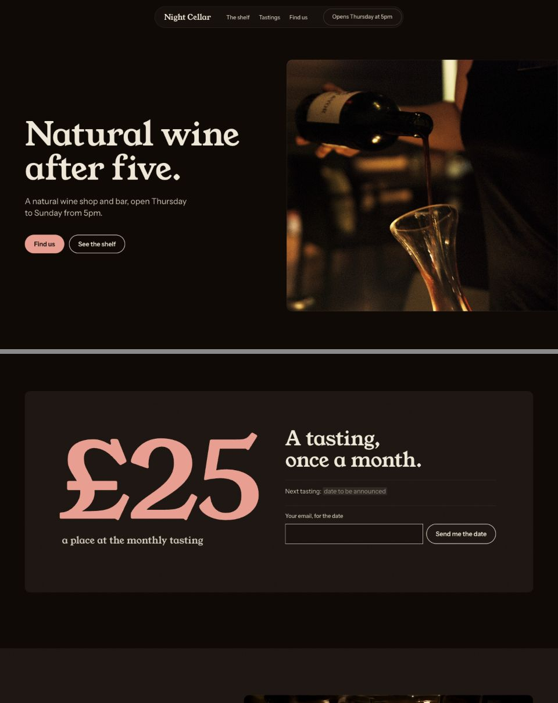

**Gözlem:** Koyu şarap fotoğrafı ve fiyat yüzeyi.

**Orkestra’ya alınabilir:** Sınırlı renk ailesi.

**Alınmamalı:** Yiyecek/içecek atmosferi.

**Fikir bağı:** Ana yön için seçilmedi; dar bir biçim ilkesi dışında sektör uyumu zayıf.

## H39 · sport

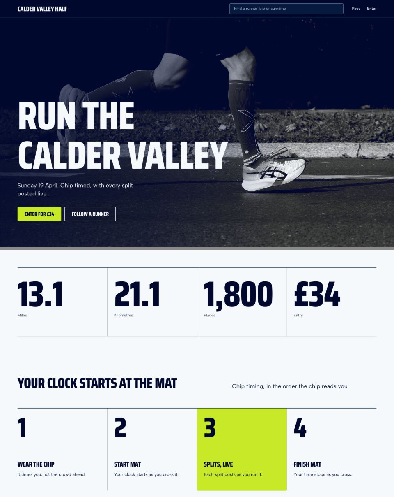

**Gözlem:** Lacivert koşucu fotoğrafı ve sarı.

**Orkestra’ya alınabilir:** Tekrarlanan fotoğraf kadrajları.

**Alınmamalı:** Spor performans göstergeleri.

**Fikir bağı:** Ana yön için seçilmedi; dar bir biçim ilkesi dışında sektör uyumu zayıf.

## H40 · squeeze

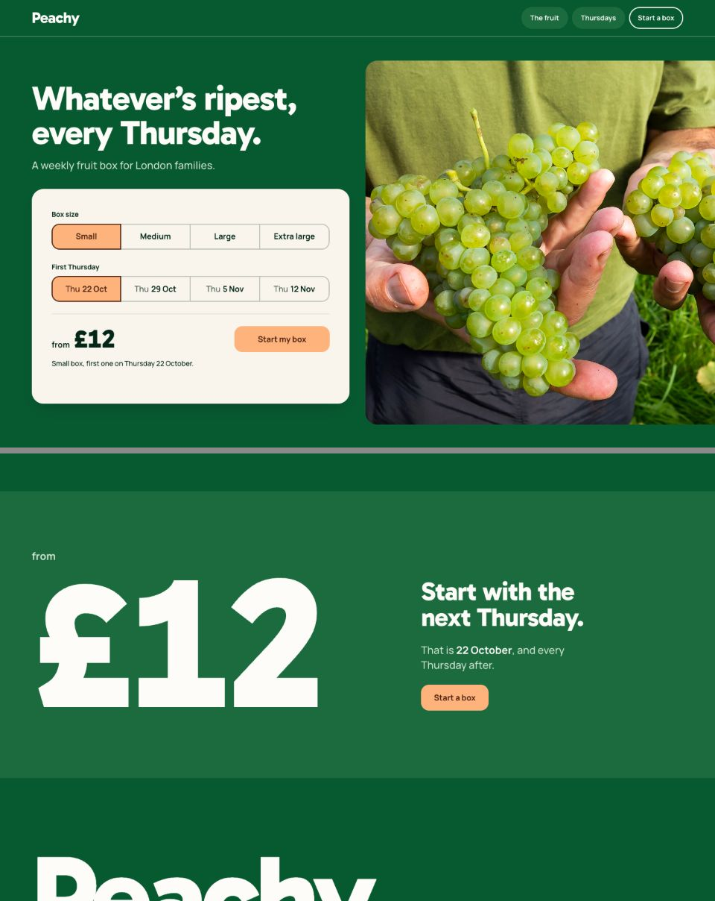

**Gözlem:** Yeşil meyve fotoğrafı, kompakt form, büyük fiyat.

**Orkestra’ya alınabilir:** Fotoğraf ile aksiyon renginin ilişkisi.

**Alınmamalı:** Doğrulanmamış fiyatı dekor yapmak.

**Fikir bağı:** Ana yön için seçilmedi; dar bir biçim ilkesi dışında sektör uyumu zayıf.

## H41 · sticker

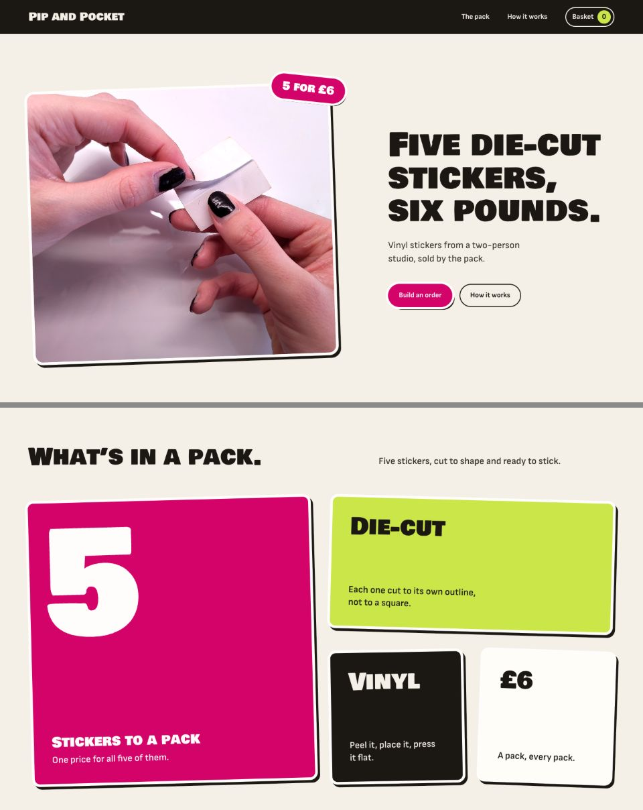

**Gözlem:** Elde ürün, pembe-yeşil ve dönük etiketler.

**Orkestra’ya alınabilir:** Konusu belli fotoğraf.

**Alınmamalı:** Dekoratif sticker ve rozetler.

**Fikir bağı:** Ana yön için seçilmedi; dar bir biçim ilkesi dışında sektör uyumu zayıf.

## H42 · studio

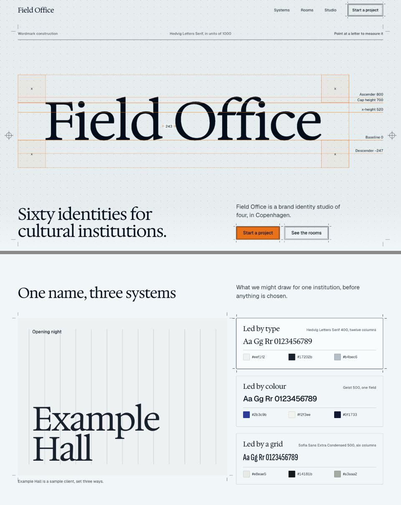

**Gözlem:** Tipografi ölçüm çizgileri ve açık zemin.

**Orkestra’ya alınabilir:** Görünmeyen hizalama disiplini.

**Alınmamalı:** Ölçüm cetvelini kullanıcının önüne taşımak.

**Fikir bağı:** I20

## H43 · terminal

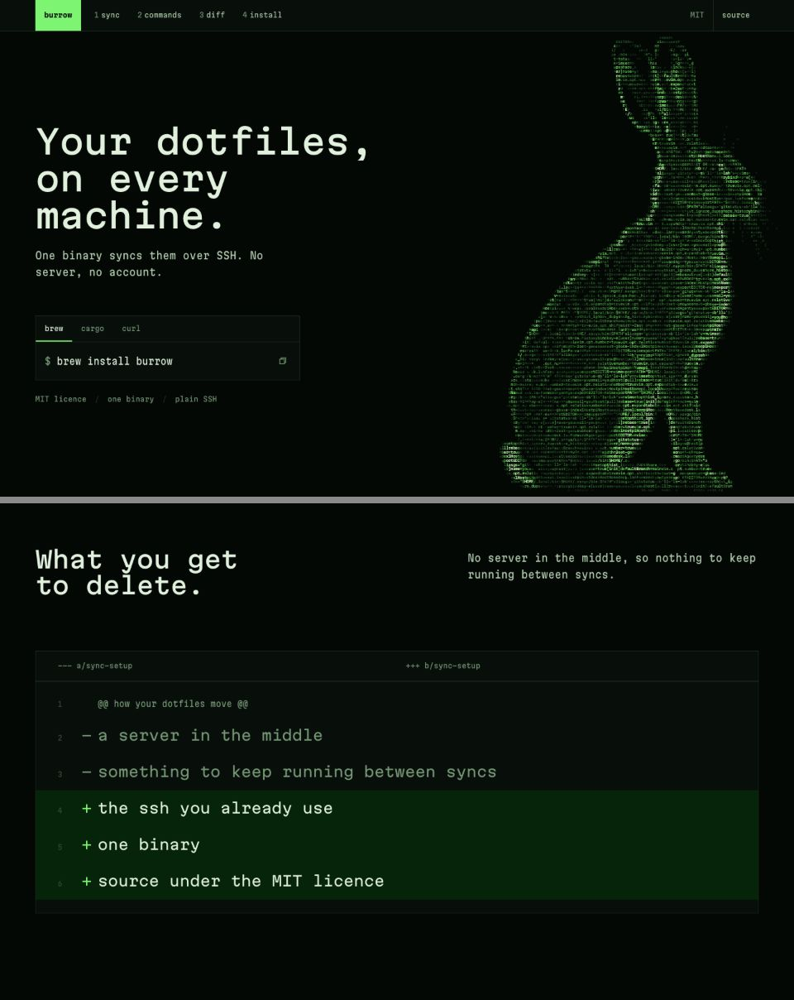

**Gözlem:** Yeşil-siyah ASCII ve kod.

**Orkestra’ya alınabilir:** Sınırlı palet ilkesi.

**Alınmamalı:** Geliştirici terminali estetiği.

**Fikir bağı:** Ana yön için seçilmedi; dar bir biçim ilkesi dışında sektör uyumu zayıf.

## H44 · terrazzo

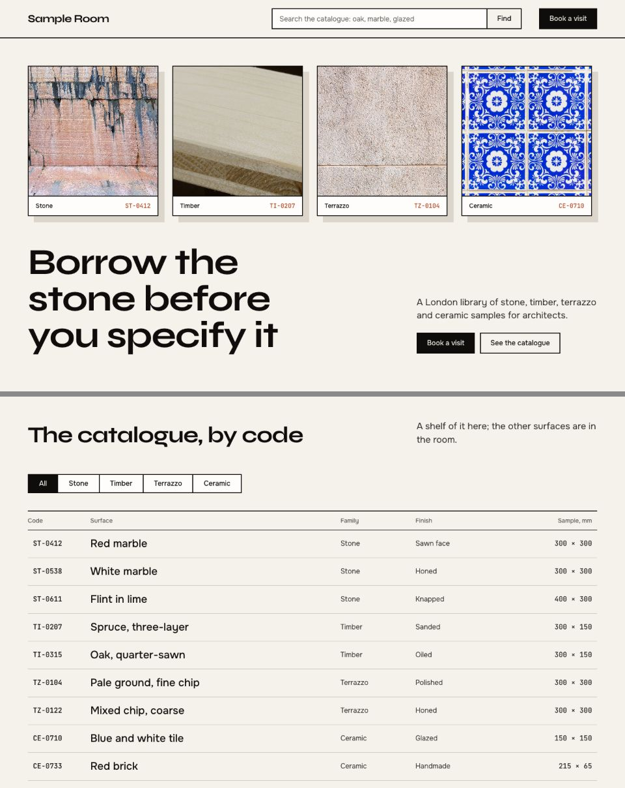

**Gözlem:** Taş/ahşap örnekleri, keskin çerçeveler ve katalog.

**Orkestra’ya alınabilir:** Gerçek malzeme yakın planları ve düzenli dizin.

**Alınmamalı:** Örnek paspartusu ve sert gölgeyi aynen kopyalamak.

**Fikir bağı:** I07, I17, I19

## H45 · ultraviolet

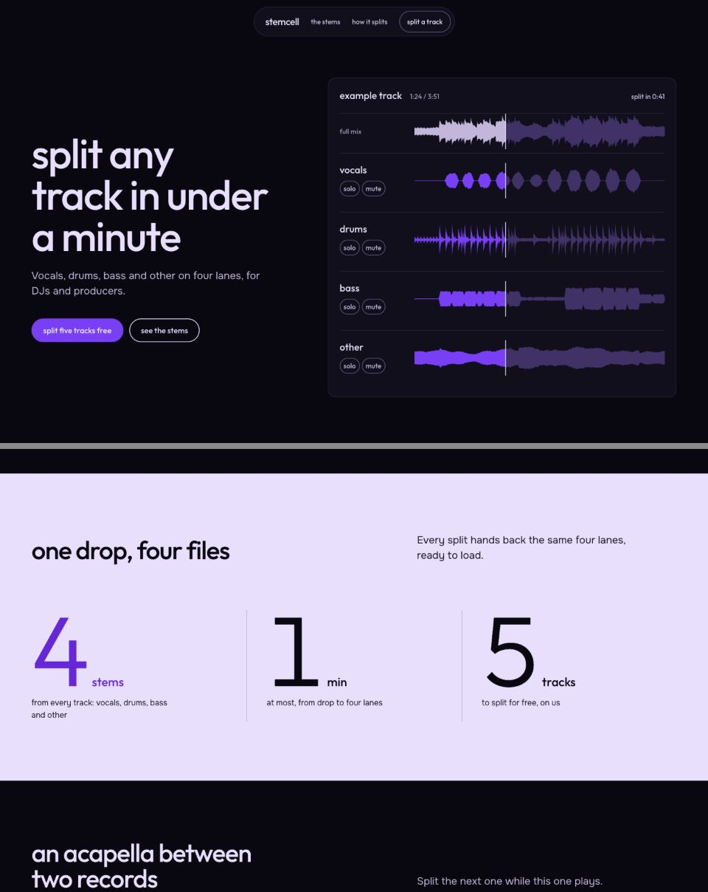

**Gözlem:** Mor ses dalgası ve ürün arayüzü.

**Orkestra’ya alınabilir:** Birincil/ikincil ağırlık ayrımı.

**Alınmamalı:** Mor palet ve teknolojik ışık.

**Fikir bağı:** Ana yön için seçilmedi; dar bir biçim ilkesi dışında sektör uyumu zayıf.

## H46 · vellum

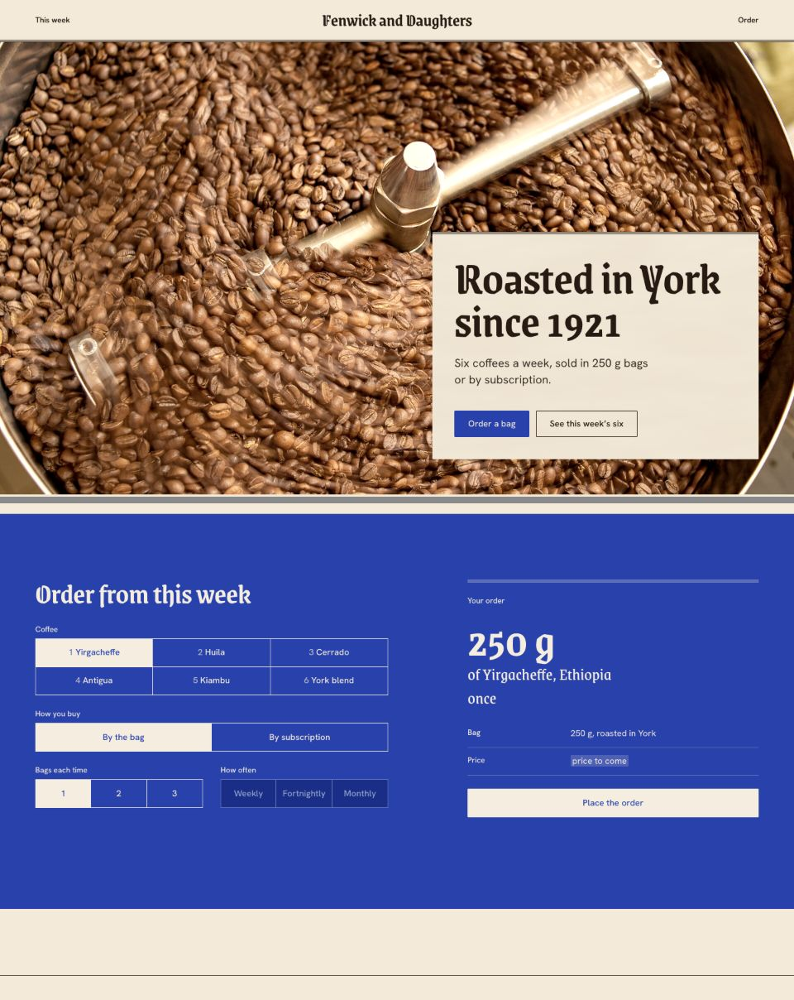

**Gözlem:** Kahve fotoğrafı ve belirgin krem form yüzeyi.

**Orkestra’ya alınabilir:** İlişkili içerikleri tek yüzeyde gruplamak.

**Alınmamalı:** Her gruba yeni çerçeve.

**Fikir bağı:** Ana yön için seçilmedi; dar bir biçim ilkesi dışında sektör uyumu zayıf.

## H47 · wayfind

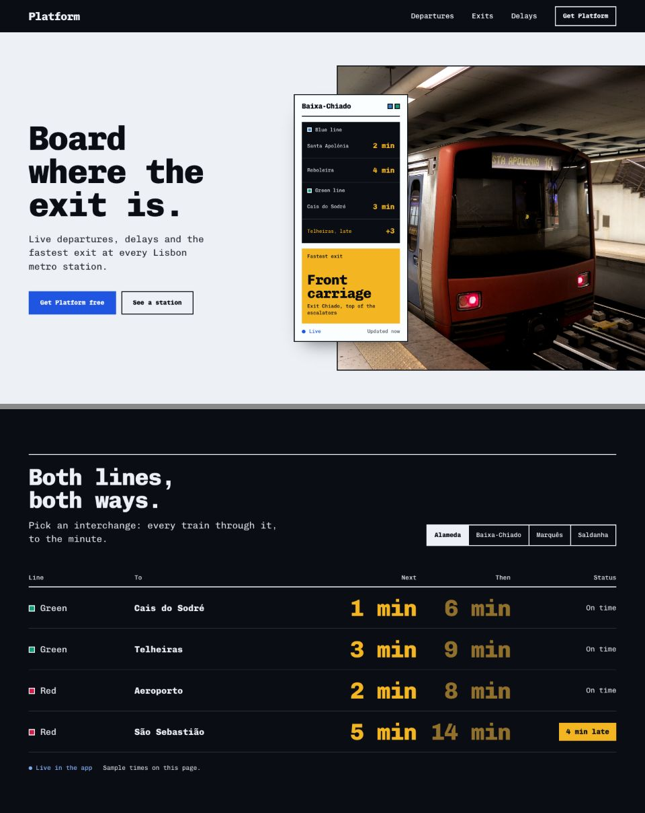

**Gözlem:** Tren fotoğrafı, yön kartı ve mavi eylem.

**Orkestra’ya alınabilir:** Yönlendirmede net yazı hiyerarşisi.

**Alınmamalı:** İstasyon tabelası görünümü.

**Fikir bağı:** Ana yön için seçilmedi; dar bir biçim ilkesi dışında sektör uyumu zayıf.

## H48 · werkstatt

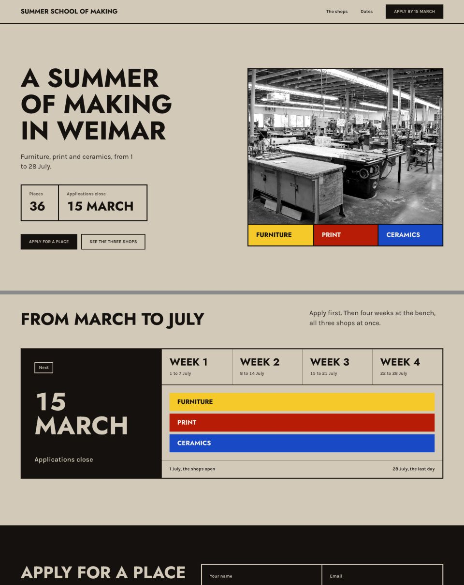

**Gözlem:** Atölye fotoğrafı, güçlü sans, renkli kategori ve tablo.

**Orkestra’ya alınabilir:** Zanaatı iş anıyla göstermek.

**Alınmamalı:** Kategorilere rastgele ana renkler atamak.

**Fikir bağı:** I05
