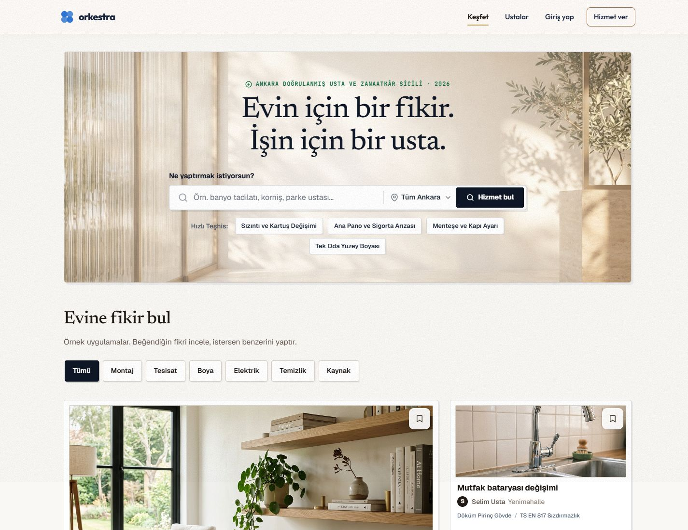
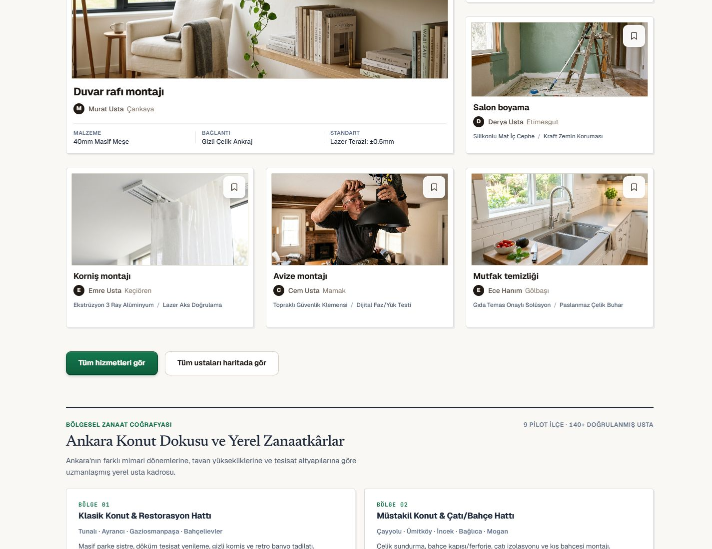
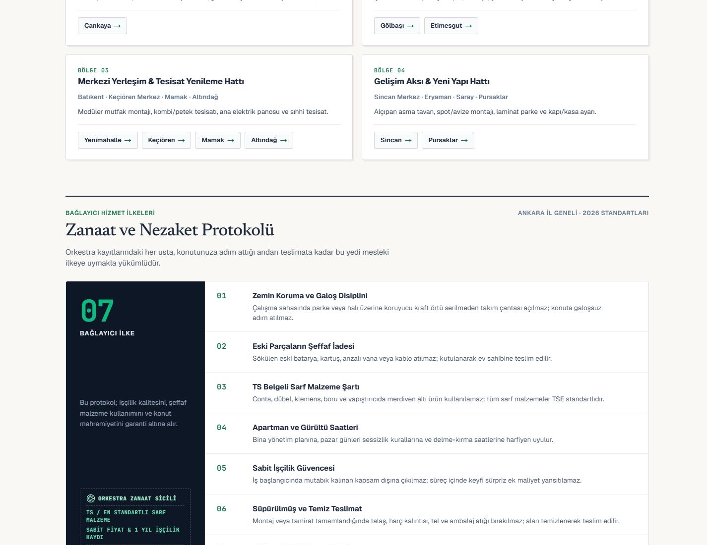
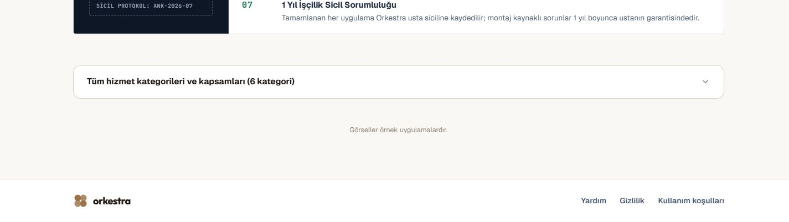
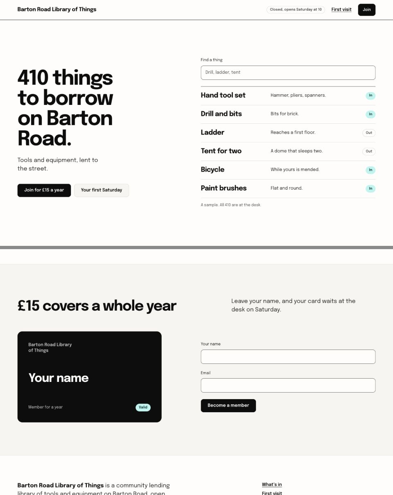
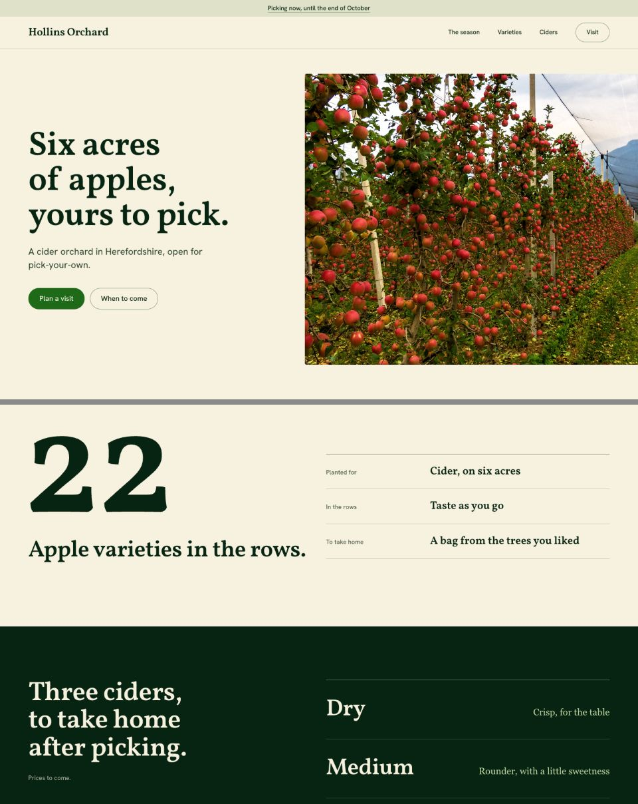
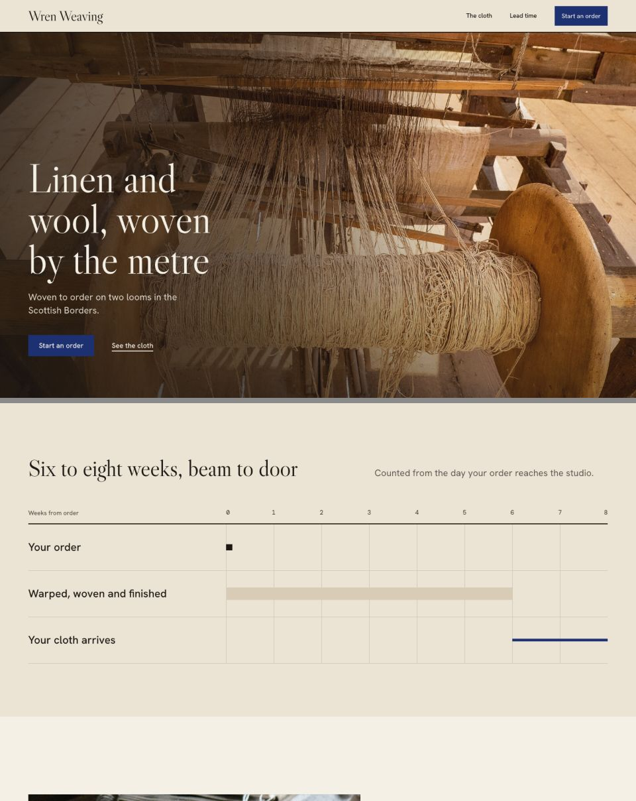
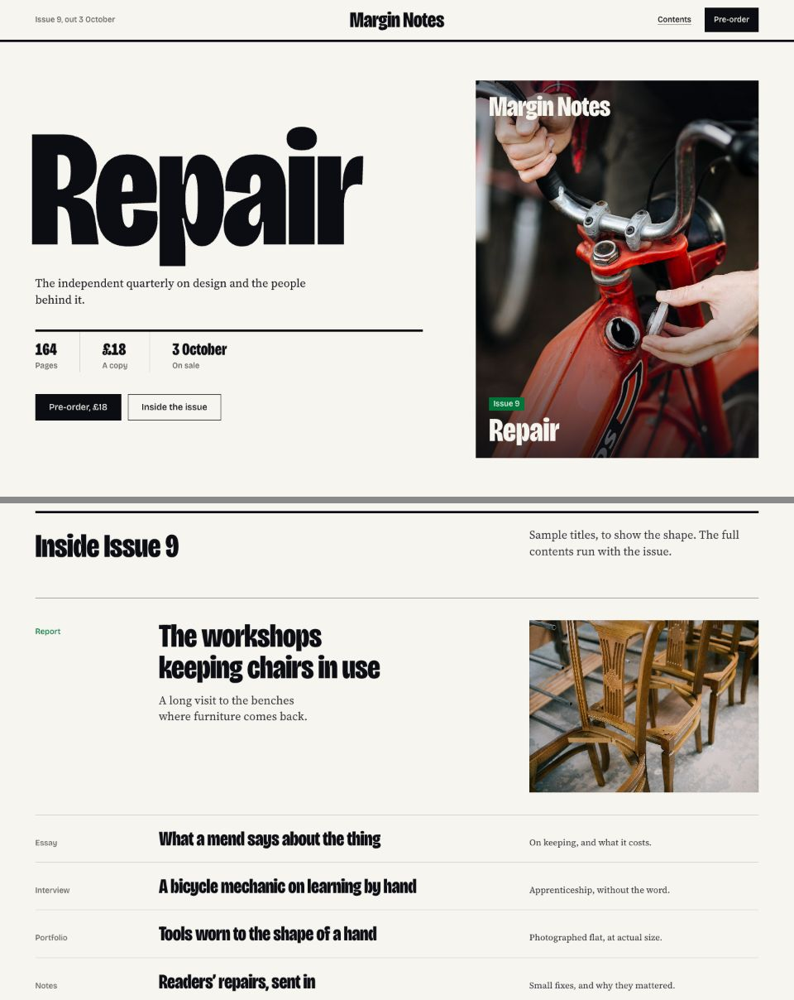

# Orkestra — estetik yönü yeniden kurmak

27 Ekim 2026 · Gözlem, karşılaştırma ve tasarım kararı · Uygulama koduna değişiklik yok

## Ana teşhis

Mevcut sayfa eksik süsten değil, birbiriyle yarışan tasarım dillerinden zayıflıyor. Fotoğraflı hizmet keşfi; sicil/standart etiketleri, serif editoryal başlıklar, teknik mono yazılar, çift çerçeveli kartlar, pirinç detaylar, mavi logo ve koyu ana butonla aynı anda anlatılıyor. Her unsur tek başına savunulabilir; birliktelikleri tutarlı bir ürün kimliği kurmuyor.

Önerdiğim yön **aydınlık, fotoğrafı öne çıkaran, yeşil eylemleri olan çağdaş bir ev hizmetleri ve keşif ürünü**. Yenilik, daha önce görülmemiş buton şeklinde değil; gerçek işçilik fotoğrafı, sakin bilgi düzeni ve aramadan keşfe kesilmeyen kompozisyonun Orkestra’ya özgü birleşiminde aranmalı. Bu bir tasarım hipotezidir; kullanıcı araştırması veya dönüşüm artışı sonucu değildir.

## Kanıt kapsamı

- Canlı `/` sayfasından yeni masaüstü (1440 × 1000 viewport) ve mobil (390 × 844 viewport) tam sayfa yakalama alındı. Masaüstü PNG içerik genişliği kaydırma alanı nedeniyle 1425 px. Sadece ana sayfanın varsayılan hali incelendi; wizard ve tüm route’lar tekrar test edilmiş sayılmıyor.
- Hallmark’ın yerel paketindeki **48 görselin tamamı** sekiz temas sayfasında tarandı, her birine ayrı gözlem/alınacak/alınmayacak kararı yazıldı. Güçlü adayların bir bölümü tam boy incelendi. Bu bir **48 örnek görsel atlası**, 48 canlı sitenin etkileşim testi değildir.
- Brain arşivinden **15 platform yakalaması** seçildi. MyBuilder görüntüsü güvenlik doğrulama ekranı; Airtasker çerez katmanıyla örtülü. Bu iki görsel tam landing karşılaştırmasına alınmadı.
- Kullanıcının saydığı beş rapor okundu. Arşivin tamamının her karesini incelediğimizi iddia etmiyoruz. Doğrudan Brain kökünde 430 PNG, 119 WebP, 22 JPG; `.tempmediaStorage` içinde 761, `.user_uploaded` içinde 42 giriş envanterlendi. Bunlar benzersiz/tamamen incelenmiş görsel sayıları değildir. WebP dosyalarının tamamının video olduğu da doğrulanmadı.
- Gemini 3.8 Flash High ile bağımsız değerlendirme ve ardından Codex itirazlarına yanıt olmak üzere iki tur yürütüldü. **On bakış açısı on ayrı insan uzman değildir**; aşağıdaki fikirler on analitik mercekle değerlendirildi.

[Görsel atlas — 48 Hallmark](HALLMARK-48-ATLAS.md) · [Platform atlası](BENCHMARK-ATLAS.md) · [30 × 10 değerlendirme CSV](IDEA-MATRIX.csv) · [Görsel okuma dosyası](index.html)

## Mevcut sayfanın baştan aşağı değerlendirmesi

### 1. Header ve hero

**Korunacak:** Ortalanmış slogan–arama ilişkisi, hizmeti yazabilme, fotoğrafla ev/zanaat bağlamı, mavi Orkestra işareti. Bunlar yeniden özellik tasarlamayı gerektirmiyor.

**Sorun:** Üstteki “doğrulanmış usta ve zanaatkâr sicili · 2026” satırı, serif slogan, koyu CTA ve çerçeveli örnekler birbirinden farklı seslerde konuşuyor. Sayfa üzerinde görülen gren/beneklenme temiz yüzey algısını zayıflatıyor; hangi CSS katmanından geldiği bu salt görsel denetimde teşhis edilmedi. Koyu arama butonu ve alttaki yeşil eylem farklı öncelik sistemleri kuruyor.

**Referans farkı:** Ink az sayıda tipografik rolle aramayı görünür kılıyor. Thumbtack metin arkasındaki fotoğraf tonunu kontrol ediyor. Massimo Dutti’de ayrı süs katmanları yerine tek güçlü fotoğraf var. Bunlardan alınacak şey yazı tipi veya fotoğrafın kendisi değil; az sayıda odak ve bilinçli kadraj.

### 2. Keşif fotoğrafları ve kartlar

**Korunacak:** Raf, batarya, boya ve montaj gibi somut iş örnekleri. Fotoğraf görmek platformun sosyal keşif yönünü destekliyor.

**Sorun:** Fotoğrafın çevresinde beyaz paspartu, sınır, gölge ve dış kutu üst üste. Büyük ilk kart diğerlerini bastırırken teknik özellik satırları ürün kataloğu hissi veriyor. Harf avatarı gerçek usta kişiliği taşımıyor; fakat sırf estetik için kimliği tümüyle silmek de doğru değil. Kaydetme ikonunun beyaz yüzeyi fotoğrafın önemli bir parçası haline geliyor.

**Referans farkı:** Airbnb fotoğraf ile kısa metni yakın tutuyor; dış çerçeve olmadan gruplama okunuyor. COS iki fotoğrafın ışık/kadraj ilişkisiyle düzen kuruyor. Editorial işin yapılışını gösteriyor. Terrazzo malzemenin kendisini net gösterse de çerçeve ve sert gölge kullanıyor: onu “çerçevesiz kart” kanıtı olarak sunmak yanlış olur.

### 3. Bölgesel alan

Dört bölge kutusu, iç çizgi ve yeniden kutulanan ilçe bağlantıları sayfayı parçalı bir kontrol paneline yaklaştırıyor. Sınırlar kaldırılınca her şeyi tek paragraf yapmak gerekmez: Ink’in liste hizası ve Terrazzo’nun katalog satırı ilişkisi, **mobilde tabloya dönüşmeden**, bağlantıların ortak zeminde okunmasını sağlayabilir. Coğrafi gruplamanın doğruluğu ayrı ürün kararıdır; estetik adına yeni coğrafi sınıflandırma icat edilmez.

### 4. Protokol, alt açılır alan ve footer

Koyu “07” alanı fotoğraflarla yarışan ikinci bir kahraman bölüm gibi. Mühür, sicil kodu ve sert kurallar resmi kurum dili yaratıyor. Premium algıyı bu bürokratik süsler üzerinden kurmayı önermiyorum. Mevcut bilgilerin gerekli olanları tipografik listeyle daha hafif sunulabilir. “1 yıl”, “140+ doğrulanmış usta”, standart ve garanti ifadeleri bu denetimde doğrulanmadı; tasarım kanıtı sayılmamalı. Footer’daki kahverengi logo üstteki mavi kimlikten ayrılıyor.

### 5. Mobil

[390 px tam sayfa kanıtı](evidence/current/live-390.png)

Üstte menü kapsülü, sonra uzun hero, arama ve ilçe alanları, dolu buton, ardından dikey örnekler geliyor. İlk keşif fotoğrafı ilk ekranın altında kalıyor. Bu tek başına evrensel hata değildir; ancak kullanıcının sosyal keşif hedefiyle gerilim yaratıyor. Çözüm küçük yazı ve küçük dokunma alanı değil, masaüstündeki her satırı telefonda da aynen yığmamak. İki platform benchmark’ının masaüstü görüntüsü onların mobil başarısına kanıt olarak kullanılamaz.

## “Continuous border” fikrine yanıt

Üç kavramı ayıralım: **sürekli zemin** (bölümler aynı görsel alanı paylaşır), **seçici sınır** (yalnız anlamlı grupları ayırır), **sürekli köşe eğrisi** (köşenin geometrisi). Biri diğerini gerektirmez. Standart `border-radius` değeri vermek gerçek squircle uygulandığını kanıtlamaz. Apple ekranında bölüm zeminleri değişiyor; Stripe’da ızgara çizgileri var; Hallmark Ink, Editorial ve Terrazzo çizgi kullanıyor. Bu nedenle “bütün premium siteler sınır kullanmaz” sonucuna katılmıyorum.

Senin gözleminin yararlı çekirdeği şu: **her bileşen kendini ayrı bir kutu olarak ilan etmek zorunda değil.** Orkestra’da fotoğraf grupları boşlukla, dizin satırları gerektiğinde çizgiyle, arama ise görünür bir kontrol yüzeyiyle tanımlanabilir. Bu, her şeyi görünmez hale getirmeden bütünlük sağlar.

## Önceki raporlara dürüst düzeltmeler

| Belge | Yararlı taraf | Düzeltilmesi gereken |
|---|---|---|
| Anti-slop premium master | Sektör, lüks ve dijital referansları birlikte toplaması | Kesin piksel, font ve dönüşüm sonuçları her zaman yakalamayla desteklenmiyor. MyBuilder güvenlik ekranı tasarım kanıtı değil. Massimo beyaz header’ından bej token sonucu çıkarılamaz. |
| Continuous squircle | Köşe tutarlılığını gündeme alması | 20 px radius tek başına sürekli eğrilik değildir. Her yüzeyin aynı geometriyi taşıması da zorunlu değil. |
| Honest debate & synthesis | Yüzey yükünü azaltma niyeti | Yeşili espresso/pirinçle değiştirme önerisi sonra yeşili koruma kararıyla çelişiyor. Rol isimleri gerçek uzman araştırması yerine geçmez. |
| Wizard premium audit | Adım ekranlarını kayıt altına alması | Native select otomatik olarak kötü değildir; otomatik ilerleme yeni davranıştır. “Bilişsel yük sıfırlanır”, hız/fiyat vaatleri doğrulanmamış. Ahşap/pirinç dekorunu tüm kontrole taşımak kimlik kaymasına yol açabilir. |
| Sabit fiyat 7 platform | Bölünmeyen fiyat ve hizalı kart gibi somut sorunlar | Rakipler için kesin font/radius/garanti değerleri doğrulanmalı. Her CTA’yı dolu yeşil yapmak eşitliği sağlar ama sayfada aşırı eylem ağırlığı da yaratabilir. |

Bu belgelerdeki geçmiş test geçişleri bu çalışma sırasında tekrar doğrulanmadı. Belgeler karar geçmişidir; otomatik uygulama talimatı değildir.

## Codex–Gemini karşılıklı inceleme

[İlk Gemini görüşü, değişmeden](GEMINI-INDEPENDENT-REVIEW.md) ve [itiraza yanıtı](GEMINI-COUNTER-REVIEW.md) saklandı. İlk görüşte serif başlıkların sans-serif diye okunması, koyu hero yazısının beyaz diye anlatılması ve yuvarlak dikdörtgenlerin genel olarak kapsül diye adlandırılması hataydı. Codex bunları reddetti; Gemini ikinci turda düzeltti.

**Uzlaşı:** Dış kutuların azaltılması, fotoğraf yönetimi, kontrollerin tutarlılığı, bölge/protokol alanının hafiflemesi. **Kabul etmediğim öneriler:** Otomatik serif ve mono mikro yazı eklemek, bütün harf avatarlarını koşulsuz silmek, “resmî sicil” kimliğini güçlendirmek. Bunlar kullanıcının sosyal hizmet ürünü hedefini tekrar daraltır. İkinci turdaki “bilişsel yükü azaltır” ifadesini de ölçülmüş sonuç değil hipotez olarak alıyorum. Görsel sekme kullanmak otomatik `tablist` semantiği gerektirmez; mevcut filtre davranışına göre seçilmelidir.

## 30 fikir / 10 değerlendirme merceği

Mercek sırası: **SY** sanat yönetimi, **T** tipografi, **F** fotoğraf, **K** kompozisyon, **M** marka, **B** kontroller, **H** hiyerarşi, **Mo** mobil, **E** erişilebilirlik, **İ** itidal. **D:** destekleniyor; **K:** koşullu/riskli; **N:** doğrudan etkisi yok; **R:** bu kapsamda reddediliyor. Bu harfler test sonucu veya kullanıcı puanı değildir. Her fikir tüm on mercekte düşünülmüş, risk sütununda belirleyici karşı gerekçe verilmiştir. Final ilk on, yalnız harf toplamıyla değil bağımsız görsel etkisi, sektör uyumu ve mevcut kimliğin korunmasıyla seçildi.

| Fikir | Öneri ve kanıt | SY T F K M B H Mo E İ | Eleme / koşul |
|---|---|---|---|
| **I01 · Temiz, kesintisiz ana zemin** | Sayfa genelindeki gren ve yinelenen yüzey efektlerini kaldır; dokuyu yalnız fotoğrafta bırak. [H23](evidence/hallmark/ink.jpg), [B05](evidence/benchmarks/airbnb_desktop_1792155821050.png), [B08](evidence/benchmarks/cos_desktop_1792155920520.png) | D / N / D / D / D / N / D / D / D / D | **Final 10.** Düzlük riski fotoğraf ve boşlukla çözülmeli, yeni efektle değil. |
| **I02 · Renklerin görevlerini sabitle** | Ana eylem yeşil, logo mavi, metin koyu nötr; pirinç, espresso ve lacivert CTA yarışını bitir. [H18](evidence/hallmark/garden.jpg), [B11](evidence/benchmarks/taskrabbit_home.png), [B12](evidence/benchmarks/armut_home.png) | D / N / N / D / D / D / D / D / D / D | **Final 10.** Logo rengini değiştirme; yeşilin her yere yayılması da çözüm değil. |
| **I03 · Tipografiyi rollere göre yeniden kur** | Mevcut serifleri premium kanıtı sayma. Bir başlık ailesi ve sade okuma/kontrol ailesi; sicil/mono katmanını azalt. [H23](evidence/hallmark/ink.jpg), [H37](evidence/hallmark/specimen.jpg), [B05](evidence/benchmarks/airbnb_desktop_1792155821050.png) | D / D / N / D / D / D / D / D / D / D | **Final 10.** Serif tamamen yasak değil; Türkçe harfler ve mobil satır kırılması karşılaştırılmalı. |
| **I04 · Hero için tek fotoğraf–başlık kompozisyonu** | Ortalanmış başlık ve arama korunur; metin arkasında sakin kadraj, daha az opak yüzey ve daha az dekoratif satır. [H25](evidence/hallmark/loom.jpg), [B13](evidence/benchmarks/thumbtack_home.png), [B07](evidence/benchmarks/massimodutti_desktop_1792155874509.png) | D / N / D / D / D / D / D / K / K / D | **Final 10.** Arama sınırı ve yazı kontrastı kaybolmamalı; fotoğraf kadrajı mobilde ayrı seçilmeli. |
| **I05 · Tek fotoğraf sanat yönetimi** | İşin sonucu ile yapılışını aynı doğal ışık ve renk sıcaklığında göster; rastgele steril oda kolajını bırak. [H15](evidence/hallmark/editorial.jpg), [H25](evidence/hallmark/loom.jpg), [H48](evidence/hallmark/werkstatt.jpg), [B08](evidence/benchmarks/cos_desktop_1792155920520.png) | D / N / D / D / D / N / D / D / K / D | **Final 10.** Yeni üretim bu adımda yok. Gerçek iş/temsili görsel ayrımı korunmalı; kaynak hakkı kontrol edilmeli. |
| **I06 · Fotoğraf ve açıklamayı dış kutudan kurtar** | Çift çerçeve, paspartu ve kart gölgesini kaldır; fotoğrafın altında yakın başlık–usta ilişkisi kur. [B05](evidence/benchmarks/airbnb_desktop_1792155821050.png), [H15](evidence/hallmark/editorial.jpg), [B08](evidence/benchmarks/cos_desktop_1792155920520.png) | D / D / D / D / N / D / D / D / K / D | **Final 10.** Kart tıklanabilirliği ve kaydetme hedefi görünür kalmalı; kaynakların kendisi tümüyle çerçevesiz değil. |
| **I07 · Bölge alanını sakin bir dizine dönüştür** | Bölge kutusu içindeki ilçe butonlarını ortak zeminde hizalı bağlantı satırlarıyla sun; yeni rota ekleme. [H23](evidence/hallmark/ink.jpg), [H01](evidence/hallmark/almanac.jpg), [H44](evidence/hallmark/terrazzo.jpg) | D / D / N / D / D / D / D / K / K / D | **Final 10.** Mobilde yatay tablo kullanılmamalı; bağlantı hedefleri küçültülmemeli. |
| **I08 · Tek, ölçülü kontrol geometrisi** | Butonları düz dolgu/ikincil çizgi/metin önceliğinde bir aileye bağla; kabartma ve çifte konturu azalt. [H23](evidence/hallmark/ink.jpg), [B11](evidence/benchmarks/taskrabbit_home.png), [B05](evidence/benchmarks/airbnb_desktop_1792155821050.png) | D / D / N / D / D / D / D / K / K / D | **Final 10.** Köşe biçimi tek başına premium yaratmaz; odak halkası ve dokunma alanı korunmalı. |
| **I09 · Kategori seçiminde tipografik sekmeler** | Her kategoriyi kutulamak yerine metin, boşluk ve tek etkin işaretle ayır; davranışı koru. [H15](evidence/hallmark/editorial.jpg), [B05](evidence/benchmarks/airbnb_desktop_1792155821050.png) | D / D / N / D / D / D / D / K / K / D | **Final 10.** Sadece renk ile seçim gösterilmemeli; görsel sekme olması otomatik ARIA tab gerektirmez. |
| **I10 · Mobil hero için bağımsız kompozisyon** | Aynı başlık–arama ilişkisini korurken hızlı örneklerin dikey yığınını azalt; keşif fotoğrafına daha erken yer aç. [B05](evidence/benchmarks/airbnb_desktop_1792155821050.png), [H23](evidence/hallmark/ink.jpg) | D / N / D / D / D / D / D / K / K / D | **Final 10.** Yazıyı ve hedefleri küçültmek çözüm değil; küçük/yatay ekranlarda ayrıca doğrulanmalı. |
| **I11 · Tüm sayfayı kenarlıksız yapmak** | Her çerçeve ve ayracı kaldırıp sadece boşluk kullan. [B08](evidence/benchmarks/cos_desktop_1792155920520.png), [H23](evidence/hallmark/ink.jpg) | K / N / N / K / D / K / K / K / R / K | Seçim/arama grupları belirsizleşebilir. Finalde seçici çerçeve azaltma tercih edildi. |
| **I12 · Tüm köşeleri gerçek squircle yapmak** | Kontrollerde tek eğrilik yaklaşımı denemek. [B03](evidence/benchmarks/apple_desktop_1792155811620.png), [H03](evidence/hallmark/atelier.jpg) | K / N / N / K / N / K / N / K / K / K | Etkisi fotoğraf ve tipografiden küçük; screenshot gerçek eğri matematiğini kanıtlamaz. |
| **I13 · Protokoldeki koyu sayısal bloğu hafifletmek** | 07 kutusunu ve mühür benzeri alanı kaldırıp mevcut maddeleri doğrudan zemine yerleştirmek. [H15](evidence/hallmark/editorial.jpg), [H23](evidence/hallmark/ink.jpg) | D / D / N / D / D / N / D / D / K / D | İçerik iddiaları ayrıca doğrulanmalı. Final 01/03/07 ilkeleriyle ikinci dilime alındı. |
| **I14 · Harf avatarlarını sade imza satırına çevirmek** | Fotoğrafı olmayan ustalarda harf diski yerine isim/yer tipografisini sakinleştirmek. [B05](evidence/benchmarks/airbnb_desktop_1792155821050.png), [H15](evidence/hallmark/editorial.jpg) | D / D / N / D / D / N / D / D / K / D | Gerçek insan bağını zayıflatabilir; varsa gerçek profil fotoğrafı öncelikli. Final 06 alt çalışması. |
| **I15 · Tek büyük fotoğraf yerine eş ölçekli keşif dizisi** | Dev raf kartı yerine benzer fotoğraf ağırlıklarıyla ritim kurmak. [B05](evidence/benchmarks/airbnb_desktop_1792155821050.png), [B08](evidence/benchmarks/cos_desktop_1792155920520.png) | D / N / D / D / N / N / D / D / K / D | Salt kolon sayısı değişikliği yetmez; final 05/06 sonrasında denenebilir. |
| **I16 · Bir süreç/sonuç fotoğraf çifti** | Aynı işi bitmiş mekân ve çalışma anıyla iki fotoğrafta anlatmak. [H15](evidence/hallmark/editorial.jpg), [H25](evidence/hallmark/loom.jpg), [B08](evidence/benchmarks/cos_desktop_1792155920520.png) | D / N / D / D / N / N / K / K / K / D | Aynı işe ait iki doğrulanmış fotoğraf yoksa sahte önce/sonra üretilmemeli. |
| **I17 · Malzeme makrosuyla zanaat vurgusu** | Ahşap bağlantı veya işçilik yakın planını bir fotoğraf odağı yapmak. [H44](evidence/hallmark/terrazzo.jpg), [H24](evidence/hallmark/kiln.jpg) | D / N / D / D / D / N / K / K / K / D | Hizmetin ne olduğu kaybolabilir; hero için otomatik doğru değil. |
| **I18 · Büyük harfli teknik etiketleri sakinleştirmek** | Malzeme/bağlantı/standart etiketlerinin ağırlığını ve satır yoğunluğunu azaltmak. [H23](evidence/hallmark/ink.jpg), [H01](evidence/hallmark/almanac.jpg) | D / D / N / D / D / N / D / D / K / D | Teknik bilgiye ihtiyaç duyan kullanıcı için okunurluk korunmalı; final 03/06 içinde. |
| **I19 · Bölüm başlarında tek çizgi ağırlığı** | Kalın kesikler yerine gerekli yerlerde bir tutarlı ince ayraç kullanmak. [H15](evidence/hallmark/editorial.jpg), [H44](evidence/hallmark/terrazzo.jpg), [B02](evidence/benchmarks/stripe_desktop_1792155791642.png) | D / D / N / D / D / N / D / D / K / D | Her başlığa çizgi de şablonlaşır; final 01/07 kapsamında. |
| **I20 · Ortak hizalama rayları** | Hero, keşif, bölge ve footer kenarlarını tek genişlik sistemine oturtmak. [H19](evidence/hallmark/grid.jpg), [H42](evidence/hallmark/studio.jpg) | D / D / N / D / D / N / D / D / D / D | Temel kalite koşulu; bağımsız yeni estetik yön değil, finalin tamamına uygulanır. |
| **I21 · Başlıklar arasında kontrollü ölçek farkı** | Hero, bölüm, kart başlığı ölçülerini görünür ama sakin bir ritme bağlamak. [H23](evidence/hallmark/ink.jpg), [H37](evidence/hallmark/specimen.jpg) | D / D / N / D / D / N / D / D / K / D | Aşırı büyük display mobil taşmaya yol açar; final 03 altında. |
| **I22 · Header ve footer marka tutarlılığı** | Üstte mavi, altta kahverengi görünen marka ve farklı konturları aynı role bağlamak. [B07](evidence/benchmarks/massimodutti_desktop_1792155874509.png), [B08](evidence/benchmarks/cos_desktop_1792155920520.png) | D / N / N / D / D / N / D / D / D / D | Yeni logo tasarımı gerekmiyor; final 02 altında. |
| **I23 · Tam ekran moda benzeri hero** | Fotoğrafı ilk ekranın tamamına yaymak. [B06](evidence/benchmarks/zara_desktop_1792155860576.png), [B09](evidence/benchmarks/mango_desktop_1792155896539.png) | D / N / D / K / K / N / K / R / K / K | Keşif gecikir ve arama ağırlaşır; mevcut kapsayıcı ve ortalama korunmalı. |
| **I24 · Koyu tema ile dramatik dönüşüm** | Tüm zemini koyulaştırıp fotoğrafları parlatmak. [H12](evidence/hallmark/darkroom.jpg), [H24](evidence/hallmark/kiln.jpg), [B01](evidence/benchmarks/linear_desktop_1792155782650.png) | K / N / K / K / R / K / K / K / K / R | Yeşil ev hizmeti kimliği ve gündelik kullanım yerine atölye sergisine kayar; elendi. |
| **I25 · Bej–pirinç lüks paleti** | Kontrolleri espresso, detayları altın yapmak. [H03](evidence/hallmark/atelier.jpg), [H36](evidence/hallmark/solstice.jpg) | K / N / N / K / R / K / K / K / K / R | Mevcut kimlik kaymasının nedeni; elendi. |
| **I26 · Serif ağırlıklı editoryal marka** | Slogan, bölüm ve kart başlıklarının tamamını serif yapmak. [H29](evidence/hallmark/newsprint.jpg), [H37](evidence/hallmark/specimen.jpg) | K / K / N / K / K / K / K / K / K / K | Mevcut serif kullanımını çoğaltmak gözlenen sorunu çözmüyor; rol bazlı 03 seçildi. |
| **I27 · Butonlarda 3D cam/kabartma** | Her kontrolü ışıklı dokunsal nesneye dönüştürmek. [H04](evidence/hallmark/bloom.jpg), [H13](evidence/hallmark/dose.jpg) | K / N / N / K / R / K / K / K / K / R | Katman kalabalığını artırır; kullanıcının önceki cam fikri bütün kontrollere yayılmamalı. |
| **I28 · Seyrek, içeriğe bağlı hareket** | Görsellerde geçiş veya seçili durumda küçük hareket düşünmek. [H33](evidence/hallmark/ribbon.jpg), [H14](evidence/hallmark/dusk.jpg) | K / N / N / K / N / K / K / K / K / K | Statik arşiv hareketi kanıtlamıyor; temel görünüm çözülmeden öncelik değil. |
| **I29 · Sicil/katalog seri numaralarını kaldırmak** | 2026, Bölge 01 ve mühür benzeri süslerin görsel ağırlığını kaldırmak. [H23](evidence/hallmark/ink.jpg), [B05](evidence/benchmarks/airbnb_desktop_1792155821050.png) | D / D / N / D / D / N / D / D / K / D | Operasyonel olarak gerekli kayıt bilgisi varsa korunmalı; final 03/07 kapsamında. |
| **I30 · Keşifte kaydetme işaretini fotoğrafa daha hafif bağlamak** | Büyük beyaz kare yerine görüntüye uyan sakin tek ikon yüzeyi tasarlamak. [B05](evidence/benchmarks/airbnb_desktop_1792155821050.png), [B08](evidence/benchmarks/cos_desktop_1792155920520.png) | D / N / D / D / N / D / D / K / K / D | İkonu kontrastsız bırakmamak ve hedefi küçültmemek şart; final 06/08 altında. |

## Nihai 10: birlikte uygulanabilecek görsel yön

Bunlar yeni buton/rozet/akış ekleme listesi değildir. Uygulama öncesi aynı içerikle çizilecek tasarımın kararlarıdır. Aşağıdaki referanslar önerinin kendisinin ekran görüntüsü değil, ilham kanıtıdır.

### I01 · Temiz, kesintisiz ana zemin

Sayfa genelindeki gren ve yinelenen yüzey efektlerini kaldır; dokuyu yalnız fotoğrafta bırak.

**İlham:** [H23](evidence/hallmark/ink.jpg), [B05](evidence/benchmarks/airbnb_desktop_1792155821050.png), [B08](evidence/benchmarks/cos_desktop_1792155920520.png).

**Sınır:** Düzlük riski fotoğraf ve boşlukla çözülmeli, yeni efektle değil.

**Sonraki tasarımda bakılacak:** Zemin üzerinde doku katmanı ve her bölümde yeni kart kabuğu yok; fotoğraf hâlâ derinlik sağlıyor.

### I02 · Renklerin görevlerini sabitle

Ana eylem yeşil, logo mavi, metin koyu nötr; pirinç, espresso ve lacivert CTA yarışını bitir.

**İlham:** [H18](evidence/hallmark/garden.jpg), [B11](evidence/benchmarks/taskrabbit_home.png), [B12](evidence/benchmarks/armut_home.png).

**Sınır:** Logo rengini değiştirme; yeşilin her yere yayılması da çözüm değil.

**Sonraki tasarımda bakılacak:** Header/footer aynı marka; birincil eylem her yerde aynı yeşil rolünde, diğer renkler onunla yarışmıyor.

### I03 · Tipografiyi rollere göre yeniden kur

Mevcut serifleri premium kanıtı sayma. Bir başlık ailesi ve sade okuma/kontrol ailesi; sicil/mono katmanını azalt.

**İlham:** [H23](evidence/hallmark/ink.jpg), [H37](evidence/hallmark/specimen.jpg), [B05](evidence/benchmarks/airbnb_desktop_1792155821050.png).

**Sınır:** Serif tamamen yasak değil; Türkçe harfler ve mobil satır kırılması karşılaştırılmalı.

**Sonraki tasarımda bakılacak:** Hero, bölüm ve kart başlığı rolleri aynı kurala bağlı; büyük harf/mono metin ancak gerekçeli yerde kalıyor.

### I04 · Hero için tek fotoğraf–başlık kompozisyonu

Ortalanmış başlık ve arama korunur; metin arkasında sakin kadraj, daha az opak yüzey ve daha az dekoratif satır.

**İlham:** [H25](evidence/hallmark/loom.jpg), [B13](evidence/benchmarks/thumbtack_home.png), [B07](evidence/benchmarks/massimodutti_desktop_1792155874509.png).

**Sınır:** Arama sınırı ve yazı kontrastı kaybolmamalı; fotoğraf kadrajı mobilde ayrı seçilmeli.

**Sonraki tasarımda bakılacak:** Slogan ve arama tek odak olarak okunuyor; yazının arkasında ikinci bir dekoratif plaka gerekmiyor.

### I05 · Tek fotoğraf sanat yönetimi

İşin sonucu ile yapılışını aynı doğal ışık ve renk sıcaklığında göster; rastgele steril oda kolajını bırak.

**İlham:** [H15](evidence/hallmark/editorial.jpg), [H25](evidence/hallmark/loom.jpg), [H48](evidence/hallmark/werkstatt.jpg), [B08](evidence/benchmarks/cos_desktop_1792155920520.png).

**Sınır:** Yeni üretim bu adımda yok. Gerçek iş/temsili görsel ayrımı korunmalı; kaynak hakkı kontrol edilmeli.

**Sonraki tasarımda bakılacak:** Yan yana işler benzer ışık/renk sıcaklığında; fotoğraf hangi işi gösterdiğini açıklıyor; temsili etiketler dürüst.

### I06 · Fotoğraf ve açıklamayı dış kutudan kurtar

Çift çerçeve, paspartu ve kart gölgesini kaldır; fotoğrafın altında yakın başlık–usta ilişkisi kur.

**İlham:** [B05](evidence/benchmarks/airbnb_desktop_1792155821050.png), [H15](evidence/hallmark/editorial.jpg), [B08](evidence/benchmarks/cos_desktop_1792155920520.png).

**Sınır:** Kart tıklanabilirliği ve kaydetme hedefi görünür kalmalı; kaynakların kendisi tümüyle çerçevesiz değil.

**Sonraki tasarımda bakılacak:** Fotoğraf–başlık–usta bir grup olarak okunuyor; kutu kaldırılınca kart sınırı ve kaydetme hedefi kaybolmuyor.

### I07 · Bölge alanını sakin bir dizine dönüştür

Bölge kutusu içindeki ilçe butonlarını ortak zeminde hizalı bağlantı satırlarıyla sun; yeni rota ekleme.

**İlham:** [H23](evidence/hallmark/ink.jpg), [H01](evidence/hallmark/almanac.jpg), [H44](evidence/hallmark/terrazzo.jpg).

**Sınır:** Mobilde yatay tablo kullanılmamalı; bağlantı hedefleri küçültülmemeli.

**Sonraki tasarımda bakılacak:** İlçe bağlantıları kutu içinde kutu olmadan taranabiliyor; mobilde okunaklı ve yeterli dokunma alanıyla kalıyor.

### I08 · Tek, ölçülü kontrol geometrisi

Butonları düz dolgu/ikincil çizgi/metin önceliğinde bir aileye bağla; kabartma ve çifte konturu azalt.

**İlham:** [H23](evidence/hallmark/ink.jpg), [B11](evidence/benchmarks/taskrabbit_home.png), [B05](evidence/benchmarks/airbnb_desktop_1792155821050.png).

**Sınır:** Köşe biçimi tek başına premium yaratmaz; odak halkası ve dokunma alanı korunmalı.

**Sonraki tasarımda bakılacak:** Ana/ikincil/metin eylemleri aynı aile; köşe, yazı, yükseklik ve odak görünümü birbiriyle tutarlı.

### I09 · Kategori seçiminde tipografik sekmeler

Her kategoriyi kutulamak yerine metin, boşluk ve tek etkin işaretle ayır; davranışı koru.

**İlham:** [H15](evidence/hallmark/editorial.jpg), [B05](evidence/benchmarks/airbnb_desktop_1792155821050.png).

**Sınır:** Sadece renk ile seçim gösterilmemeli; görsel sekme olması otomatik ARIA tab gerektirmez.

**Sonraki tasarımda bakılacak:** Etkin kategori yalnız renkle değil işaretle belirgin; seçilmemiş kategoriler pasif/disabled sanılmıyor.

### I10 · Mobil hero için bağımsız kompozisyon

Aynı başlık–arama ilişkisini korurken hızlı örneklerin dikey yığınını azalt; keşif fotoğrafına daha erken yer aç.

**İlham:** [B05](evidence/benchmarks/airbnb_desktop_1792155821050.png), [H23](evidence/hallmark/ink.jpg).

**Sınır:** Yazıyı ve hedefleri küçültmek çözüm değil; küçük/yatay ekranlarda ayrıca doğrulanmalı.

**Sonraki tasarımda bakılacak:** 390 px kompozisyonda büyük boşluk ve örnek yığını azaltılmış; metin veya dokunma hedefi küçültülmeden fotoğraf daha erken görünüyor.

## Sonraki çalışma için sözleşme — bu turda uygulanmadı

Önce aynı içerik ve var olan eylemlerle masaüstü ve mobil tek bir kompozisyon hazırlanmalı. Başlangıç yönü Ink’in kontrol sakinliği + Editorial/Loom’un iş fotoğrafı + Airbnb/COS’un fotoğraf/altyazı oranı. Bunları dört ayrı tema olarak üst üste koymamalıyız. Bej/pirinç makyajı, yeni slogan, yeni rozet, yeni fiyat veya yeni özellik yok.

İlk karşılaştırma mevcut ekran ile önerilen ekranı aynı içerik ve viewport’ta göstermeli. İnceleme soruları: marka ilk bakışta tutarlı mı; fotoğraf mı dekor mu baskın; arama hâlâ görünür mü; kart grupları kutusuz okunuyor mu; mobilde ilk iş örneği gereksiz yere gecikiyor mu? Bundan sonra erişilebilirlik ölçümleri ve kullanıcı görevi denemeleri yapılabilir. Bu tur kod, canlı tasarım değişikliği, commit veya push içermedi.

## Kaynaklar ve izlenebilirlik

- [Hallmark repo](https://github.com/nutlope/hallmark): 27 Ekim erişimi, 48 tema kataloğu doğrulandı. Temalar hazır ürün akışı yerine malzeme/görsel dil örnekleridir. Bu raporun uzun görsel yorumları yerel görüntü incelemesidir, README özeti değildir.
- [SHA-256 kaynak manifesti](SOURCE-MANIFEST.json): orijinallerin kopyalarla eşleşmesi, boyutlar ve dosya yolları.
- [Hallmark tema/spec envanteri](hallmark-inventory.json), [platform envanteri](benchmark-inventory.json), [fikir verisi](ideas.json).
- Arşiv ekranları araştırma kanıtıdır. Marka görsellerini uygulamanın ticari görseli olarak kullanma kararı verilmedi. Fotoğrafın kullanımı ayrı lisans/atıf kontrolü gerektirir.
