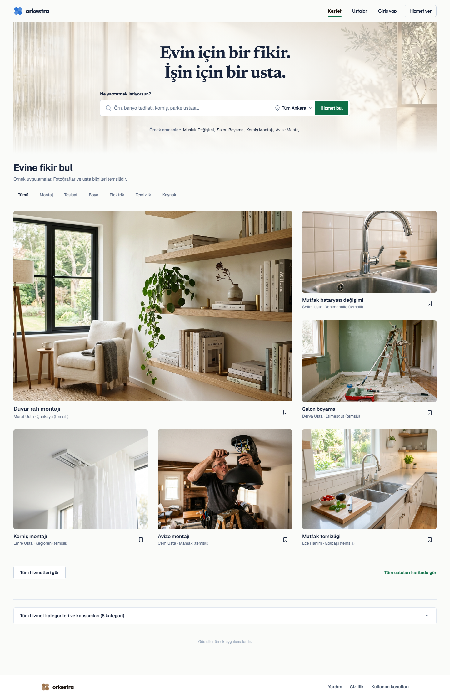
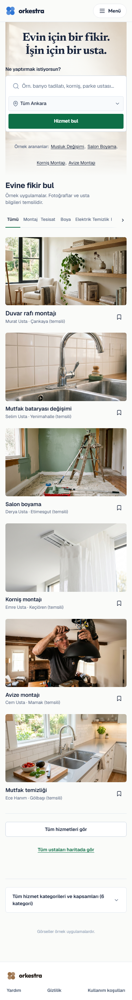

# Keşif kontrolleri — Gemini uygulama ve Codex inceleme kaydı

29 Ekim 2026. Uygulayıcı: Gemini 3.8 Flash High. Tasarım yönü, kapsam, kod farkı incelemesi ve tarayıcı doğrulaması: Codex.

Gemini oturumu: `3f0b6402-206a-40d4-be2b-df891a2d4cb1`.

| Önce | Sonra | Gerekçe |
|---|---|---|
| Beyaz kutulu kategoriler | Şeffaf zemin, seçilide yeşil alt çizgi ve kalın yazı | Fotoğrafları öne çıkaran sakin gezinme |
| Kaydedilenler için farklı kutu | Aynı kategori dili | Tutarlı seçili/seçili değil ayrımı |
| Üste hizalı künye ve kaydet | Dikey ortalanmış künye satırı | Daha dengeli fotoğraf altı düzen |

Korunanlar: geniş sayfa yerleşimi, hero, editöryal büyük/küçük fotoğraf düzeni, temsili açıklaması, 44px hedefler, kategori davranışı.

## Kanıt

- Stil giriş noktası denetimi geçti.
- 320 / 390 / 820 / 1440 / 1920 px: yatay taşma görülmedi.
- 390 px klavye Enter ile Tesisat seçimi: aria-pressed=true, 1 kart. Tümü seçimi: 6 kart.
- İlk incelemede global !important kuralının odak offsetini +2px yaptığı bulundu; Gemini'ye dar düzeltme geri bildirimi verildi.
- Eski `home-discovery.spec.ts` kaldırılmış ilçe bölümünü hâlâ bekliyor; bu dilimde değiştirilmedi veya tamamı geçti denmedi.

Son düzeltme doğrulandı: tarayıcıda outline-offset=-2px; styles:check tekrar başarılı. Odak kanıtı: [390px](focus-390.png).

## Landing kapanış dilimi: hizmet dizini ve footer

Bu bounded dilimde yeni bir özellik eklenmedi. Native `details/summary` davranışı korunarak alt hizmet alanı kutu içinde kutu hissinden çıkarıldı; hizmet bağlantıları, chevron durumu ve klavye odağı aynı kaldı. Landing footer'ı da hero ve keşif yüzeyindeki parchment/ink/forest diline yaklaştırıldı. Logo markası landing'e özel olarak yeşile alındı; diğer route footer'ları kapsam dışı bırakıldı.

### Önce / sonra / neden

| Önce | Sonra | Neden |
|---|---|---|
| Kavisli beyaz accordion kutusu | Tek üst-alt hairline, şeffaf yüzey, 48px summary | Sayfa akışını bölmeden erişilebilir disclosure affordance'ı korumak |
| Hizmet grid'inde ayrı renkli panel | Aynı landing paper yüzeyinde içerik | Görsel yoğunluğu ve bilişsel yükü azaltmak |
| Ayrı beyaz footer ve bronz logo | Parchment footer, ink metin, forest mark | Landing'in kapanışını ana marka diliyle aynı register'a almak |

### Kanıt

- `npm run styles:check` başarılı.
- 390 ve 1440 px'de `documentElement.scrollWidth === clientWidth`; yatay taşma yok.
- Her iki genişlikte `details` başlangıçta kapalı, programatik açıldığında `open=true` ve 26 hizmet butonu erişilebilir.
- Landing footer arka planı `rgb(247, 247, 242)`, summary minimum yüksekliği `48px`.
- Görsel kanıt: [390px kapanış](closure-390.png), [390px açık dizin](closure-390-open.png), [1440px kapanış](closure-1440.png), [1440px açık dizin](closure-1440-open.png).

Bu aşamada bilinçli olarak yeni güven bandı, sticky CTA, badge veya içerik bölümü eklenmedi. Sonraki estetik inceleme, placeholder görseller ve izin banner'ı kapalı durumdaki gerçek ilk ziyaret kompozisyonu üzerinden yapılmalı.

## İlk ziyaret gözlemi

Görsel QA sırasında üç keşif fotoğrafının gri görünmesi gerçek bir 404 değil, tam sayfa ekran görüntüsünün lazy image'ları viewport'a getirmeden alınmasıydı. Scroll sonrası altı keşif görselinin de `naturalWidth=1200` ile yüklendiği doğrulandı. İzin banner'ı da 390 ve 1440 px'de arama alanıyla çakışmıyor:

- 390 px: banner 817-888, arama 223-389, çakışma 0 px.
- 1440 px: banner 802-880, arama 319-371, çakışma 0 px.

Bu nedenle bu gözlemde kod değişikliği yapılmadı. Sonraki görsel karar, izin banner'ının ilk ziyaret kompozisyonundaki algılanan ağırlığı hakkında yapılmalı; davranışsal ve erişilebilirlik sözleşmesi şu an korunuyor.

## Görsel yüklenme geçişi

`ProgressiveImage` tarafından üretilen `progressive-image-loading` sınıfının landing CSS karşılığı yoktu. Bu nedenle gerçek görsel yüklenirken kart yüzeyi yalnızca sabit gri blok gibi algılanabiliyordu. [home.module.css](../../app/home.module.css) içinde yalnızca kart görsellerine scoped bir opacity geçişi eklendi: yüklenirken `0.72`, yüklendiğinde `1`; hover transform geçişi de aynı kısa easing ailesine alındı. Shimmer, gradient veya parıltı eklenmedi. Sayfanın mevcut reduced-motion kuralı bu geçişi sıfırlıyor.

- `npm run styles:check` başarılı.
- 390 px gerçek tarayıcı kontrolünde kart görsellerinin transition değeri `opacity 0.18s ... , transform 0.22s ...` olarak doğrulandı.
- Gemini High bu küçük headless görevi 90 saniyede tamamlayamadı ve dosya değiştirmedi; fallback diff Codex tarafından uygulandı ve doğrulandı.

## Son kabul matrisi: izin kapalı, görseller yüklenmiş

İlk ziyaret artefaktını ayırmak için `ankara_analytics_consent=rejected` ile 320, 390, 820 ve 1440 px ekranlar yeniden yakalandı. Dört genişlikte de yatay taşma yok, izin banner'ı görünmüyor, altı keşif kartı mevcut ve altı görselin tamamı `naturalWidth=1200` ile yüklenmiş durumda.

| Genişlik | Belge genişliği | Kart | Görsel | İzin banner'ı |
|---:|---:|---:|---:|---:|
| 320 | 320 | 6 | 6/6 | kapalı |
| 390 | 390 | 6 | 6/6 | kapalı |
| 820 | 820 | 6 | 6/6 | kapalı |
| 1440 | 1440 | 6 | 6/6 | kapalı |

Kanıt: [320](accepted-320.png), [390](accepted-390.png), [820](accepted-820.png), [1440](accepted-1440.png), [JSON matrisi](accepted-layout-check.json).
