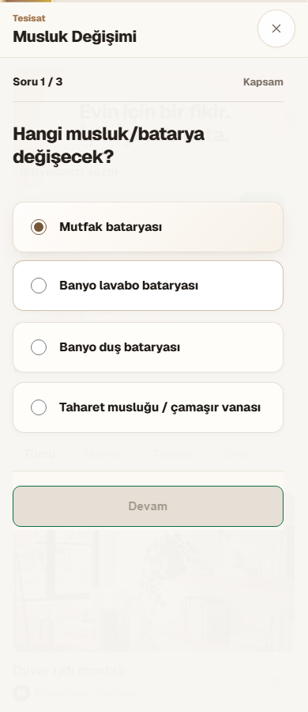
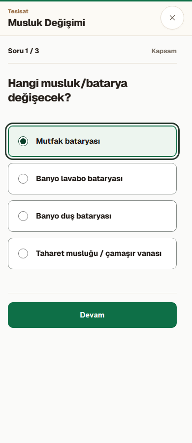
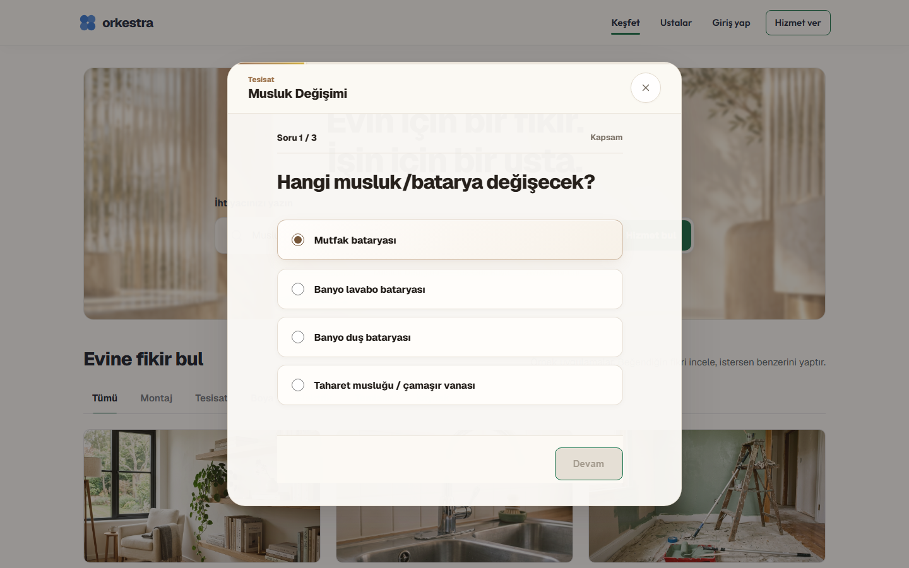
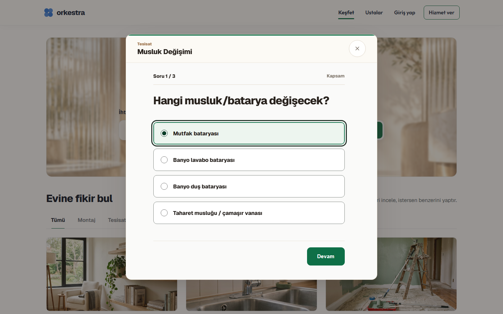
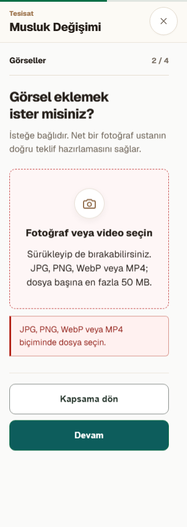
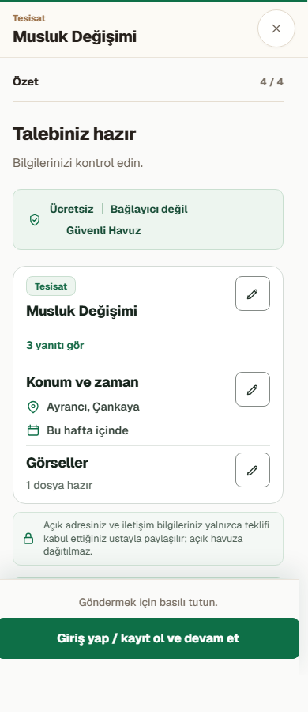
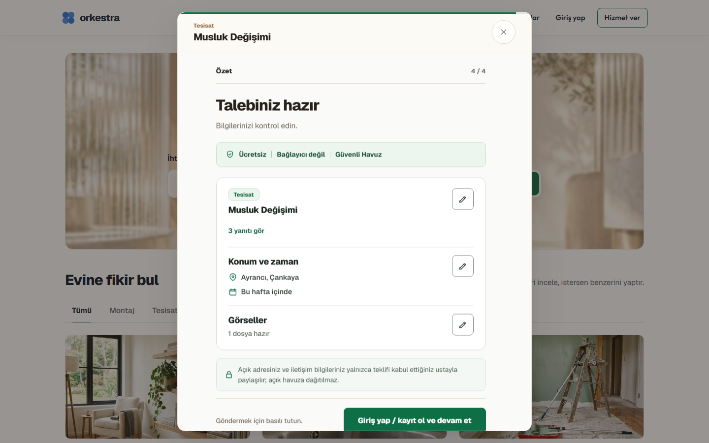

# Wizard kontrol iyileştirmesi

24 Ekim 2026. Kapsam: seçenekler, buton hiyerarşisi, odak ve yerel dosya doğrulama hataları. Yeni özellik, uzaktaki veri değişikliği, commit veya deploy yok.

## Tasarım kararı

Orkestra'nın mevcut yeşil eylem rengini koruyan, opak ve sakin bir form yüzeyi. Design-taste rehberinin seçim/odak ayrımı ve denetim yaklaşımı kullanıldı. Görsel çeşitlilik düşük; hareket yalnız durum geçişini açıklıyor. Native radio, select ve file input korundu.

| Önce | Sonra | Neden |
| --- | --- | --- |
| Mobil yüzeyden landing metni görünüyordu | Opak açık form yüzeyi | Okuma ve görev odağı |
| Kahverengi gradyanlı, hover ile yükselen seçenekler | Beyaz seçenekler, yeşil seçili durum, sabit konum | Landing eylem diliyle tutarlılık |
| Küçük radyoda odak | Seçenek kartının tamamında koyu dış çerçeve | Seçim ile klavye odağını ayırmak |
| Gölgeli ve hareketli geri/ileri butonları | Dolu yeşil birincil, nötr çerçeveli ikincil | Sonraki eylemi belirginleştirmek |
| Altın ışık tarayan ilerleme çizgisi | Sakin yeşil tamamlanma çizgisi | Yükleniyor animasyonu ile ilerlemeyi karıştırmamak |
| Konum grubunda eşleşmeyen CSS sınıfı | Gerçek kullanılan locationModeToggle sınıfı | Grup yüzeyinin uygulanmasını sağlamak |
| Dosya hatası yalnız görsel metindi | Alanla bağlı açıklama, aria-invalid ve role=alert | Hata ve düzeltme bilgisini erişilebilir kılmak |

## Ekranlar

Önce ekranları eski production build'den alındı. Sonra ekranları seçili ve klavye odaklı durumdadır. Bunlar piksel eşitliği veya dönüşüm oranı ölçümü değildir; önce karelerinde kontrol geçişleri tamamlanmamış olabilir.

### Mobil

### Masaüstü

### Dosya hatası

### Özet ve giriş geçişi

## Doğrulama

- styles:check başarılı.
- type-check başarılı.
- RequestWizard, ilgili bileşen ve E2E test dosyalarına hedefli ESLint başarılı.
- RequestWizard + DirectedRequestWizard: 18/18 bileşen testi başarılı. İlk sandbox denemesi temp dosya rename EPERM nedeniyle çalışmadı; normal yerel ortamda yeniden çalıştırıldı.
- Production build başarılı.
- Wizard production E2E: 24/24 başarılı. 320, 390, 820, 1440 px; seçim, sonraki adım, dosya hatası ve düzeltme, konum, özet, düzenleme, Escape, odak geri dönüşü ve focus trap.
- Son görsel incelemede ikinci radyo focus çerçevesi kaldırıldı. Son build sonrasında Chromium dört genişlik + klavye + harita opt-in: 6/6 tekrar başarılı.
- Gerçek istek gönderimi veya medya upload yapılmadı; dosya testi istemci doğrulamasını kontrol eder. Tüm repo kalite kapısının geçtiği iddia edilmiyor.

## Gemini katkısının sınırı

gemini-3.8-flash-high ile metin tabanlı tasarım karşı değerlendirmesi alındı. Gemini bu turda ekranları veya repo kaynaklarını bağımsız incelemedi; kod ve testleri çalıştırmadı. Nötr yüzey, yeşil seçim, belirgin odak ve hata bağlantısı önerileri değerlendirildi. Native radyoyu gizleme önerisi kabul edilmedi. Uygulama ve gerçek tarayıcı denetimi Codex tarafından yapıldı.

## Sonraki dilim

Özet kartları, düzenleme kontrolleri ve girişe geçiş yüzeyindeki sıcak vurgu dili de aynı kontrol sistemiyle hizalandı. Güven bandı, gizlilik notu ve hesap mesajı yeşil güven yüzeyine; düzenleme düğmeleri nötr çerçeveye; giriş bağlantısı tek birincil yeşil aksiyona çekildi. Hover token çakışması nedeniyle maviye dönen auth bağlantısı wizard kapsamı içinde forest-hover ile sabitlendi. Mobilde review kartı ve gizlilik notu, sticky alt aksiyonun altında kalmaması için kontrollü biçimde sıkıştırıldı; 44 px düzenleme hedefleri korunuyor.

Bu devam diliminin doğrulaması:

- Özet yüzeyi E2E assertions: güven bandı `#edf5ef`, özet kartı opak beyaz, auth bağlantısı `#0e6f47`, düzenleme düğmesi 44 px ve 8 px radius.
- Chromium tekrar kontrolü: 6/6 başarılı.
- Dört Playwright projesi: 24/24 başarılı (son mobil yoğunluk düzeltmesi sonrası tekrarlandı).
- RequestWizard bileşen testi: 12/12 başarılı.
- Production build, styles check ve type-check başarılı.

Bu dilimde talep gönderme, hesap, backend veya yönlendirme sözleşmeleri değiştirilmedi. Commit veya push yapılmadı.
