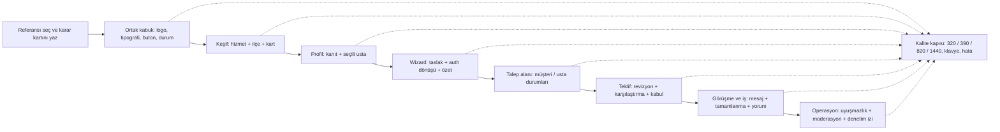

# Orkestra tasarım uygulama rotası

Bu rota, görsel referans arşivini ürün ekranlarına bağlar. Sıra ekran sayısına göre değil, karar bağımlılıklarına göre belirlenmiştir. Bir dilim tamamlanmadan sonraki dilimin kopya stilleri eklenmez.

## Yolun kuralları

1. **D0**, her yeni ekranda referans görseli, Orkestra route’u, alınan karar ve alınmayan davranışı kaydeder. [Route matrisi](./ROUTE-MATRIX.md) bu sözlüğün kaynağıdır.
2. **D1**, bütün yüzeylerin ortak görsel dilini sabitler: beş daireli logo, kobalt ana eylem, açık yüzey, tek radius ailesi, 44 px dokunma alanı ve görünür odak.
3. **D2–D3**, kullanıcıyı keşiften seçili ustaya taşır. Karttaki kanıt kısa, profil detaylıdır. Harita yardımcıdır ve listeyle aynı veri sözleşmesini kullanır.
4. **D4**, mevcut wizard’ı ikinci bir wizard oluşturmadan düzeltir. Tek progress, hesap girişinden sonra aynı taslak, hedef usta ve adım korunur.
5. **D5–D7**, mevcut M0–M4 sözleşmelerini UI’da görünür kılar. Görsel değişiklik yetki, sahiplik, teklif sürümü veya görünürlük kuralını değiştiremez.
6. **D8**, operasyon ekranlarını kamuya açık rakip görsellerinden türetmez. Rol ve audit sözleşmesi SRS/SDD’den gelir.

## İlk çalışma dilimi: D1 ortak kabuk

Bu turda uygulanacak yüzeyler:

| Yüzey | Route / bileşen | Karar |
|---|---|---|
| Marka | `AppHeader`, `OrchestraLogo`, `OrkestraWordmark` | Logo tek marka işareti; wordmark erişilebilir adla birlikte kalır |
| Masaüstü navigasyon | `AppHeader` | Birincil görev yalnız `Yeni talep`; diğer bağlantılar ikincil ağırlıkta |
| Hesap | `AppHeader` hesap trigger/drawer | Kimlik ve çalışma alanı ayrı; çıkış ikincil görünür |
| Mobil menü | `AppHeader` drawer | Aynı canonical linkler; drawer ekranı kapatmadan yatay taşma yapmaz |
| Etkileşim | `appHeader.module.css` | Hover, focus-visible, active, disabled ve reduced-motion aynı dilde |
| Ortak buton | `tr-button`, `Button.module.css` | Kobalt intent, açık geçiş özellikleri ve reduced-motion; eski yeşil hover kaldırıldı |
| Ortak yüzey | `SurfaceCard` | Keşif, profil ve çalışma alanları için tek radius/elevation/focus anatomisi |

### Kabul ölçütleri

- Header masaüstünde 72 px ritmi korur; mobilde 64 px altına düşmez.
- Her kontrol en az 44 px olur.
- Hover yalnız renk/border/shadow değiştirir; layout kayması ve `transition: all` yoktur.
- `prefers-reduced-motion: reduce` durumunda geçişler anlık olur.
- Aktif route `aria-current="page"` ile görünür; görünür odak kobalt halkadır.
- Uzun kullanıcı adı drawer’ı yatay taşırmaz.
- D1 değişikliği auth, RLS, route manifesti veya çalışma alanı yetkisini değiştirmez.
- `SurfaceCard` ilk etapta yeni ortak primitive olarak eklendi; mevcut kartlar D2’de tek tek bu anatomiye taşınacaktır.

## Sonraki doğrulama sırası

1. D1 header ve account paneli masaüstü + mobilde açılır.
2. Aynı URL’ler anonim, müşteri, usta ve operasyon bağlamında kontrol edilir.
3. 320/390/820/1440 görüntüleri, klavye sırası, Escape ile kapanış ve dialog odağı kontrol edilir.
4. D1 yeşil olduktan sonra D2 keşif kabuğuna geçilir.

## D1 ilk doğrulama kaydı — 2026-10-08

- `npm run styles:check`: geçti.
- `npm run lint`: geçti; yalnız referans arşivi oluşturma scriptinde 3 mevcut kullanılmayan değişken uyarısı var, hata yok.
- `npm run type-check`: geçti.
- `npm run build`: geçti; route çıktısı üretildi.
- `git diff --check`: geçti; görülen CRLF mesajları Git’in satır sonu uyarısıdır.
- Header bileşen testleri (`AccountManagement`, `ProductNavigation`): Windows geçici klasöründe Vitest’in dosya rename adımında `EPERM` ile başlatılamadı. Bu sonuç test başarısı sayılmaz; yeniden çalıştırma, sandbox dışı/CI ortamı kalite kapısında bekliyor.
- D1 token, buton ve kart primitive değişikliklerinden sonra lint, type-check ve production build yeniden geçti.

Bu kayıt D1’in kod değişikliğinin derlendiğini gösterir; gerçek tarayıcıdaki 320/390/820/1440 kanıtı henüz “yerel doğrulandı” durumuna geçirilmemiştir.

## Durum ve sonraki dilim

- **D1 — Ortak kabuk:** Implemented; yerel derleme doğrulandı; gerçek tarayıcı kanıtı bekliyor.
- **D2 — Keşif kartları:** İlk uygulama tamamlandı. `UstalarSplitView` kartları `SurfaceCard` anatomisine bağlandı; tek CTA, doğrulama ikonu, puan/yorum ve hizmet-ilçe bağlamı korunuyor. Gerçek tarayıcı kanıtı bekliyor.
- **D3 — Profil:** Implemented locally. `/ustalar/[id]` hero ve kanıt bölümleri `SurfaceCard` kullanıyor; hizmetler chip görünümüne alındı, doğrulama metni ikonlu kısa özete indirildi, kart CTA’ları klavye tab sırasına döndü ve wizard kapanışında service/district query’si korunuyor. Mobil sabit CTA ve gerçek tarayıcı kanıtı bekliyor.
- **D4 — Wizard ve seçili usta bağlamı:** Implemented; yerel component/unit doğrulaması ve dört viewport tarayıcı doğrulaması geçti. Wizard üst çubuğunda seçili usta bağlamı görünür; auth dönüş path’i `service`, `district`, `resume` ve hedef usta bilgisini koruyor. Gerçek staging auth dönüşü, staging ortam değişkenleri sağlanınca ayrı kalite kapısıdır.
- **D5 — Müşteri/usta talep alanları:** Implemented locally. Müşteri ve usta rolleri ayrı sonraki eylem sözlüğü kullanıyor; boş, yükleniyor, hata ve kısmi veri durumları mevcut. Staging çoklu hesap ve gerçek Realtime yenileme doğrulaması bekliyor.
- **D6 — Teklif ve anlaşma:** Implemented locally. Güncel sürüm filtreleme, değişiklik özeti, en fazla üçlü karşılaştırma, stale-base kabul koruması ve iş ekranı yönlendirmesi doğrulandı. Gerçek staging kabul yarışı bekliyor.
- **D7 — Görüşme ve iş:** Implemented locally. Mesaj retry/idempotency, geçmiş yakalama, okunmamış durumları, kabul sonrası iş bağlantısı ve iş yaşam döngüsü kontrolleri doğrulandı. Gerçek iki hesaplı browser koşusu staging kapısında bekliyor.
- **D8 — Operasyon ve uyuşmazlık:** Implemented locally. Admin/moderator erişim sınırları, kanıt ve karar ayrımı, moderasyon geri bildirimi ve denetim izi yüzeyleri doğrulandı. Gerçek admin–müşteri–usta browser koşusu staging kapısında bekliyor.

## D4 doğrulama kaydı — 2026-10-12

- `npm run test -- tests/component/DirectedRequestWizard.test.tsx tests/unit/requestRouting.test.ts tests/component/PublicProfessionalVisibility.test.tsx -- --reporter=verbose`: **18/18 test geçti** (3 test dosyası). Dönüş URL’sinde seçili usta, hizmet ve ilçe korunuyor; taslak hedef uyuşmazlığında fail-closed davranış korunuyor.
- `npm run test:e2e -- tests/e2e/quick-service-resume.spec.ts` (`PLAYWRIGHT_NO_COMPRESSION=1`, `PLAYWRIGHT_HOST=127.0.0.1`, `PLAYWRIGHT_WORKERS=1`): **48/48 geçti**. Üç hizmet, 320/390/820/1440 px ve chromium/mobile/tablet/wide projelerinde wizard açılışı ile taslak devamı doğrulandı.
- `tests/staging/directed-auth-return.spec.ts` bu koşuda çalıştırılmadı; mevcut terminal oturumunda `E2E_SUPABASE_URL`, `E2E_SUPABASE_KEY`, `E2E_CUSTOMER_EMAIL` ve `E2E_CUSTOMER_PASSWORD` bulunmuyor. Bu nedenle gerçek Supabase auth dönüşü “staging verified” olarak işaretlenmemelidir.
- Playwright koşusunda başarılı assertion kanıtı alındı; çalışma ortamındaki Vinext child-server kapanış uyarısı test sonucunu değiştirmedi.

## D5 başlangıç doğrulama kaydı — 2026-10-12

- Müşteri çalışma alanı component testleri: **6/6 geçti**. Boş liste, sorgu hatası, kısmi teklif/iş özeti hatası, taslak ve durum bazlı sonraki eylemler kapsandı.
- Usta çalışma alanı component testleri: **8/8 geçti**. Doğrudan davet/açık talep ayrımı, usta olmayan hesapta güvenli geri dönüş, teklif durumu, kapanmış/sona ermiş fırsat ve iş bağlantısı eksikliği kapsandı.
- Harita/çalışma alanı sayfa ve skeleton testleri: **9/9 geçti**. Yükleniyor, boş ve rol ayrımı yüzeyleri kapsandı.
- D5 yüzeylerinde hareket kalitesi için `transition: all` yerine etkileşime konu özellikler açıkça listelendi; klavye odağı ve reduced-motion sözleşmesi korunuyor.
- Gerçek çoklu hesap browser doğrulaması için staging değişkenleri bu oturumda yok; bu nedenle D5 henüz “staging verified” değildir.

## D6 doğrulama kaydı — 2026-10-12

- Teklif karşılaştırma ve kabul component testleri: **10/10 geçti**. En fazla üç teklif seçimi, yeni sürüm geldiğinde açık kabul diyaloğunun geçersizleşmesi, çift tıklama engeli, ağ hatasından sonra güvenli yeniden deneme ve iş ekranına yönlendirme kapsandı.
- Revizyon ve değişiklik özeti testleri: **6/6 geçti**. Alan doğrulaması, aynı isteğin yeniden gönderimi, eski ve yeni sürüm farklarının gösterimi ve ilk teklif oluşturma geriye dönük uyumluluğu kapsandı.
- Karşılaştırma bileşeni her profesyonel için yalnızca en güncel sürümü gösteriyor; eski sürümler detay ekranında salt okunur kalıyor. Kabul eylemi yalnız güncel `submitted` sürümde etkin.
- Gerçek müşteri–usta staging kabul yarışı ve browser iş geçişi bu oturumda staging değişkenleri olmadığı için çalıştırılmadı; D6 durumu “locally verified” seviyesindedir.

## D7 doğrulama kaydı — 2026-10-12

- Görüşme ve iş geçişi component testleri: **15/15 geçti**. Mesaj gönderim hatası sonrası aynı gövdeyle yeniden deneme, gönderim sırasında çift tıklama engeli, geçmişin sayfalı tamamlanması, bağlantı dönüşü, okunmamış mesaj ve kabul edilen iş bağlantısı kapsandı.
- İş güvenilirliği ve tamamlanma testleri: **33/33 geçti**. İş sayfası okuma, dispatch/rework, escrow, kapsam sözleşmesi ve kullanıcı–iş erişim sınırları doğrulandı.
- Gerçek iki oturumlu browser senaryosu (`golden-musluk-browser.spec.ts`) bu oturumda staging kimlik bilgileri olmadığı için çalıştırılmadı. D7 durumu “locally verified”; “multi-account verified” değildir.

## D8 doğrulama kaydı — 2026-10-14

- Operasyon component testleri: **24/24 geçti**. Moderasyon kuyruğu, usta başvuru incelemesi, uyuşmazlık durum geçişleri, kullanıcı uyuşmazlık görünümü, role özel açıklamalar ve denetim izi kayıtları kapsandı.
- Admin ve moderator erişim kontrolleri, özel notların katılımcılara sızmaması ve karar gerekçesi olmadan geçiş yapılamaması doğrulandı.
- Gerçek üç hesaplı admin uyuşmazlık browser senaryosu (`admin-dispute-browser.spec.ts`) `npm run test:remote:p1:dispute` ile izole `orkestra-e2e` ortamında çalıştırıldı ve **1/1 geçti**. Fixture müşteri ve onaylı usta hesaplarıyla işi oluşturdu; müşteri gerçek iş ekranından uyuşmazlık açtı; admin kuyruğundan dosyayı keşfetti ve `triage → investigation → resolution_proposed → notified` geçişlerini yaptı.
- Müşteri ve usta oturumlarında yalnız role özel karar açıklaması görüldü; diğer tarafa ait açıklama görünmedi. Son doğrulama sorgusu dosyanın `notified` durumunu, karar kaydını ve bağımsız iş yaşam döngüsünün değişmediğini doğruladı.
- Ön/son temizlik yalnız `P1 ADMIN DISPUTE` işaretli fixture kayıtlarını sildi. D8 durumu artık **Implemented + Locally verified + Multi-account verified** seviyesindedir; yayınlanmış değildir.
- Vinext üretim sunucusu tarayıcı kapanışında `ERR_STREAM_UNABLE_TO_PIPE` uyarısı üretmeye devam ediyor. Test assertion'ları, temizlik ve normal build başarılı; uyarı yayın öncesi altyapı borcu olarak açık tutuluyor.

### D8 kalite kapısı — 2026-10-14

- `npm run styles:check`: geçti.
- `npm run type-check`: geçti.
- Hedefli Vitest paketi: **5 dosya / 15 test geçti**. İlk sandbox koşusu Windows geçici klasöründeki `EPERM rename` nedeniyle başlatılamadı; aynı paket izole süreçte yeniden çalıştırılarak yeşil sonuç alındı.
- `npm run build`: geçti.
- `npm run lint`: hata yok; referans kütüphanesi oluşturma scriptlerinde mevcut 3 unused-variable uyarısı sürüyor.
- D8 değişiklikleri henüz commit edilmedi; çalışma ağacı başka ürün dilimlerinden gelen değişiklikler içerdiği için commit sınırı ayrıca hazırlanacak.

## Kaynak bağlantısı

- [Görsel arşiv](./index.html)
- [Route eşleştirme matrisi](./ROUTE-MATRIX.md)
- [Uygulama bazlı raporlar](./README.md)
- [Canonical route manifesti](../../../app/lib/routeManifest.ts)
