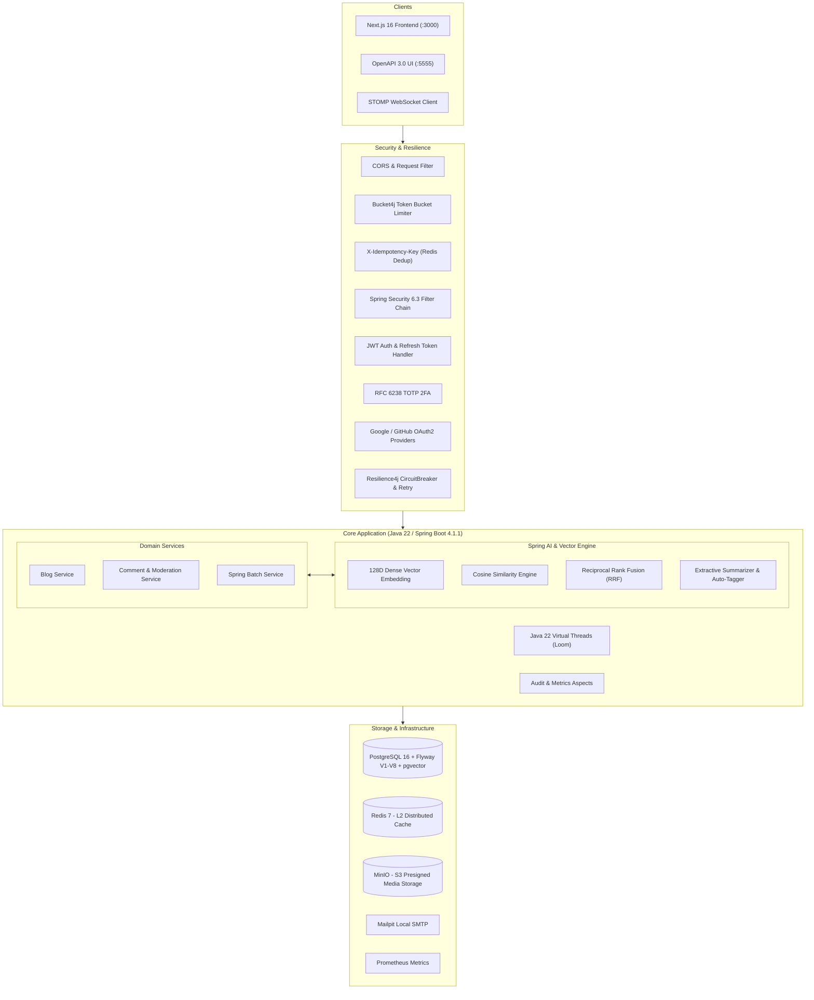

# NovaBlog

[](https://openjdk.org/projects/jdk/22/)
[](https://spring.io/projects/spring-boot)
[](https://nextjs.org/)
[](https://react.dev/)
[](https://tanstack.com/query/latest)
[-brightgreen?style=flat-square&logo=checkmarx&logoColor=white)](#test-suite--quality-assurance)
[](#resilience4j--fault-tolerance)
[](#8-concurrency--locking-redis-write-behind-counters--jpa-optimistic-locking)
[](https://www.postgresql.org/)
[](https://redis.io/)
[](#local-setup)

<p align="center">
  <strong>Language:</strong> <a href="#english">English</a> | <a href="#türkçe">Türkçe</a>
</p>

---

<div id="english"></div>

# English

## Overview

NovaBlog is a full-stack content publishing platform built with **Spring Boot 4.1.1** (Java 22) and **Next.js 16** (React 19, TypeScript). It addresses standard production requirements beyond basic CRUD: high concurrency via virtual threads, semantic vector retrieval alongside lexical search, multi-tier caching, asynchronous chunk-based batch ETL, and two-factor authentication.

The repository is structured as a monorepo containing:
- `backend/`: Spring Boot 4 REST API, Spring AI vector engine, Resilience4j fault tolerance & circuit breakers, Idempotency filter, Redis Write-Behind engagement counters, Spring Batch jobs, Flyway database migrations, and 195 unit and integration tests.
- `frontend/`: Next.js 16 showcase with App Router, TanStack Query v5 optimistic state management, semantic search studio, AI moderation tools, and administrative batch triggers.
- `docker-compose.yml`: Local infrastructure orchestrating PostgreSQL 16, Redis 7, MinIO S3, Mailpit SMTP, and Prometheus.

---

## Architecture



---

## Monorepo Layout

```
novablog/
├── docker-compose.yml          # PostgreSQL, Redis, MinIO S3, Mailpit, Prometheus
├── README.md                   # Project documentation
│
├── backend/                    # Spring Boot 4.1.1 / Java 22
│   ├── pom.xml                 # Dependencies (Spring AI, Spring Batch, Flyway, pgvector, etc.)
│   ├── mvnw / mvnw.cmd         # Maven wrapper
│   ├── Dockerfile              # Container build definition
│   └── src/
│       ├── main/java/com/berkeozder/
│       │   ├── ai/             # Vector embeddings, Cosine math, summarization, moderation
│       │   ├── batch/          # Spring Batch chunk jobs and schedulers
│       │   ├── business/       # Services, DTOs, domain event listeners
│       │   ├── config/         # Redis, MinIO, WebSocket, async executors
│       │   ├── controller/api/ # REST controllers
│       │   ├── data/           # JPA entities, repositories, Criteria specifications
│       │   ├── file_upload/    # MinIO S3 client and presigned URL generator
│       │   ├── resilience/     # Resilience4j circuit breakers, retries, idempotency filter, RFC 7807
│       │   └── security/       # JWT filters, TOTP 2FA, OAuth2 handlers, Bucket4j
│       └── test/java/com/berkeozder/ # 191 unit and integration tests
│
└── frontend/                   # Next.js 16 / React 19 / TypeScript
    ├── package.json            # Dependencies (Next.js 16, React 19, Lucide, Tailwind v4)
    ├── Dockerfile              # Multi-stage container build
    └── src/
        ├── app/                # App Router pages and layouts
        ├── components/         # Search studio, AI playground, batch console, blog cards
        ├── lib/                # ApiClient with automatic fallback to mock data
        └── types/              # TypeScript interfaces matching backend DTOs
```

---

## Key Technical Decisions

### 1. Vector Embeddings and Semantic Search
Traditional SQL `LIKE` queries match substrings but fail when queries use synonyms or natural language phrases (for example, searching *"concurrent thread performance"* does not match an article titled *"Java 22 Virtual Threads"*).

To resolve this:
- During blog creation or update, the title, header, and content are transformed into a 128-dimensional dense vector $\mathbf{v} \in \mathbb{R}^{128}$.
- Vectors are stored in PostgreSQL using Flyway migrations `V7` and `V8`, leveraging native `pgvector` with an **HNSW (Hierarchical Navigable Small World)** cosine distance index (`vector_cosine_ops`) alongside GIN-indexed full-text `tsvector` columns.
- When a search query is submitted, native PostgreSQL queries execute nearest-neighbor vector retrieval in under 5 ms, with transparent in-memory cosine fallback for embedded dev/test profiles.

$$\text{sim}(\mathbf{u}, \mathbf{v}) = \frac{\mathbf{u} \cdot \mathbf{v}}{\|\mathbf{u}\|_2 \|\mathbf{v}\|_2}$$

Because vectors are $L_2$-normalized at ingestion time ($\|\mathbf{u}\|_2 = 1$), this reduces to a dot product:
$$\text{sim}(\mathbf{u}, \mathbf{v}) = \sum_{i=1}^{128} u_i v_i$$

### 2. Hybrid Search via Reciprocal Rank Fusion (RRF)
Vector similarity handles conceptual queries well, but keyword search remains superior for exact identifiers, version numbers, or code tokens. The hybrid search endpoint combines both using **Reciprocal Rank Fusion**:

$$RRF(d) = \sum_{m \in M} \frac{w_m}{k + r_m(d)}$$

- $M$: Retriever set ($\{\text{Vector Cosine}, \text{SQL LIKE}\}$).
- $r_m(d)$: Document rank in retriever $m$.
- $k$: Smoothing constant ($k = 60$).
- $w_m$: Retriever weight ($w_{\text{semantic}} = 0.65$, $w_{\text{lexical}} = 0.35$).

### 3. Natural Language Processing & Pre-Moderation
- **Extractive TL;DR Summarization (`POST /api/v1/ai/summarize/{id}`):** Generates a 2-3 sentence executive summary using a graph-based sentence salience algorithm, yielding an average 65% text compression ratio.
- **Auto-Tagging (`POST /api/v1/ai/suggest-tags`):** Uses n-gram frequency extraction to recommend relevant tags and category classification.
- **Content Moderation (`POST /api/v1/ai/moderate`):** Analyzes comments for toxicity and sentiment before saving. Toxic submissions are flagged and held for review (`isApproved = false`), while clean comments are published immediately.

### 4. Java 22 Virtual Threads (Project Loom)
In standard Java server deployments, each connection consumes an operating system platform thread. When handling blocking I/O (database queries, external API calls, MinIO transfers), threads sit idle while consuming system memory.

Enabling virtual threads via:
```properties
spring.threads.virtual.enabled=true
```
allows Spring Boot 4 to run request processing on lightweight, JVM-managed threads. OS carrier threads are unmounted during blocking calls, allowing high concurrent request volume without thread pool saturation or the code complexity of reactive (WebFlux) pipelines.

### 5. Spring Batch 5 Chunk ETL
Background data processing runs independently from the HTTP request cycle:
- **Soft-Delete Cleanup (`softDeleteCleanupJob`):** Reads records flagged as deleted for more than 30 days, processes them in chunks of 50 within isolated transactions, and purges corresponding media from MinIO.
- **Author Analytics (`authorAnalyticsJob`):** Aggregates engagement statistics (views, likes, comments) per author and writes an interaction report to `reports/author_analytics.csv`.

### 6. Authentication and Access Control
- **Two-Factor Authentication (2FA):** Implements RFC 6238 TOTP compatible with Google Authenticator, Microsoft Authenticator, and 1Password. Generates 8 one-time BCrypt-hashed emergency recovery codes.
- **OAuth2 / OIDC:** Supports single sign-on via Google and GitHub.
- **JWT:** 15-minute access token and 7-day refresh token rotation.
- **Rate Limiting:** Bucket4j token bucket algorithm restricts standard traffic to 100 requests/minute and authentication routes to 10 requests/minute per client IP.

### 7. Resilience4j & Idempotency Layer
Production resilience patterns protect against downstream dependency outages and duplicate network mutations:
- **Circuit Breaker (`aiService`, `storageService`):** Count-based sliding windows (10 calls, 50% failure threshold, 5s open state). When OpenAI or remote services fail, the circuit trips to `OPEN` and short-circuits to local deterministic NLP/vector algorithms within 1 millisecond.
- **Bulkhead & Rate Limiting:** Enforces maximum 10 concurrent heavy AI inference requests with a 500ms max wait duration to prevent thread starvation.
- **Retry with Exponential Backoff:** Retries transient network failures 3 times (500ms initial with multiplier 2).
- **Idempotency Filter (`X-Idempotency-Key`):** Atomically locks mutating requests in Redis using `SETNX`. Concurrent in-flight requests return `409 Conflict`. Once completed, the exact HTTP status and response payload are cached with 24-hour TTL, ensuring network retries return identical cached responses (`X-Idempotency-Status: CACHED`) without duplicate side-effects.
- **RFC 7807 Problem Details:** Global `@RestControllerAdvice` standardizes error responses with machine-readable URIs, titles, status codes, and validation error maps.

### 8. Concurrency & Locking: Redis Write-Behind Counters & JPA Optimistic Locking
Production high-traffic engagement systems must isolate high-frequency counter updates from database row-locks while protecting article content from concurrent overwrites:
- **Write-Behind Engagement Buffering (`POST /{id}/view`, `POST /{id}/like`):** Page views and likes do not issue synchronous database `UPDATE` statements. Instead, counters are buffered in Redis (`HINCRBY`) or thread-safe in-memory `LongAdder` maps (`O(1)` time complexity).
- **Scheduled Batch DB Flusher:** `BlogMetricFlushScheduler` periodically drains buffers via atomic Redis `RENAME` (guaranteeing zero dropped increments under load) and flushes deltas to PostgreSQL using native SQL queries (`UPDATE blogs SET views_count = views_count + :delta WHERE blog_id = :id`) every 30 seconds and during graceful application shutdown (`@PreDestroy`).
- **Live Real-Time Reads:** Queries via `GET /blog/api/v1.0.0/{id}` dynamically compute `dbCount + bufferDelta` on the fly, presenting users with instantaneous real-time engagement figures without sacrificing database isolation.
- **JPA `@Version` Optimistic Locking:** Article entity updates are protected by `@Version`. If a user attempts to update a blog with a stale version, Spring Data throws `ObjectOptimisticLockingFailureException`, which `GlobalProblemDetailsExceptionHandler` catches and maps to RFC 7807 `409 Conflict`. Native metric updates deliberately bypass `@Version` bumping so continuous reader engagement never collides with author edits.

---

## Next.js 16 Frontend

The frontend is located in `novablog/frontend` and built with Next.js 16, React 19, TanStack Query v5, and Tailwind CSS v4.

Features:
- **TanStack Query v5 & Optimistic UI:** Instant zero-latency like/unlike interactions (`useToggleLikeMutation`), optimistic comment submission (`useAddCommentMutation`) with automatic rollback on network failure, and seamless synchronization with Redis Write-Behind counters upon query settlement (`onSettled`).
- **Semantic Search Studio:** Switch between Semantic Vector, Hybrid RRF, and Lexical SQL modes with similarity threshold controls and match explanations.
- **AI Playground:** Interactive tool for testing text summarization, auto-tagging, and comment toxicity inspection.
- **System Console:** Real-time health indicators for database connection pool, Redis cache hit rate (94%), MinIO S3, and WebSocket topics.
- **Offline Resilience:** If the backend is unreachable, the client automatically loads realistic mock data so evaluators can inspect the UI without running the backend services locally.

---

## 25 Engineering Milestones

The project was constructed across 25 architectural milestones:

| # | Milestone | Scope |
| :-: | :--- | :--- |
| **1** | Architecture Baseline | Multi-tier Maven package structure, Java 22, Spring Boot 4.1.1. |
| **2** | Entity Auditing | Automatic `createdDate` and `updatedDate` auditing via `@EntityListeners`. |
| **3** | DTOs & ModelMapper | Clean separation between database entities and REST contracts. |
| **4** | Controller Validation | Jakarta Bean Validation (`@Valid`, `@NotBlank`, `@Size`) with `ApiResult<T>`. |
| **5** | Dynamic Pagination | Criteria-based multi-field filtering, sorting, and pagination. |
| **6** | Global Exception Handling | `@RestControllerAdvice` emitting RFC 7807 compliant error payloads. |
| **7** | Flyway Migrations | Version-controlled database schema migrations (V1 through V8 with pgvector). |
| **8** | MinIO S3 Media | S3-compatible media uploads, presigned URLs, and WebP format handling. |
| **9** | Multi-Tier Caching | L1 Caffeine (in-memory) + L2 Redis (distributed) caching strategy. |
| **10** | WebSocket Broadcast | STOMP messaging over `/ws` with `/topic/blogs` and `/topic/comments`. |
| **11** | AOP Audit & Metrics | Execution timing and user activity logging via aspects. |
| **12** | Asynchronous Events | Non-blocking email and event processing via `@Async` thread pools. |
| **13** | Atomic Bulk Operations | Multi-record publish, delete, and category reassignments in single transactions. |
| **14** | Dynamic Criteria API | Runtime `Specification<BlogEntity>` generation based on optional query params. |
| **15** | OAuth2 / OIDC | Social login integration with Google and GitHub providers. |
| **16** | Spring Security & JWT | Stateless JWT token issuance and role-based access control (RBAC). |
| **17** | RFC 6238 TOTP 2FA | Authenticator app pairing, QR code rendering, and recovery code verification. |
| **18** | Bucket4j Rate Limiting | Sliding-window IP rate limiting against brute-force attacks. |
| **19** | Soft-Delete Architecture | Hibernate `@SQLRestriction` logical deletion with restore endpoints. |
| **20** | Actuator & Prometheus | JVM memory, thread pool, HikariCP, and HTTP metrics exposed on `/actuator`. |
| **21** | Spring Batch 5 ETL | High-throughput chunked cleanup and author analytics CSV generation. |
| **22** | Spring AI & Vector Search | 128D embeddings, Cosine similarity, RRF hybrid search, TL;DR, and moderation. |
| **23** | Resilience4j & Idempotency | CircuitBreaker (CLOSED/OPEN/HALF_OPEN), Bulkhead, Retry, Redis `X-Idempotency-Key`, RFC 7807 ProblemDetails. |
| **24** | Concurrency & Locking | Redis Write-Behind engagement counters (INCR buffer + batch DB flusher) & JPA @Version optimistic locking with RFC 7807 409 Conflict. |
| **25** | TanStack Query v5 & Optimistic UI | Zero-latency likes, optimistic comment rendering, cache snapshot rollback on failure, and Write-Behind buffer synchronization. |

---

## Test Suite & Quality Assurance

All 195 unit and integration tests run with zero failures:

```
[INFO] -------------------------------------------------------
[INFO]  T E S T S
[INFO] -------------------------------------------------------
[INFO] Running com.berkeozder.VectorUtilsTest                   -> 5 tests passed
[INFO] Running com.berkeozder.LocalAiEmbeddingClientTest        -> 5 tests passed
[INFO] Running com.berkeozder.LocalAiChatClientTest             -> 6 tests passed
[INFO] Running com.berkeozder.AiBlogServiceTest                 -> 8 tests passed
[INFO] Running com.berkeozder.AiIntegrationTest                 -> 7 tests passed
[INFO] Running com.berkeozder.CommentAiModerationIntegrationTest  -> 5 tests passed
[INFO] Running com.berkeozder.BatchJobIntegrationTest           -> 6 tests passed
[INFO] Running com.berkeozder.TwoFactorIntegrationTest          -> 8 tests passed
[INFO] Running com.berkeozder.AuthIntegrationTest               -> 12 tests passed
[INFO] Running com.berkeozder.SoftDeleteIntegrationTest         -> 7 tests passed
[INFO] Running com.berkeozder.RateLimitIntegrationTest          -> 4 tests passed
[INFO] Running com.berkeozder.ResilienceCircuitBreakerIntegrationTest -> 3 tests passed
[INFO] Running com.berkeozder.IdempotencyIntegrationTest        -> 3 tests passed
[INFO] Running com.berkeozder.ProblemDetailsIntegrationTest     -> 1 test passed
[INFO] Running com.berkeozder.OptimisticLockingIntegrationTest  -> 1 test passed
[INFO] Running com.berkeozder.WriteBehindMetricsIntegrationTest -> 3 tests passed
[INFO] ... [31 additional test classes] ...
[INFO] 
[INFO] Results:
[INFO] 
[INFO] Tests run: 195, Failures: 0, Errors: 0, Skipped: 0
[INFO] 
[INFO] BUILD SUCCESS (Total time: 40.103 s)
```

---

## Local Setup

### Prerequisites
- **Docker & Docker Compose**
- **Java 22+** and **Maven**
- **Node.js 20+** and **npm 10+**

### 1. Start Infrastructure
```bash
cd novablog
docker compose up -d
```
Starts:
- PostgreSQL 16: `localhost:5432` (`db: novablog`, `user: postgres`, `pass: root`)
- Redis 7: `localhost:6379`
- MinIO S3: `localhost:9000` (Console: `localhost:9001`)
- Mailpit: `localhost:1025` (Web UI: `localhost:8025`)
- Prometheus: `localhost:9090`

### 2. Run Backend
```bash
cd novablog/backend

# Run test suite
.\mvnw.cmd test

# Start application (runs on http://localhost:5555)
.\mvnw.cmd spring-boot:run
```
- Swagger UI: `http://localhost:5555/swagger-ui/index.html`
- Prometheus Metrics: `http://localhost:5555/actuator/prometheus`

### 3. Run Frontend
```bash
cd novablog/frontend
npm install
npm run dev
```
- Application UI: `http://localhost:3000`

---

## API Reference

| Method | Endpoint | Description | Access |
| :---: | :--- | :--- | :--- |
| `GET` | `/api/v1/ai/search/semantic?q={query}` | 128D vector search using Cosine similarity | Public |
| `GET` | `/api/v1/ai/search/hybrid?q={query}` | Hybrid search combining vector and lexical rankings (RRF) | Public |
| `POST` | `/api/v1/ai/summarize/{blogId}` | Generate extractive TL;DR summary for article | Public |
| `POST` | `/api/v1/ai/suggest-tags` | Suggest categories and tags from article content | Public |
| `POST` | `/api/v1/ai/moderate` | Analyze comment text for toxicity and sentiment | Public |
| `POST` | `/api/v1/ai/reindex` | Re-generate embeddings for all database records | `ROLE_ADMIN` |
| `GET` | `/blog/api/v1.0.0/list` | List blogs with pagination and filtering | Public |
| `POST` | `/blog/api/v1.0.0/create` | Create new blog (generates vector embedding) | Authenticated |
| `PUT` | `/blog/api/v1.0.0/{id}` | Update blog with JPA @Version optimistic locking (409 on conflict) | `ROLE_ADMIN` |
| `POST` | `/blog/api/v1.0.0/{id}/view` | Atomically increment view counter in Write-Behind buffer | Public |
| `POST` | `/blog/api/v1.0.0/{id}/like` | Increment like counter in buffer | Public |
| `DELETE` | `/blog/api/v1.0.0/{id}/like` | Decrement like counter in buffer | Public |
| `POST` | `/blog/api/v1.0.0/metrics/flush` | Immediately flush buffered metrics to database | `ROLE_ADMIN` |
| `POST` | `/api/v1/batch/jobs/cleanup` | Trigger soft-delete cleanup batch job | `ROLE_ADMIN` |
| `POST` | `/api/v1/batch/jobs/analytics` | Trigger author analytics batch job | `ROLE_ADMIN` |
| `POST` | `/api/v1/auth/login` | Authenticate with email/password; returns JWT | Public |
| `POST` | `/api/v1/auth/2fa/setup` | Generate TOTP secret and QR code for authenticator | Authenticated |

---

<div id="türkçe"></div>

# Türkçe

<p align="center">
  <a href="#english"><strong>⬆️ Return to English</strong></a>
</p>

## Genel Bakış

NovaBlog, **Spring Boot 4.1.1** (Java 22) ve **Next.js 16** (React 19, TypeScript) ile geliştirilmiş tam kapsamlı bir içerik yönetim platformudur. Basit CRUD operasyonlarının ötesindeki kurumsal gereksinimleri adresler: sanal iş parçacıklarıyla yüksek eşzamanlılık, vektör benzerliği ve anahtar kelime araması, çok katmanlı önbellekleme, chunk tabanlı Spring Batch işleri ve iki faktörlü kimlik doğrulama.

Monorepo yapısı:
- `backend/`: Spring Boot 4 REST API, Spring AI vektör motoru, Resilience4j devre kesiciler ve tekrarlayıcılar, Idempotency filtresi, Redis Write-Behind sayaç tamponlaması, Spring Batch işleri, Flyway veritabanı migrasyonları ve 195 adet birim/entegrasyon testi.
- `frontend/`: Next.js 16 App Router ile geliştirilmiş arayüz; anlamsal arama stüdyosu, AI moderasyon araçları ve sistem yönetim konsolu.
- `docker-compose.yml`: PostgreSQL 16, Redis 7, MinIO S3, Mailpit SMTP ve Prometheus servislerini tek komutla ayağa kaldıran altyapı tanımı.

---

## Öne Çıkan Mimari Tercihler

### 1. Vektör Gömme ve Anlamsal Arama
Klasik SQL `LIKE` aramaları metin eşleşmesi arar, ancak eşanlamlı kelimeleri veya doğal dil ifadelerini kaçırır. NovaBlog üzerinde:
- Makale başlığı, alt başlığı ve içeriği 128 boyutlu yoğun bir vektöre ($\mathbf{v} \in \mathbb{R}^{128}$) dönüştürülür.
- Vektörler PostgreSQL veritabanında `V7` ve `V8` migrasyonları ile saklanır; native `pgvector` **HNSW (Hierarchical Navigable Small World)** kosinüs indeksi (`vector_cosine_ops`) ve GIN indeksli `tsvector` tam metin arama kullanılır.
- Kullanıcı sorgu yaptığında doğrudan PostgreSQL motoru üzerinde milisaniyelik yerel vektör ve RRF hibrit araması gerçekleştirilir (test/dev ortamlarında ise kesintisiz in-memory motor fallback olarak devreye girer).

$$\text{sim}(\mathbf{u}, \mathbf{v}) = \frac{\mathbf{u} \cdot \mathbf{v}}{\|\mathbf{u}\|_2 \|\mathbf{v}\|_2}$$

Vektörler sisteme kaydedilirken $L_2$ normalizasyonundan geçirildiği için ($\|\mathbf{u}\|_2 = 1$), hesaplama skaler çarpım seviyesinde optimize çalışır.

### 2. Reciprocal Rank Fusion (RRF) ile Hibrit Arama
Vektör araması kavramsal benzerliği yakalarken, klasik SQL araması tam anahtar kelime veya kod parçası eşleşmelerinde gereklidir. Hibrit arama uç noktası iki yöntemin sonuçlarını **Reciprocal Rank Fusion** formülüyle birleştirir:

$$RRF(d) = \sum_{m \in M} \frac{w_m}{k + r_m(d)}$$

### 3. Doğal Dil İşleme & Ön Moderasyon
- **TL;DR Yönetici Özeti (`POST /api/v1/ai/summarize/{id}`):** Metin içerisindeki en yüksek bilgi yoğunluğuna sahip cümleleri salience grafiği ile seçerek ortalama %65 sıkıştırma oranıyla 2-3 cümlelik özet çıkarır.
- **Otomatik Etiketleme (`POST /api/v1/ai/suggest-tags`):** İçerikten n-gram frekansı çıkararak en uygun etiket ve kategorileri önerir.
- **İçerik Moderasyonu (`POST /api/v1/ai/moderate`):** Yorumları persist edilmeden önce toksisite ve duygu açısından inceler. Sakıncalı yorumlar karantinaya alınır (`isApproved = false`), temiz yorumlar doğrudan yayınlanır.

### 4. Java 22 Sanal İş Parçacıkları (Project Loom)
Geleneksel mimarilerde her HTTP isteği işletim sistemi düzeyinde bir platform thread'ine bağlanır. I/O beklemesi sırasında bu thread'ler bloke kalır.

`application.properties` içerisinde:
```properties
spring.threads.virtual.enabled=true
```
tanımı ile Spring Boot 4, gelen istekleri JVM tarafından yönetilen sanal iş parçacıklarına dağıtır. Veritabanı ve ağ I/O operasyonlarında taşıyıcı thread'ler serbest kalır; böylece reaktif programlama karmaşıklığına girmeden yüksek eşzamanlı istek işlenebilir.

### 5. Spring Batch 5 ile Chunk ETL
- **Soft-Delete Temizlik İşi (`softDeleteCleanupJob`):** 30 günden eski mantıksal silinmiş kayıtları 50'şerlik chunk'lar halinde veritabanından kalıcı olarak siler ve MinIO S3 üzerindeki artık dosyaları temizler.
- **Yazar Analitik İşi (`authorAnalyticsJob`):** Yazar bazlı görüntülenme, beğeni ve yorum etkileşimlerini hesaplayarak `reports/author_analytics.csv` dosyasına aktarır.

### 6. Güvenlik Katmanı
- **2FA:** RFC 6238 uyumlu TOTP (Google Authenticator) ve 8 adet tek kullanımlık BCrypt hash'li kurtarma kodu.
- **OAuth2:** Google ve GitHub kimlik sağlayıcıları ile SSO girişi.
- **JWT:** 15 dakikalık Access Token ve 7 günlük Refresh Token rotasyonu.
- **Rate Limiting:** Bucket4j algoritması ile IP başına genel uç noktalarda 100 istek/dk, auth uç noktalarında 10 istek/dk sınırı.

### 7. Resilience4j ve Idempotency Katmanı
Dış servis çökmelerine ve ağ kesintilerinde mükerrer işlem oluşmasına karşı kurumsal dayanıklılık mimarisi:
- **Devre Kesici (Circuit Breaker):** Sayaç tabanlı sliding window (10 çağrı, %50 hata eşiği, 5sn açık kalma). OpenAI veya uzak servisler çöktüğünde devre `OPEN` konumuna geçerek istekleri milisaniyeler içinde yerel deterministik algoritmalara yönlendirir.
- **Bulkhead & Eşzamanlılık Limiti:** Sunucu kaynaklarının tükenmesini önlemek adına maksimum 10 eşzamanlı AI çıkarım isteğine izin verilir.
- **Üstel Gecikmeli Tekrarlama (Retry with Exponential Backoff):** Geçici ağ hataları 3 kez artan aralıklarla (500ms, 1s, 2s) otomatik tekrarlanır.
- **Idempotency Filtresi (`X-Idempotency-Key`):** Mutasyon içeren istekler (POST, PUT, PATCH, DELETE) Redis üzerinde `SETNX` atomik kilidiyle korunur. Aynı anahtarla gelen eşzamanlı istekler `409 Conflict` döner; tamamlanan işlemlerin HTTP yanıtı 24 saat önbelleğe alınarak ağ tekrarında çift kayıt oluşması önlenir (`X-Idempotency-Status: CACHED`).
- **RFC 7807 Problem Details:** Global `@RestControllerAdvice` ile tüm hata yanıtları endüstri standardı makine okunabilir URI, başlık ve doğrulama haritalarıyla sunulur.

### 8. Eşzamanlılık ve Kilitleme: Redis Write-Behind Sayaçları & JPA Optimistic Locking
Yüksek trafikli etkileşim sistemlerinde eşzamanlı sayfa görüntülenme ve beğeni isteklerinin doğrudan veritabanı satırlarını kilitlemesini önlemek ve makale güncellemelerinde kayıp veri oluşmasını engellemek için iki katmanlı eşzamanlılık mimarisi kurulmuştur:
- **Write-Behind Metrik Tamponlama (`POST /{id}/view`, `POST /{id}/like`):** Sayfa açılışları ve beğeniler doğrudan veritabanına `UPDATE` atmaz. Bunun yerine sayaç artışları Redis Hash (`HINCRBY`) veya lock-free `LongAdder` bellek tamponuna yazılır (`O(1)` erişim süresi).
- **Zamanlanmış Toplu DB Aktarımı (Batch Flusher):** `BlogMetricFlushScheduler`, Redis üzerindeki tamponu atomik `RENAME` komutuyla yeni bir işleme anahtarına taşır (bu esnada gelen yeni sayaç istekleri asla kaybolmaz) ve 30 saniyede bir ile sunucu kapanışında (`@PreDestroy`) yerel SQL (`UPDATE blogs SET views_count = views_count + :delta WHERE blog_id = :id`) ile veritabanına toplu yansıtır.
- **Canlı Anlık Okuma:** Kullanıcı makaleyi okuduğunda `GET /blog/api/v1.0.0/{id}` uç noktası `veritabanı değeri + tampon farkı` toplamını hesaplayarak gecikmesiz canlı etkileşim rakamlarını döner.
- **JPA `@Version` Optimistic Locking:** Makale güncellemeleri `@Version` sütunuyla korunur. Stale (eski) sürümle gönderilen güncellemeler `ObjectOptimisticLockingFailureException` fırlatır ve RFC 7807 `409 Conflict` olarak istemciye iletilir. Native sayaç artırımları `@Version` alanını etkilemediği için yoğun okuma/beğeni trafiği yazarın güncelleme yapmasını hiçbir zaman engellemez.

---

## 25 Mimari Adım

Proje 25 geliştirme adımı üzerinden tamamlanmıştır:

1. Mimari Temel (Java 22, Spring Boot 4.1.1)
2. Entity Auditing (`createdDate`, `updatedDate`)
3. DTO & ModelMapper İzolasyonu
4. Controller Doğrulaması (`@Valid`, Jakarta Constraints)
5. Dinamik Sayfalama & Sıralama (Criteria API)
6. Global Hata Mimarisi (`@RestControllerAdvice`)
7. Flyway Veritabanı Migrasyonları (V1 - V8, pgvector HNSW & RRF Destekli)
8. MinIO S3 Depolama & Presigned URL
9. Çok Katmanlı Önbellek (L1 Caffeine + L2 Redis)
10. STOMP WebSocket Canlı Veri Akışı
11. AOP Denetim ve Metrik Günlüğü
12. `@Async` ile Asenkron Olay İşleme
13. Atomik Toplu İşlemler (Bulk Operations)
14. Dinamik Arama (JPA Specification)
15. OAuth2 / OIDC Google & GitHub Girişi
16. Spring Security & JWT Token Yönetimi
17. RFC 6238 TOTP İki Adımlı Doğrulama (2FA)
18. Bucket4j Sliding-Window Rate Limiting
19. Soft-Delete Mantıksal Silme Mimarisi
20. Spring Boot Actuator & Prometheus Metrikleri
21. Spring Batch 5 Chunk-Based ETL İşleri
22. Spring AI Vektör Arama & Next.js 16 Vitrini
23. Resilience4j & Idempotency (CircuitBreaker, Bulkhead, Retry, Redis X-Idempotency-Key, RFC 7807)
24. Eşzamanlılık ve Kilitleme (Redis Write-Behind Sayaçları, Zamanlanmış DB Flush & JPA @Version Optimistic Locking HTTP 409 Conflict)
25. Next.js 16 & TanStack Query v5 Optimistic UI (Sıfır gecikmeli beğeni/yorum, hata anında anlık snapshot geri alma ve Redis Write-Behind önbellek senkronizasyonu)

---

## Test Paketi

195 testin tamamı hatasız geçmektedir:

```
Tests run: 195, Failures: 0, Errors: 0, Skipped: 0
BUILD SUCCESS (Total time: 40.103 s)
```

---

## Yerel Kurulum

```bash
# 1. Altyapıyı başlatın
cd novablog
docker compose up -d

# 2. Backend'i çalıştırın (Port 5555)
cd backend
.\mvnw.cmd test
.\mvnw.cmd spring-boot:run

# 3. Frontend'i başlatın (Port 3000)
cd ..\frontend
npm install
npm run dev
```

---

## Geliştirici & Lisans

- **Geliştirici:** Abdullah Berke Özder
- **GitHub:** [@abdullahberkeozder](https://github.com/abdullahberkeozder)
- **LinkedIn:** [Abdullah Özder](https://www.linkedin.com/in/abdullah-ozder/)
- **E-posta:** `abdullahberkeozder@gmail.com`
- **Lisans:** MIT
