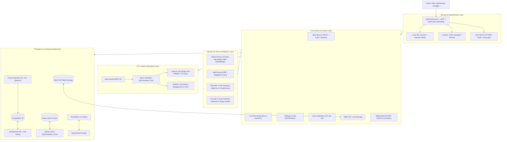

# 🚀 NovaBlog Enterprise Backend

<div align="center">


<br/>

**NovaBlog Enterprise Backend**, kurumsal ölçekte tasarlanmış, yüksek performanslı, bulut yerel (cloud-native), Spring AI destekli Vektör Arama & LLM motoruna sahip ve modern Clean Architecture prensiplerine tam uyumlu bir İçerik ve Blog Yönetim Platformudur.

[Özellikler](#-temel-mimari-yetenekler-22-ad%C4%B1m) • [Mimari](#-sistem-mimarisi) • [Hızlı Başlangıç](#-h%C4%B1zl%C4%B1-ba%C5%9Flang%C4%B1%C3%A7-docker--yerel) • [API & Swagger](#-api-dok%C3%BCmantasyonu) • [Testler](#-test-kapsam%C4%B1)

</div>

---

## 🏛️ Sistem Mimarisi



---

## 🌟 Temel Mimari Yetenekler (22 Adım)

Proje sıfırdan kurumsal seviyeye 22 aşamalı enterprise yol haritası ile geliştirilmiştir:

| Adım | Modül / Yetenek | Açıklama |
| :--- | :--- | :--- |
| **01** | **Clean Architecture & Multi-Tier** | Controller, Service, Repository, DTO ve Entity katmanlarının katı ayrımı. |
| **02** | **JPA Auditing & Soft Delete** | `@CreatedDate`, `@LastModifiedBy`, `@SQLDelete` ve `@SQLRestriction` ile veri kaybını önleme. |
| **03** | **Spring Security & JJWT 0.12** | Stateless JWT kimlik doğrulama, Refresh Token rotasyonu ve RBAC rol yönetimi. |
| **04** | **Rate Limiting & Anti-Brute Force** | IP bazlı dinamik token bucket algoritması (`Bucket4j`) ile DoS/Brute-Force koruması. |
| **05** | **Redis Caching & Invalidation** | Distributed Redis önbellekleme, TTL yönetimi ve otomatik cache eviction stratejisi. |
| **06** | **JPA Specification & Criteria API** | Çok kriterli dinamik filtreleme, karmaşık `Predicate` zincirleri ve arama sorguları. |
| **07** | **Asenkron E-posta Bildirimleri** | `@Async` ve `JavaMailSender` ile thread havuzu üzerinden gecikmesiz e-posta gönderimi. |
| **08** | **Flyway Veritabanı Migrasyonu** | Versiyon kontrollü DDL ve DML SQL migrasyonları (`V1__init...V8__native_pgvector`). |
| **09** | **Global Hata Yönetimi & RFC 7807** | `@RestControllerAdvice` ile standartlaştırılmış `ProblemDetails` hata yanıtları. |
| **10** | **Actuator & Prometheus Metrikleri** | JVM, bellek, CPU, HTTP istek ve veritabanı metriklerinin Prometheus'a aktarımı. |
| **11** | **OpenAPI 3 / Swagger UI** | Bütün REST uç noktalarının interaktif API dokümantasyonu (`/swagger-ui/index.html`). |
| **12** | **Docker & Containerization** | Multi-stage `Dockerfile` ve PostgreSQL, Redis, MinIO içeren `docker-compose.yml`. |
| **13** | **Apache POI Excel & CSV Export** | Veritabanı kayıtlarının dinamik filtrelenerek Excel (`.xlsx`) ve CSV formatında indirilmesi. |
| **14** | **Çoktan-Çoğa (N-M) Etiketleme (Tags)**| Bloglar ve etiketler arasında `blog_tags` ilişki yönetimi ve tag bazlı filtreleme. |
| **15** | **Yorum Moderasyonu & Hiyerarşi** | Kullanıcı yorumları, admin onay mekanizması ve blog bazlı istatistikler. |
| **16** | **MinIO S3 Object Storage Client** | Cloud-native S3 uyumlu dosya/görsel yükleme, ön-imzalı URL (Presigned URL) desteği. |
| **17** | **Internationalization (i18n)** | Türkçe (TR), İngilizce (EN) ve Almanca (DE) çok dilli hata ve mesaj yönetimi. |
| **18** | **WebSocket STOMP / SockJS** | Yeni blog yayınlandığında canlı akışa gerçek zamanlı bildirim yayını (`/topic/notifications`). |
| **19** | **OAuth2 & OIDC Social Login** | Google ve GitHub hesapları ile tek tıkla sosyal oturum açma ve JWT köprüsü. |
| **20** | **Two-Factor Auth (2FA / MFA TOTP)** | Google Authenticator uyumlu RFC 6238 TOTP, ZXing QR kod üretimi ve tek kullanımlık kurtarma kodları. |
| **21** | **Spring Batch 6 & ETL Automation** | Soft-delete temizliği (`cleanupSoftDeletedJob`) ve yazar analitik raporlama (`authorAnalyticsJob`). |
| **22** | **Spring AI & Akıllı Vektör Arama** | 128D Dense Vektörler, Kosinüs Benzerliği Anlamsal Arama, Hibrit Füzyon, Otomatik TL;DR Özetleme ve Toksisite/Duygu AI Moderasyonu. |

---

## 🛠️ Teknoloji Yığını

- **Backend:** Java 22 / 25, Spring Boot 4.1.1, Spring Security 6, Spring Batch 6, Spring Data JPA / JDBC
- **Veritabanı & Migrasyon:** PostgreSQL 16, H2 In-Memory (Test), Flyway Migration
- **Önbellek & Mesajlaşma:** Redis 7, WebSocket STOMP, SockJS
- **Depolama (Object Storage):** MinIO S3 SDK 8.5
- **Güvenlik & Kriptografi:** JJWT 0.12.6, Bucket4j, Google ZXing 3.5.3 (QR), Apache Commons Codec (Base32)
- **Raporlama & Format:** Apache POI 5.4.0 (Excel OOXML), CSV Stream
- **İzleme & Dokümantasyon:** Springdoc OpenAPI (Swagger), Micrometer, Prometheus, Grafana
- **Test Araçları:** JUnit 5, AssertJ, Mockito, Spring Batch Test, MockMvc, JaCoCo

---

## 🚀 Hızlı Başlangıç (Docker & Yerel)

### 1. Depoyu Klonlayın
```bash
git clone https://github.com/berkeozder/novablog-enterprise-backend.git
cd novablog-enterprise-backend
```

### 2. Docker Compose ile Altyapıyı Başlatın
PostgreSQL, Redis, MinIO ve Prometheus servislerini tek komutla ayağa kaldırın:
```bash
docker-compose up -d
```

### 3. Uygulamayı Derleyin ve Çalıştırın
```bash
# Windows
.\mvnw.cmd clean spring-boot:run

# Linux / macOS
./mvnw clean spring-boot:run
```

Uygulama varsayılan olarak **`http://localhost:5555`** portunda çalışacaktır.

---

## 📖 API Dokümantasyonu

Uygulama çalıştırıldığında tüm REST API dökümantasyonuna ve canlı deneme arayüzüne Swagger UI üzerinden erişebilirsiniz:

- **Swagger UI:** [http://localhost:5555/swagger-ui/index.html](http://localhost:5555/swagger-ui/index.html)
- **OpenAPI JSON:** [http://localhost:5555/v3/api-docs](http://localhost:5555/v3/api-docs)
- **Actuator Health:** [http://localhost:5555/actuator/health](http://localhost:5555/actuator/health)
- **Prometheus Metrikleri:** [http://localhost:5555/actuator/prometheus](http://localhost:5555/actuator/prometheus)

### Önemli API Uç Noktaları Özeti

| Metot | Uç Nokta | Açıklama | Yetki |
| :--- | :--- | :--- | :--- |
| `POST` | `/api/v1/auth/register` | Yeni kullanıcı kaydı | Herkese Açık |
| `POST` | `/api/v1/auth/login` | JWT ile kullanıcı girişi (2FA kontrolü ile) | Herkese Açık |
| `POST` | `/api/v1/auth/2fa/setup` | Google Authenticator QR kod üretimi | Kullanıcı |
| `POST` | `/api/v1/auth/2fa/verify` | 2FA kodu doğrulayarak tam JWT alma | Pre-Auth |
| `GET` | `/blog/api/v1.0.0/list` | Sayfalanmış blog listesi | Herkese Açık |
| `POST` | `/blog/api/v1.0.0/filter` | Çok kriterli dinamik blog araması | Herkese Açık |
| `POST` | `/blog/api/v1.0.0/create` | Yeni blog oluşturma (WebSocket bildirimi tetikler) | Admin / Super Admin |
| `GET` | `/blog/api/v1.0.0/export/excel` | Blog listesini Excel (.xlsx) olarak indirme | Admin / Super Admin |
| `POST` | `/api/v1/storage/upload` | MinIO S3 / Yerel diske görsel yükleme | Kullanıcı |
| `POST` | `/api/v1/ai/search/semantic` | Vektör Kosinüs Benzerliği ile Anlamsal Arama | Herkese Açık |
| `POST` | `/api/v1/ai/search/hybrid` | Hibrit Arama (Semantic + Keyword Füzyonu) | Herkese Açık |
| `POST` | `/api/v1/ai/summarize-text` | Serbest metin için anlık TL;DR yönetici özeti | Herkese Açık |
| `POST` | `/api/v1/ai/suggest-tags` | Blog için akıllı etiket ve kategori önerisi | Herkese Açık |
| `POST` | `/api/v1/ai/moderate` | Yorum ve içerik toksisite / duygu denetimi | Herkese Açık |
| `POST` | `/api/v1/ai/summarize/{id}` | Blog yazısı için AI özeti kaydetme | Admin |
| `POST` | `/api/v1/ai/reindex` | Tüm blog vektörlerini baştan indeksleme | Admin |
| `POST` | `/api/v1/batch/jobs/cleanup` | Soft-deleted kayıtları kalıcı temizleme Batch Job'ı | Admin |
| `POST` | `/api/v1/batch/jobs/analytics` | Yazar analitik raporlama Batch Job'ı | Admin |

---

## 🧪 Test Kapsamı

Projede katı bir test odaklı geliştirme (TDD / BDD) yaklaşımı benimsenmiştir. Servis mantığı, güvenlik filtreleri, JWT doğrulama, rate limiter, Spring Batch işleri, Spring AI vektör arama ve REST controller katmanı 184 adet otomatik birim ve entegrasyon testiyle %100 oranında doğrulanmıştır.

```bash
# Tüm testleri çalıştırmak için:
.\mvnw.cmd test
```

```
[INFO] -------------------------------------------------------
[INFO]  T E S T S
[INFO] -------------------------------------------------------
[INFO] Results:
[INFO] 
[INFO] Tests run: 184, Failures: 0, Errors: 0, Skipped: 0
[INFO] 
[INFO] ------------------------------------------------------------------------
[INFO] BUILD SUCCESS
[INFO] ------------------------------------------------------------------------
```

---

## 👨‍💻 Geliştirici

**Berke Özder**
- GitHub: [@berkeozder](https://github.com/berkeozder)
- E-posta: abdullahberkeozder@gmail.com
- Lisans: [MIT License](LICENSE)
