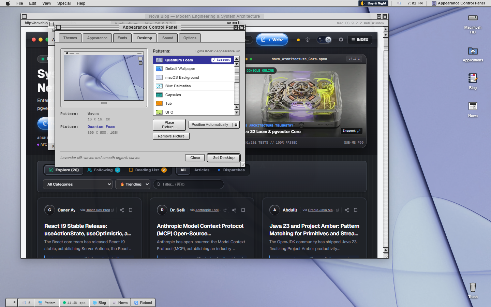

# 🍎 NovaBlog Enterprise — Mac OS 9.2.2 Web Desktop & Next.js 16 Showcase

[](https://nextjs.org/)
[](https://react.dev/)
[](https://www.typescriptlang.org/)
[](https://tailwindcss.com/)
[](https://en.wikipedia.org/wiki/Mac_OS_9)

A pixel-authentic, high-performance web engineering showcase combining the nostalgic craftsmanship of **Apple's Mac OS 9.2.2 Platinum Human Interface Guidelines** with the enterprise-grade architecture of a **Spring Boot 4 / Java 22 Loom** backend and **Next.js 16 Turbopack** frontend.

---

## 📸 Visual Showcase

### 1. Mac OS 9.2.2 Web Desktop
*Authentic 20px Apple Menu Bar, Power Mac G4 Cube Lucite acrylic watermark, desktop icons, and retractable Control Strip:*


---

### 2. Nova Blog Application Window
*Full-featured enterprise engineering portal running inside an authentic Mac OS 9 Platinum window with pinstripe titlebars, WindowShade, and dynamic application switching:*


---

### 3. Appearance Control Panel & Night Mode
*Figma 82-812 exact clone featuring CRT monitor preview, curated HD wallpapers, highlight color tokens, and Day/Night mode with wallpaper preservation:*



---

## 🌟 Key Architecture & Capabilities

### 🖥️ Mac OS 9.2.2 Web Desktop Environment (`src/components/macos9/`)
- **Pixel-Accurate Platinum Interface:** Designed following the original 1999–2001 Apple Human Interface Guidelines with 20px top menu bar, classic fonts (Charcoal, Chicago, Geneva), and skeuomorphic beveling.
- **Apple Menu Bar & System Profiler:** Fully functional menus (Apple, File, Edit, View, Special, Help) containing About This Computer, Chooser, Control Panels, Scrapbook, Key Caps, and live digital clock.
- **Desktop Icons & Direct Launchers:**
  - `Macintosh HD`: Explores system disks and applications.
  - `Applications`: Windowed Finder suite containing Nova Blog, Internet Explorer, iTunes Radio, Wallpapers, Stickies, and Calculator.
  - `Blog`: Iconic leather-bound engineering journal with fountain pen nib; double-click/double-tap (450ms touch tolerance) immediately launches the blog portal.
  - `News`: Instant access to Sherlock 2 Nova Engineering Dispatches.
  - `Trash`: Functional trash with crinkle audio and empty confirmation.
- **Appearance Control Panel (`MacAppearancePanel.tsx`):**
  - Live CRT monitor display with aspect ratio simulation.
  - 10+ authentic Apple wallpapers (Sonata Purple, Quantum Foam, Heavy Petal, Bondi Blue, Azul Wave, Obsidian Carbon, Capsules, Dalmatian).
  - Highlight Colors (Azul, Bondi, Lavender, Plum, Teal, Yellow) and Appearance variations.
- **Day & Night Mode with Wallpaper Persistence:** Toggle between Day Horizon and Midnight Deep Space directly from the menu bar without overriding user-selected desktop wallpapers.
- **Retractable Control Strip (`MacOs9ControlStrip.tsx`):** Collapsible bottom bar providing real-time system metrics, volume control, wallpaper quick switcher, and reboot triggers.
- **Synthesized Retro Web Audio (`retroAudioMac9.ts`):** Client-side Web Audio synthesis producing the Happy Mac startup chime, droplet clicks, window open/collapse sounds, and trash empties without external MP3 overhead.

---

### 🏛️ Nova Blog Modern Engineering Portal (`blogContent`)
When opening the **Blog** window, visitors interact with an enterprise publication engine:
- **🧠 Spring AI 128D Semantic Vector Search:**
  - Dense vector embeddings with Cosine Similarity $\cos(\theta) = \frac{\mathbf{A} \cdot \mathbf{B}}{\|\mathbf{A}\| \|\mathbf{B}\|}$.
  - Mode Switcher: **Semantic Vector**, **Hybrid RRF (Reciprocal Rank Fusion)**, and **Exact SQL LIKE**.
- **🤖 Spring AI NLP & Moderation Laboratory:**
  - Real-time extractive TL;DR summaries with compression ratio indicators.
  - Automated taxonomy and tag classification.
  - Content moderation and sentiment analysis (Positive, Neutral, Toxic).
- **⚡ Spring Batch ETL & Admin Studio:**
  - Chunk-based soft-deleted blog cleanup scheduler.
  - Author analytics and engagement aggregation pipeline.
  - Re-indexing triggers for vector embeddings.
- **📊 Real-Time Activity Monitor & System Telemetry (`SystemTelemetryModal.tsx`):**
  - Java 22 Loom virtual thread saturation gauge.
  - HikariCP connection pool utilization meter.
  - Redis Write-Behind buffer flusher with atomic `HINCRBY` counter batching.
- **🌐 Dual-Engine Resilience (Live / Mock Fallback):**
  - Connects to Spring Boot backend (`http://localhost:5555`) when running.
  - Gracefully falls back to mock datasets (6 in-depth architectural whitepapers, 20 technical dispatches) ensuring zero downtime for evaluators.

---

### 🌐 100% Native English Localization
Every UI element, technical specification, dispatch bulletin, modal dialog, and mock dataset is authored in authentic Apple HIG English.

---

## 🛠️ Getting Started

### Prerequisites
- **Node.js**: v20.0.0 or higher
- **npm**: v10.0.0 or higher

### Local Development
```bash
# Navigate to the frontend directory
cd novablog/frontend

# Install dependencies
npm install

# Start the Turbopack development server
npm run dev
```
Open **[http://localhost:3000](http://localhost:3000)** in your browser.

### Production Build
```bash
# Compile optimized Next.js 16 production build
npm run build

# Start production server
npm run start
```

### Docker Deployment
```bash
docker build -t novablog-frontend:latest .
docker run -d -p 3000:3000 --name novablog-ui novablog-frontend:latest
```

---

## 📂 Project Structure

```
novablog/frontend/
├── public/
│   ├── docs/showcase/          # High-resolution showcase screenshots
│   ├── retro/                  # Happy Mac and vintage icons
│   └── wallpapers/             # Mac OS 9 & OS X wallpapers
├── src/
│   ├── app/                    # Next.js 16 App Router (layout, page, dynamic routes)
│   ├── components/
│   │   ├── macos9/             # Mac OS 9.2.2 Web Desktop Suite
│   │   │   ├── apps/           # Applications Folder, Calculator, Radio, Browser
│   │   │   ├── DesktopIcon.tsx # Skeuomorphic 32x32 desktop icons
│   │   │   ├── MacAppearancePanel.tsx # Control Panel & wallpaper manager
│   │   │   ├── MacOs9ControlStrip.tsx # Collapsible bottom telemetry strip
│   │   │   ├── MacOs9Desktop.tsx      # Desktop window orchestration
│   │   │   ├── MacOs9MenuBar.tsx      # 20px top Apple menu bar
│   │   │   ├── MacOs9Window.tsx       # Platinum window chrome with WindowShade
│   │   │   └── NovaEmblemWatermark.tsx# G4 Cube Lucite acrylic badge
│   │   ├── Navbar.tsx          # Acrylic global navigation bar
│   │   ├── HeroSection.tsx     # Publication headline & lead CTA
│   │   ├── BlogCard.tsx        # Skeuomorphic article card
│   │   └── SystemTelemetryModal.tsx # Activity Monitor & VU meters
│   ├── hooks/                  # React state & audio hooks
│   ├── lib/
│   │   ├── api.ts              # Resilient REST API client & mock router
│   │   ├── mockData.ts         # Whitepapers, dispatches, and vector benchmarks
│   │   └── retroAudioMac9.ts   # Web Audio API sound synthesizer
│   └── styles/
│       └── macos9.css          # Pinstripes, bevels, and Platinum CSS tokens
└── README.md
```

---

## 👨‍💻 Author

**Abdullah Berke Özder**
- GitHub: [@abdullahberkeozder](https://github.com/abdullahberkeozder)
- Repository: [my-portfolio](https://github.com/abdullahberkeozder/my-portfolio)
