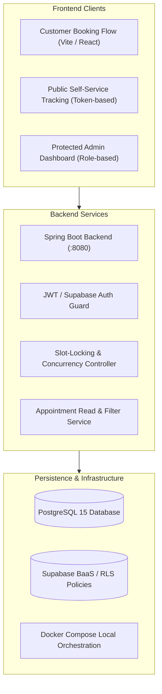

# Umut Usta (The Welding Expert App)

[](https://react.dev/)
[](https://vitejs.dev/)
[](https://spring.io/projects/spring-boot)
[](https://openjdk.org/)
[](https://www.postgresql.org/)
[](https://playwright.dev/)
[](#local-setup)

<p align="center">
  <strong>Language:</strong> <a href="#english">English</a> | <a href="#türkçe">Türkçe</a>
</p>

---

<div id="english"></div>

# English

## Overview

Umut Usta is an appointment scheduling and operations platform designed for a local metalwork, welding, and repair business in Ankara. It addresses common operational bottlenecks in service businesses: double bookings, coordination overhead across phone calls, lack of customer self-service, and fragmented job tracking.

The product consists of:
- **Customer Booking Experience:** A focused, low-friction three-step booking flow (Service Selection &rarr; Date/Time Slot &rarr; Contact & Review).
- **Customer Self-Service:** Token-based tracking allowing customers to cancel, reschedule, or submit feedback without creating an account.
- **Admin Workspace:** Role-based dashboard for slot management, request triage, capacity planning, and operational analytics.
- **Backend Services:** Spring Boot backend with PostgreSQL transaction boundaries, slot-locking verification, and Supabase integration.

---

## Architecture



---

## Monorepo Layout

```
the-welding-expert-app/
├── docker-compose.yml          # PostgreSQL local service definition
├── README.md                   # Full-stack documentation (English & Turkish)
│
├── backend/                    # Spring Boot backend
│   ├── pom.xml                 # Maven dependencies (Spring Data JPA, PostgreSQL, Security, Validation)
│   ├── src/                    # Controllers, Services, Entities, Integration Tests
│   ├── admin-ci/               # Admin acceptance test scripts and SQL grants
│   └── README.md               # Backend technical specification and architecture decisions
│
├── backend-contract/           # PostgreSQL contract test suite
│   ├── pom.xml                 # Testcontainers and JUnit test definitions
│   └── src/                    # Schema compliance assertions
│
├── frontend/                   # React / Vite application
│   ├── package.json            # Dependencies (React, TanStack Query, Styled Components, Vitest)
│   ├── vite.config.js          # Vite build and dev configuration
│   ├── src/                    # Components, hooks, context, pages
│   ├── e2e/                    # Playwright end-to-end test suites
│   └── README.md               # Frontend user journey and interface documentation
│
├── supabase/                   # Database schemas and migration definitions
└── docs/                       # Screenshots and user journey assets
```

---

## Key Technical Decisions

### 1. Conflict-Free Slot Locking
To prevent double bookings during simultaneous customer checkouts, appointment slots employ database-backed transactional locking:
- Available time slots are partitioned into deterministic two-hour windows.
- When a customer submits an appointment, the operation executes within an isolated database transaction that validates slot availability before persisting the reservation.
- Slot-locking integrity is verified by automated integration tests (`BookingReadPostgresIT.java`).

### 2. Token-Based Customer Self-Service
Requiring customers to create an account increases booking drop-off. Umut Usta uses cryptographically secure public tokens:
- Upon booking confirmation, a unique tracking token is generated and delivered to the customer (via confirmation screen and direct URL).
- Customers can access their reservation details, request cancellations, or modify appointment times directly via this token.
- Sensitive administrative fields and other customer records remain strictly inaccessible.

### 3. Privilege Separation & Read/Write Boundaries
- Public endpoints allow unauthenticated customers to view available slots and submit booking requests.
- Administrative endpoints (capacity adjustment, status overrides, revenue reporting) require authenticated sessions with role-based verification (`ReadSecurity.java`).
- Database constraints and Row-Level Security (RLS) enforce data segregation at the persistence tier.

---

## Test Suite & Quality Assurance

The repository includes test suites across unit, component, contract, and browser levels:
- **Frontend Component & Unit Tests:** Vitest and React Testing Library covering step transitions, form validations, and date helpers.
- **Backend Contract Tests:** Testcontainers-based PostgreSQL schema validation (`backend-contract/`).
- **End-to-End Tests:** Playwright suites exercising customer booking flows, mobile responsiveness, and administrator workflows.

---

## Local Setup

### Prerequisites
- **Node.js 20+** & **npm 10+**
- **Java 17+** & **Maven**
- **Docker & Docker Compose**

### 1. Start Database
```bash
cd the-welding-expert-app
docker compose up -d
```
Starts PostgreSQL on `localhost:54322` with the initial schema loaded.

### 2. Run Backend
```bash
cd backend
mvn test
mvn spring-boot:run
```

### 3. Run Frontend
```bash
cd ../frontend
npm install
npm run dev
```
Application opens at `http://localhost:5173`.

---

<div id="türkçe"></div>

# Türkçe

<p align="center">
  <a href="#english"><strong>⬆️ Return to English</strong></a>
</p>

## Genel Bakış

Umut Usta, Ankara'da faaliyet gösteren kaynak, demir doğrama ve mekanik tadilat işletmesi için geliştirilmiş randevu ve operasyon yönetim platformudur. Telefon trafiği üzerinden yürüyen randevu süreçlerindeki çakışmaları, müşteri bilgi kaybını ve planlama belirsizliklerini çözmeyi hedefler.

Sistem bileşenleri:
- **Müşteri Randevu Akışı:** Hizmet Seçimi &rarr; Tarih ve Saat Dilimi &rarr; İletişim Bilgileri adımlarından oluşan üç aşamalı akış.
- **Kayıtsız Self-Servis:** Müşterilerin üyelik oluşturmadan, randevu takip bağlantısı üzerinden iptal veya saat değişikliği talebi iletebilmesi.
- **Yönetici Paneli:** Kapasite yönetimi, randevu onay/ret işlemleri ve operasyonel iş yükü takibi.
- **Spring Boot Arka Yüz:** PostgreSQL işlem sınırları, slot kilitleme ve yetkilendirme katmanları.

---

## Monorepo Düzeni

```
the-welding-expert-app/
├── docker-compose.yml          # PostgreSQL yerel veritabanı tanımı
├── README.md                   # Proje ana dokümantasyonu (İngilizce & Türkçe)
│
├── backend/                    # Spring Boot arka yüz uygulaması
├── backend-contract/           # Veritabanı şema ve sözleşme testleri
├── frontend/                   # React + Vite arayüz uygulaması
├── supabase/                   # Veritabanı şema ve migration dosyaları
└── docs/                       # Ekran görüntüleri ve dokümantasyon varlıkları
```

---

## Temel Mühendislik Kararları

### 1. Çakışmasız Randevu Kilitleme (Slot Locking)
Aynı saat dilimine birden fazla müşterinin kayıt yapmasını engellemek için iki saatlik deterministik randevu pencereleri tanımlanmıştır. Randevu kaydı, veritabanı düzeyinde işlem (transaction) izolasyonu ile korunur.

### 2. Token Tabanlı Müşteri Takibi
Kullanıcıların randevu takibi için şifre ve üyelik zorunluluğu kaldırılmıştır. Randevu oluşturulduğunda üretilen güvenli erişim belirteci (token) ile müşteri randevusunu görüntüleyebilir, iptal veya değişiklik talebinde bulunabilir.

### 3. Okuma/Yazma ve Yetki Ayrımı
Müşteri uç noktaları yalnızca uygun zaman dilimlerini okuma ve yeni talep oluşturma ile sınırlandırılmıştır. Takvim düzenleme ve operasyonel durum değişiklikleri yönetici doğrulaması gerektirir.

---

## Yerel Kurulum

```bash
# 1. Veritabanını başlatın
cd the-welding-expert-app
docker compose up -d

# 2. Backend uygulamasını derleyin ve çalıştırın
cd backend
mvn test
mvn spring-boot:run

# 3. Frontend uygulamasını çalıştırın
cd ../frontend
npm install
npm run dev
```

---

## Geliştirici & Lisans

- **Geliştirici:** Abdullah Berke Özder
- **GitHub:** [@abdullahberkeozder](https://github.com/abdullahberkeozder)
- **LinkedIn:** [Abdullah Özder](https://www.linkedin.com/in/abdullah-ozder/)
- **E-posta:** `abdullahberkeozder@gmail.com`
- **Lisans:** MIT
